# Historia czatu — dzień 1, 2 listopada 2026

Wiadomości publiczne w kolejności chronologicznej. Reakcje oznaczają zliczenia przy wiadomościach, nie rozłączne głosy ani liczbę uczestników.

## Wiadomości

- **09:11 — E.K.:**

  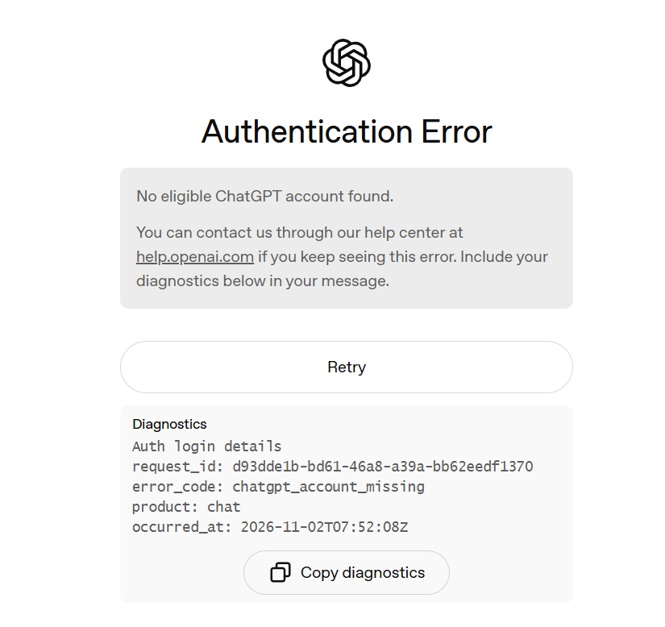

- **09:12 — A.S.:**

  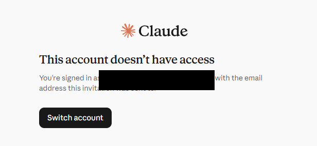

- **09:12 — E.K.:**

  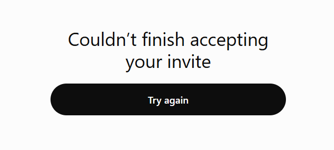

- **09:16 — E.K.:**

  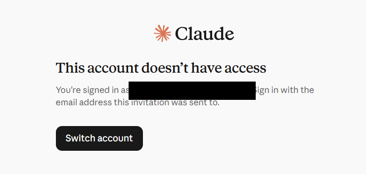

- **09:16 — M.:**

  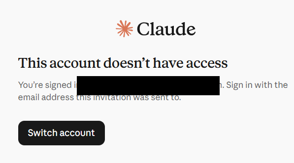

- **09:16 — N.:**

  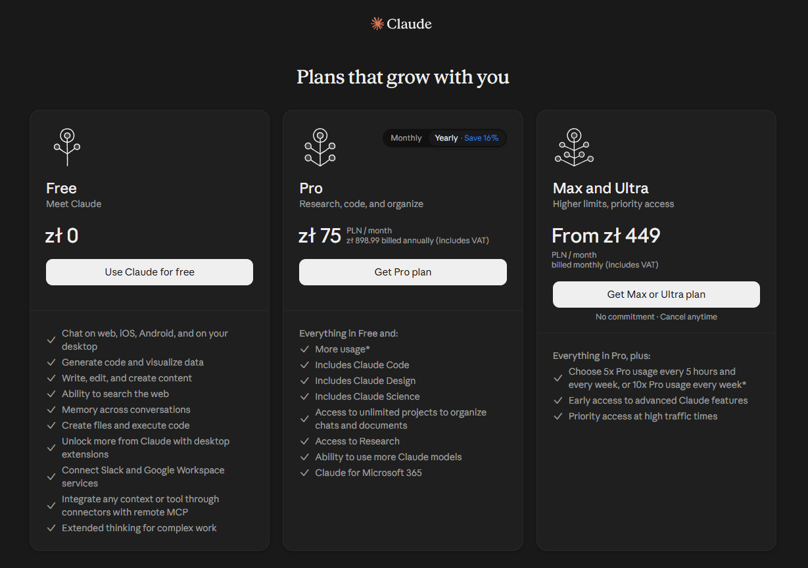

- **09:33 — Łukasz Matuszewski:** Materiały szkoleniowe:  
  https://devpowers.com/szkolenia/jsystems/tomtom-ai-2026-11/index.html

- **09:33 — Łukasz Matuszewski:** Repo szkoleniowe:  
  https://github.com/LucasMatuszewski/jsystems-claude-codex-gis-2026-11

- **09:38 — Łukasz Matuszewski:** Windows  
  *Reakcje: 👍: 9.*

- **09:38 — Łukasz Matuszewski:** Linux

- **09:38 — Łukasz Matuszewski:** macOS  
  *Reakcje: 🎉: 1.*

- **09:41 — Ł.M.:** MacBook - działa 😛

- **09:44 — E.K.:** działa

- **09:44 — N.:** dziala

- **09:44 — A.S.:** dziala

- **09:44 — M.:** dziala

- **09:44 — M.J.:** dziala

- **09:46 — K.L.:** działa

- **09:54 — Łukasz Matuszewski:** cli / tui  
  *Reakcje: 👍: 4; 🎉: 1.*

- **09:54 — Łukasz Matuszewski:** wtyczki do VSCode / Jetbrains itp.  
  *Reakcje: 👍: 6.*

- **09:54 — Łukasz Matuszewski:** Applikacja Desktop ChatGPT / Claude  
  *Reakcje: 🎉: 1; 👍: 3.*

- **09:55 — Łukasz Matuszewski:** opencode

- **10:03 — Łukasz Matuszewski:** https://docs.tabnine.com/main  
  Pierwszy autocomplete Tabnine

- **10:05 — Łukasz Matuszewski:** https://crewai.com/  
  Zespoły agentów pierwsze

- **10:07 — Łukasz Matuszewski:** https://www.langchain.com/

- **10:07 — Łukasz Matuszewski:** RAG - bazy wiedzy

- **10:13 — Łukasz Matuszewski:** https://developers.google.com/machine-learning/crash-course/automl?hl=pl

- **10:19 — A.S.:** zw

- **10:34 — Łukasz Matuszewski:** Modele decyzyjne  
  https://typesafe.ai/

- **10:35 — Łukasz Matuszewski:** https://developers.openai.com/api/docs/guides/decisions

- **10:35 — Łukasz Matuszewski:** https://github.com/fstandhartinger/jevbench  
  https://benchmarkheaven.com/jev-models

- **10:36 — Łukasz Matuszewski:** Polski model decyzyjny:  
  https://huggingface.co/Remek/basal-omni-1.0-ultra

- **10:42 — Łukasz Matuszewski:** CLAUDE.md

- **11:11 — W.:** chcialbym

- **11:11 — W.:** ale momenty

- **11:32 — Łukasz Matuszewski:** koniec przerwy 11:50

- **11:50 — Ł.M.:**

  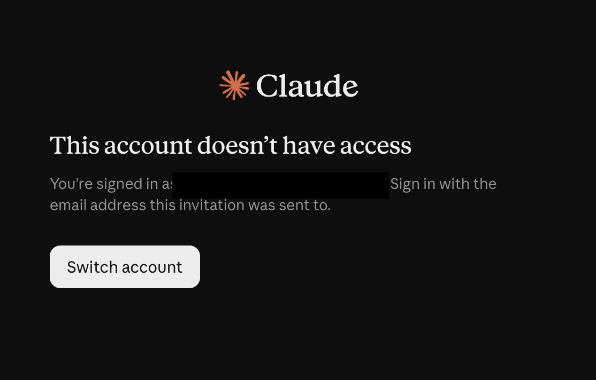

- **11:51 — M.J.:**

  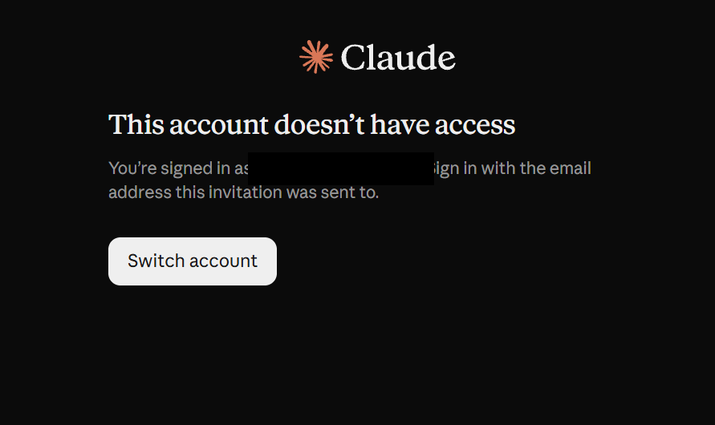

- **12:08 — Łukasz Matuszewski:** curl -fsSL https://claude.ai/install.sh | bash

- **12:08 — Łukasz Matuszewski:** winget install Anthropic.ClaudeCode

- **12:21 — Łukasz Matuszewski:** Logged in as [dane usunięte]  
   Login successful. Press Enter to continue…

- **12:21 — Łukasz Matuszewski:** Authentication code  
  Paste this into Claude Code:

- **12:23 — Łukasz Matuszewski:** prompt injection  
  https://code.claude.com/docs/en/security

- **12:25 — Łukasz Matuszewski:** https://github.com/LucasMatuszewski/jsystems-claude-codex-gis-2026-11

- **12:29 — Łukasz Matuszewski:** Code Mode

- **12:29 — Łukasz Matuszewski:** codemod

- **12:31 — Łukasz Matuszewski:** użył skryptu aby przeanalizować wszyskie pliki w tym repo pod kątem ryzyk i typowych fraz dla prompt injection

- **12:32 — Łukasz Matuszewski:** https://claude.ai/new

- **12:33 — Łukasz Matuszewski:** Tryb Claude Code:  
  https://claude.ai/code

- **12:37 — Łukasz Matuszewski:** https://github.com/LucasMatuszewski/jsystems-claude-codex-gis-2026-11  
  this repo is public so you can clone it

- **12:38 — Łukasz Matuszewski:** Use CodeMode here and create a script that will analyze the entire repository for characteristic prompt injection attacks and other things that may be related to attempts to manipulate the agent. The script should analyze the repository and look for different fragments and patterns so that we can determine whether this repository is safe to use.

- **12:49 — Łukasz Matuszewski:** https://github.com/LucasMatuszewski/jsystems-claude-codex-gis-2026-11

- **12:54 — Łukasz Matuszewski:** login with code  
  przy linkach aktywacyjnych dodatkowa opcja dla zdalnych komputerów

- **13:04 — Łukasz Matuszewski:** 13:35 Koniec przerwy

- **13:04 — Łukasz Matuszewski:** https://chatgpt.com/

- **13:37 — Ł.M.:**

  

- **13:39 — M.F.:**

  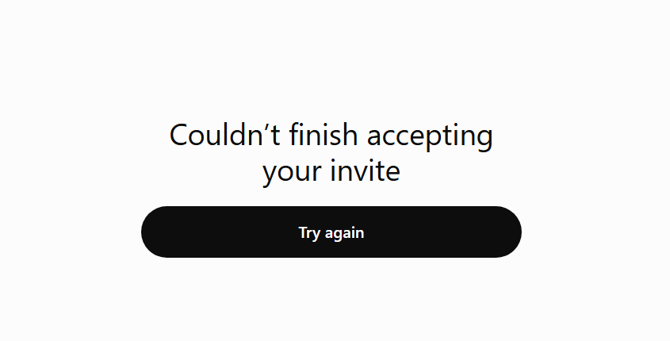

- **13:39 — A.S.:**

  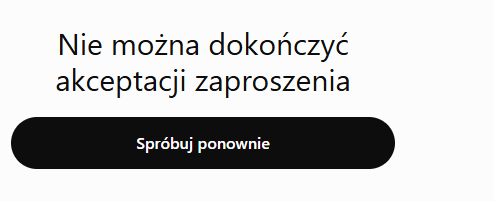

- **13:42 — M.:** do mnie jeszcze nie przyszlo zaproszenie

- **13:46 — D.:** do mnie jeszcze nie przyszlo zaproszenie ([dane usunięte])

- **13:48 — M.:** ja tez nie mam nadal zaproszenia (M.)  
  spam i wszystkie foldery sprawdzilam

- **13:48 — M.:** wlasnie mail doszedl  
  *Odpowiedź do M. (13:48).*

- **13:49 — M.:** juz tez wyslalam prosbe o zaakceptowanie  
  *Odpowiedź do M. (13:48).*

- **13:50 — Łukasz Matuszewski:** https://status.openai.com/  
  Status page - dostępność OpenAI i Awarie

- **13:53 — Łukasz Matuszewski:** https://chatgpt.com/

- **13:55 — Łukasz Matuszewski:** codex login --device-auth

- **13:55 — Łukasz Matuszewski:** Logowanie do Codex przez kod na zdalnym komputerze

- **14:07 — Łukasz Matuszewski:** https://platform.openai.com/tokenizer

- **14:08 — Łukasz Matuszewski:** OpenAI's large language models process text using tokens, which are common sequences of characters found in a set of text. The models learn to understand the statistical relationships between these tokens, and excel at producing the next token in a sequence of tokens.

- **14:10 — Łukasz Matuszewski:** Duże modele językowe OpenAI przetwarzają tekst za pomocą tokenów, czyli powszechnych sekwencji znaków występujących w zbiorze tekstu. Modele uczą się rozumieć zależności statystyczne między tymi tokenami i doskonale radzą sobie z generowaniem kolejnego tokena w sekwencji tokenów.

- **14:10 — Łukasz Matuszewski:** Duże modele językowe OpenAI przetwarzają tekst za pomocą tokenów, czyli powszechnych sekwencji znaków występujących w zbiorze tekstu. Modele uczą się rozumieć zależności statystyczne między tymi tokenami i doskonale radzą sobie z generowaniem kolejnego tokena w sekwencji tokenów.

- **14:17 — Łukasz Matuszewski:** https://github.com/LucasMatuszewski/jsystems-claude-codex-gis-2026-11/tree/main/course-materials

- **14:17 — Łukasz Matuszewski:** https://github.com/LucasMatuszewski/jsystems-claude-codex-gis-2026-11/blob/main/course-materials/Course%20INDEX%20-%20AI%20in%20Programming.md

- **14:18 — Łukasz Matuszewski:** https://cryps.pl/sztuczna-inteligencja-mowi-po-polsku-nasz-jezyk-zdeklasowal-angielski-w-najnowszym-rankingu/

- **14:20 — Łukasz Matuszewski:** RAG - umiejętność wyszukiwania info w przestrzeni wektorowej - dla PL była lepsza

- **14:21 — Łukasz Matuszewski:** https://devpowers.com/szkolenia/jsystems/tomtom-ai-2026-11/slownik-ai.html

- **14:27 — Łukasz Matuszewski:** /compact  
  kompresja / podsumowanie sesji

- **14:38 — Łukasz Matuszewski:** https://arena.ai/

- **14:47 — Łukasz Matuszewski:** https://arena.ai/leaderboard/agent

- **14:48 — E.K.:**

  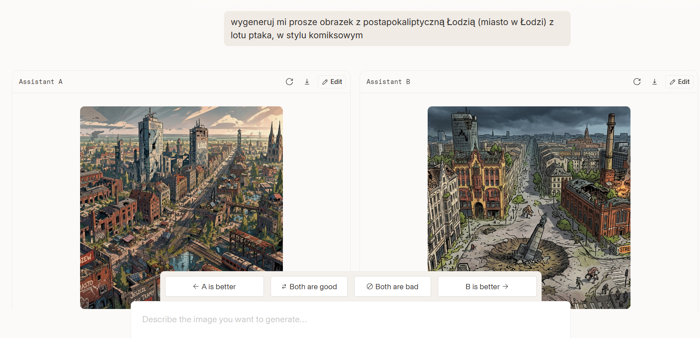  
  *Reakcje: ❤️: 1; 👍: 1.*

- **14:56 — Łukasz Matuszewski:** https://arena.ai/leaderboard/agent?license=open-source  
  Open Source modele

- **14:57 — Łukasz Matuszewski:** Lokalne modele - około 32GB VRAM rekomendowane:  
  https://huggingface.co/Qwen/Qwen3.8-27B

- **14:58 — Łukasz Matuszewski:** https://arena.ai/leaderboard/code/webdev

- **15:00 — Łukasz Matuszewski:** Agregator benchmarków:  
  https://artificialanalysis.ai/

- **15:05 — K.L.:**

  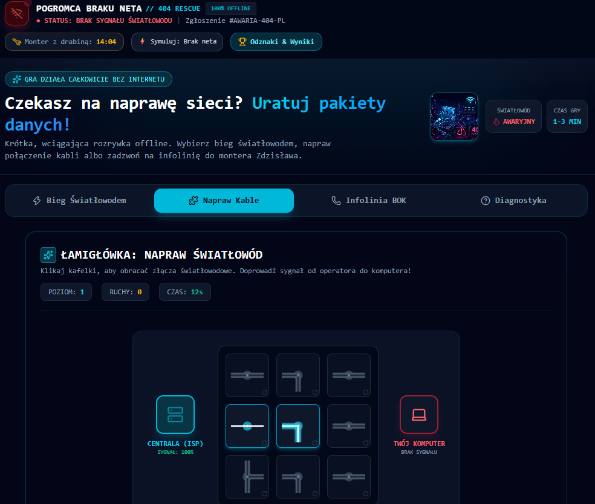

- **15:07 — A.S.:** heh podobne  
  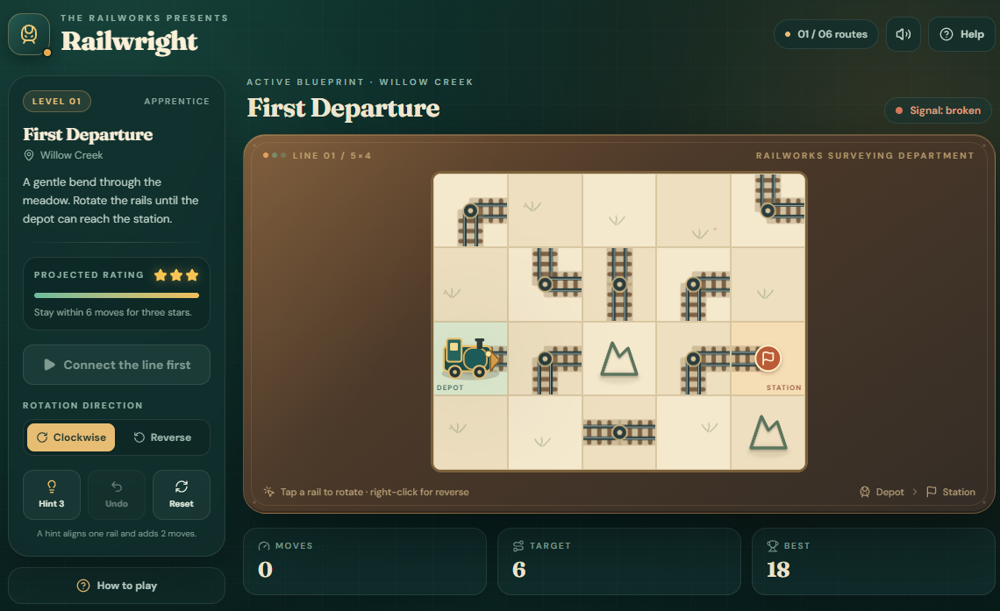  
  *Odpowiedź do K.L. (15:05).*

- **15:09 — K.L.:** 😁  
  *Odpowiedź do K.L. (15:05).*

- **15:07 — Łukasz Matuszewski:** https://01a19c7f-0a9d-757a-aa68-e82360806561.arena.site/  
  hunyuan-hy4-preview

- **15:07 — Łukasz Matuszewski:** Opus 5.5  
  https://01a19c7f-0a9d-7951-8811-a74ce4aa1b9b.arena.site/

- **15:10 — Łukasz Matuszewski:** 15:15 Koniec przerwy

- **15:16 — Ł.M.:** https://01a19c7c-d2fa-7e46-b081-db8a1fb08b72.arena.site  😄

- **15:17 — Ł.M.:**

  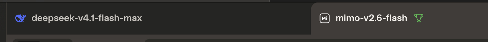  
  *Reakcje: 👍: 1.*

- **15:18 — Łukasz Matuszewski:** https://github.com/EdukeyTeam/agent-toolbox

- **15:19 — Łukasz Matuszewski:** https://github.com/EdukeyTeam/agent-toolbox/tree/main/skills/write-adr

- **15:20 — Łukasz Matuszewski:** jedyny plik obowiązkowy skills  
  https://github.com/EdukeyTeam/agent-toolbox/blob/main/skills/write-adr/SKILL.md

- **15:25 — M.F.:** https://01a19c81-4e62-7de9-b044-93a970b7afac.arena.site/  
  *Reakcje: ❤️: 1.*

- **15:48 — Łukasz Matuszewski:** Gemini 4 Argon  
  *Odpowiedź do M.F. (15:25).*

- **15:28 — Łukasz Matuszewski:** Zaawansowany skill:  
  https://github.com/EdukeyTeam/agent-toolbox/tree/main/skills/legacy-codebase-workflows

- **15:32 — Łukasz Matuszewski:** https://www.skills.sh/  
  Wyszukiwarka skills + skill manager

- **15:36 — Łukasz Matuszewski:** https://github.com/vosslab/vosslab-skills/tree/main/skills/experts/pyside6-engineer  
  Przykładowy skill

- **15:44 — Łukasz Matuszewski:** Analyze this skill from a security perspective, focusing on the skill itself. Is it practical? Does it contain any potentially injectable elements, or do you see any other dangerous elements? Also, assess the quality of the skill. Do you think it's good quality and that we can use it to work with this PySight 6 tool?  
  https://github.com/vosslab/vosslab-skills/tree/main/skills/experts/pyside6-engineer

- **15:50 — Łukasz Matuszewski:** npx skills add https://github.com/vosslab/vosslab-skills --skill pyside6-engineer

- **15:50 — Łukasz Matuszewski:** npx --yes skills@latest add EdukeyTeam/agent-toolbox --skill '*'

- **15:52 — Łukasz Matuszewski:** PS C:\Users\labuser> cd 'D:\'

- **15:52 — Łukasz Matuszewski:** PS D:\> git clone https://github.com/LucasMatuszewski/jsystems-claude-codex-gis-2026-11.git

- **15:53 — Łukasz Matuszewski:** cd 'D:\'

- **15:53 — Łukasz Matuszewski:** git clone https://github.com/LucasMatuszewski/jsystems-claude-codex-gis-2026-11.git

- **15:54 — Łukasz Matuszewski:** cd js + tab

- **15:54 — Łukasz Matuszewski:** cd .\jsystems-claude-codex-gis-2026-11\

- **15:55 — Łukasz Matuszewski:** npx --yes skills@latest add EdukeyTeam/agent-toolbox --skill '*'

- **15:55 — Łukasz Matuszewski:** cd 'D:\'

- **15:58 — Łukasz Matuszewski:** standardowy katalog większości agentów:  
  .agents/skills

- **16:01 — Łukasz Matuszewski:** skills.sh/EdukeyTeam/agent-toolbox
