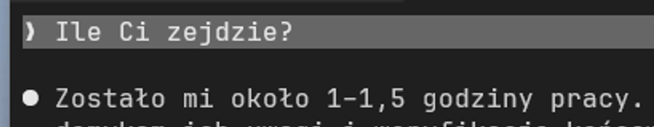
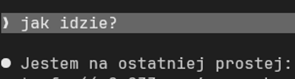
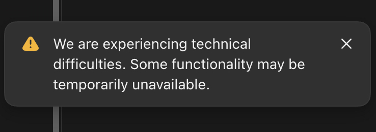
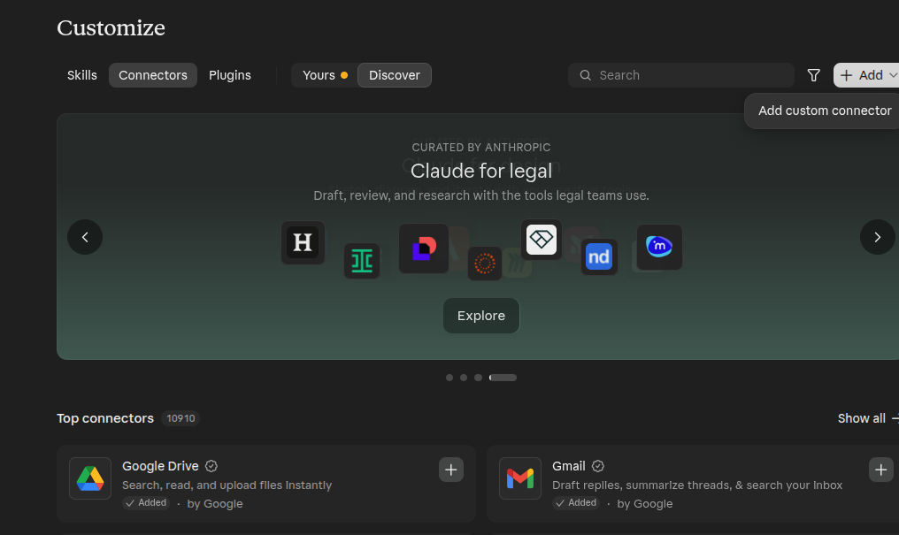

# Historia czatu — dzień 4, 13 listopada 2026

Wiadomości publiczne w kolejności chronologicznej. Reakcje oznaczają zliczenia przy wiadomościach, nie rozłączne głosy ani liczbę uczestników.

## Wiadomości

- **09:07 — Ł.M.:** 

- **09:09 — Łukasz Matuszewski:** https://github.com/LucasMatuszewski/jsystems-claude-codex-gis-2026-11/pull/10

- **09:09 — Łukasz Matuszewski:** PR 10 = moje narzędzie do analizy danych z map z Jev vs Luna Decisions vs Luna LLM

- **09:10 — Łukasz Matuszewski:** PR 11 = manualny raport / tool do kontroli jakości wyników  
  https://github.com/LucasMatuszewski/jsystems-claude-codex-gis-2026-11/pull/11

- **09:26 — J.:** k  
  *Reakcje: 🫢: 1.*

- **09:29 — Łukasz Matuszewski:** Podsumowania z wczoraj:  
  https://github.com/LucasMatuszewski/jsystems-claude-codex-gis-2026-11/blob/main/course-materials/zoom-summary-chat-history/day-3-summary.md

- **09:29 — Łukasz Matuszewski:** historia chata zoom:  
  https://github.com/LucasMatuszewski/jsystems-claude-codex-gis-2026-11/blob/main/course-materials/zoom-summary-chat-history/day-3-chat-history.md

- **09:40 — Łukasz Matuszewski:** https://langfuse.com/  
  Observability możliwe do podpięcia pod OpenRouter lub bezpośrednio w kodzie aplikacji

- **09:41 — Łukasz Matuszewski:** https://openrouter.ai/

- **09:50 — Łukasz Matuszewski:** Claude ma Monitors i Shell

- **10:05 — Łukasz Matuszewski:** Przykładowy prompt dla tworzenia planu:  
  https://github.com/LucasMatuszewski/jsystems-claude-codex-gis-2026-11/blob/main/course-materials/Prompt%20examples/Plan-SubAgents-matrix-dependency-map.md

- **10:07 — Łukasz Matuszewski:** Prefer cheap small workers for bounded implementation and test-writing: Claude Code subagents (Haiku 5.5 for most work); Codex (Sol 6.1 for more complicated task & Code Review and Luna 6 for simple tasks and research) and OpenCode (MiMo-V2.6-FlashXiaomi Token Plan) via cli hedless mode.

- **10:07 — Łukasz Matuszewski:** Research how to delegate to Codex & OpenCode CLI agents in hedless mode and include instruction inside the plan.

- **10:08 — Łukasz Matuszewski:** Implement whole app at one flow, but plan the steps/phases in logical way. I will later set a goal to create whole app without stoping. But set the priorities and order of tasksin logical way

- **10:11 — Łukasz Matuszewski:** commit PRD, ADR i Plan file  
  review wszystkich plików AGENTS.md, PRD, ADR i Planu - wyłapać i poprawić niespójności, sprzeczności  
  poprosić o rekomendacje agenta co poprawić

- **10:12 — Łukasz Matuszewski:** Sprawdzić:  
  czy plan nie jest ogromny > 500 linii, około 200-300 ok  
  czy nie duplikuje większości info z ADR i PRD (powinien do nich się odnosić, source of true)

- **10:12 — Łukasz Matuszewski:** /goal implement the plan from @docs/plans/implementation-plan.md Before completing the plan, make sure that all conditions from the ADR and PRD files are met.

- **10:17 — Ł.M.:** 

- **10:17 — Łukasz Matuszewski:** /btw - pytanie na boku, bez przerywania agentowi  
  /fork - kopia sesji z hisotrią zmian

- **10:18 — Łukasz Matuszewski:** Czy macie plany stworzone?  
  *Reakcje: 👍: 6; 👎: 1.*

- **10:23 — Łukasz Matuszewski:** Spec Driven Development:  
  https://specs.md/  
  Fire flow: https://specs.md/fire-flow/overview

- **10:23 — Łukasz Matuszewski:** Spec Kit  
  https://github.com/github/spec-kit

- **10:25 — Łukasz Matuszewski:** Skills dla SDD  
  https://www.skills.sh/search?q=spec  
  https://www.skills.sh/search?q=prd  
  https://www.skills.sh/search?q=adr  
  https://www.skills.sh/search?q=plan

- **10:33 — Łukasz Matuszewski:** https://chatgpt.com/settings/personalization?instructions=chatgpt

- **10:33 — Łukasz Matuszewski:** Custom instruction dla ChatGPT  
  Be casual, not formal, but still professional.  
  Be concise! Provide short answers unless I ask for more details. I prefer step-by-step instructions that are straight to the point. Never repeat the same information.  
  You may provide your opinions on topics but always make it clear that this is your opinion, not a fact. When you don't know, just say that you don't know.

- **10:38 — Łukasz Matuszewski:** Personalizacja w Claude  
  https://claude.ai/code#settings/personalization

- **10:41 — Łukasz Matuszewski:** dodajcie intrukcje dla agentów:  
  lokalne w projekcie  
  na poziomie usera  
  w koncie web chatgpt / claude

- **10:42 — Łukasz Matuszewski:** czas do 10:50

- **10:49 — Łukasz Matuszewski:** DATABRICKS_HOST  
  https://dbc-410b5b93-3ba0.cloud.databricks.com

- **10:49 — Łukasz Matuszewski:** DATABRICKS_SQL_WAREHOUSE_ID  
  97c455ee6fb1fcb9

- **10:49 — Łukasz Matuszewski:** DATABRICKS_TOKEN  
  [dane usunięte]

- **10:55 — Ł.M.:** Aplikacja poza wirtualna maszyna:

- **10:55 — Ł.M.:** 

- **10:56 — Łukasz Matuszewski:** Claude Status:  
  https://status.claude.com/

- **10:57 — Łukasz Matuszewski:** https://status.openai.com/  
  OpenAI Status Page

- **11:06 — Łukasz Matuszewski:** Koniec przerwy 11:20

- **11:28 — Łukasz Matuszewski:** ANTHROPIC_API_KEY

- **11:33 — Łukasz Matuszewski:** /status

- **11:33 — Łukasz Matuszewski:** ID sesji pobierzcie

- **11:41 — Łukasz Matuszewski:** /statusline w Codex  
  wyklikanie opcji  
  strzałki na boki - kolejność  
  spacja - wybór

- **11:46 — Łukasz Matuszewski:** TODO: Remote Control

- **11:50 — Łukasz Matuszewski:** claude daemon stop --any  
  Zatrzymać serwer sesji agentów w tle

- **12:18 — Łukasz Matuszewski:** 12:30 czas na zadanie:  
  stworzyć skill do tworzenia planów  
  ID sesji z Claude gdzie powstawał plan aby agent ją znalazł i użył histroii  
  uniknij błędów które agent popełnił w danej sesji aby kolejny razem plan ich nie zawierał  
  Opcja: template 2, np. subagents only, oraz agenci CLI headless  
  tryb zadawania pytań jeśli brak informacji  
  przed odpalenie planu review AGENTS.md, ADR, PRD i Plan file.  
  Zapisć w .agents/skills  
  *Wiadomość edytowana.*

- **12:20 — Łukasz Matuszewski:** przykładowe skills do tworzenia skills:  
  https://www.skills.sh/search?q=skill-creator

- **12:23 — Łukasz Matuszewski:** Raporty które dla mnie stworzył agent w ramach szkolenia:  
  https://devpowers.com/szkolenia/jsystems/tomtom-ai-2026-11/reports/map-qa/report.html  
  https://devpowers.com/szkolenia/jsystems/tomtom-ai-2026-11/reports/map-qa/summary.html  
  Narzędzie do review manualnego / evaluacji decyzji AI:  
  https://devpowers.com/szkolenia/jsystems/tomtom-ai-2026-11/reports/map-qa/review/review.html

- **12:23 — Łukasz Matuszewski:** Update na górze repo:  
  https://github.com/LucasMatuszewski/jsystems-claude-codex-gis-2026-11

- **12:35 — Łukasz Matuszewski:** World Model - Genie 3 - generowanie wideo live:  
  https://deepmind.google/blog/genie-3-a-new-frontier-for-world-models/

- **12:43 — Łukasz Matuszewski:** codex:  
  ctrl+t - transkrypcja ze szczegółami tools

- **12:43 — Łukasz Matuszewski:** Claude:  
  ctrl+o - transkrypcja ze szczegółami

- **12:53 — Łukasz Matuszewski:** /zoom-notes pobierz chat history z zoom

- **13:01 — Łukasz Matuszewski:** https://devpowers.com/szkolenia/jsystems/tomtom-ai-2026-11/reports/map-qa/review/review.html

- **13:01 — Łukasz Matuszewski:** https://github.com/LucasMatuszewski/jsystems-claude-codex-gis-2026-11/pull/11  
  Review manualne / ewaluacja

- **13:03 — Łukasz Matuszewski:** HOMEWORK:  
  skill do towrzenia aplikacji z pipeline z modelem decyzyjnym dla dowolnych danych - na podstawie sesji naszego narzędzia szkoleniowego  
  skill do tworzenia Manual QA / Ewaluacji - narzędzie do ręcznej walidacji decyzji modelu

- **13:04 — Łukasz Matuszewski:** Koniec przerwy 13:35

- **13:06 — Łukasz Matuszewski:** Po przerwie:  
  Permissions / snadbox  
  AGENTS.md workflow  
  CI/CD + Chmura + Connectors/MCP + Jira

- **13:39 — Łukasz Matuszewski:** Codex:  
  /permissions -> full access (bez sandboxa)

- **13:43 — Łukasz Matuszewski:** https://claude.ai/new

- **13:51 — Łukasz Matuszewski:** Permissions dla Codex - przykładowe profile:  
  https://github.com/LucasMatuszewski/jsystems-claude-codex-gis-2026-11/blob/main/.codex/config.toml#L304

- **13:54 — Łukasz Matuszewski:** Codex Permissions: https://github.com/LucasMatuszewski/jsystems-claude-codex-gis-2026-11/blob/main/course-materials/agent-configs/codex/PERMISSIONS.md

- **13:55 — Łukasz Matuszewski:** osobny plik .codex/permission.toml  
  może być globalny dla usera ~/.codex/  
  lub na poziomie projektu ./.codex/

- **13:55 — Łukasz Matuszewski:** https://github.com/LucasMatuszewski/jsystems-claude-codex-gis-2026-11/blob/main/course-materials/agent-configs/codex/permissions.toml

- **13:55 — Łukasz Matuszewski:** tak samo config.toml

- **13:56 — Łukasz Matuszewski:** Domyślnie Sandbox: elevate - wymaga root admin

- **13:57 — Łukasz Matuszewski:** unelevated - najprostszy bez admina

- **13:58 — Łukasz Matuszewski:** Na linux Bubblewrap i w Codex lepiej działa

- **13:58 — Łukasz Matuszewski:** NA Windows najnowszy sandbox to MXC

- **13:58 — Łukasz Matuszewski:**

  ```toml
  [windows]
  sandbox = "elevated"
  [features]
  # Tested course baseline; MXC requires a separate acceptance run.
  prefer_mxc = false
  network_proxy = false
  ```

- **14:02 — Łukasz Matuszewski:** Approve for me na stałę w config.toml  
  approvals_reviewer = "auto_review"  
  approval_policy = "on-request"  
  *Wiadomość edytowana.*

- **14:02 — Łukasz Matuszewski:** warto dodać:  
  personality = "pragmatic"        # Style/tone preset (e.g., pragmatic/friendly/none depending on build).

- **14:04 — Łukasz Matuszewski:** Claude permissions:  
  https://github.com/LucasMatuszewski/jsystems-claude-codex-gis-2026-11/blob/main/course-materials/agent-configs/claude/settings.json  
  przykładowe

- **14:09 — Łukasz Matuszewski:** Code Mode - pisanie skryptów wykonujących wiele rzeczy na raz, na wielu plikach albo wielu komend:  
  https://github.com/LucasMatuszewski/jsystems-claude-codex-gis-2026-11/blob/main/course-materials/Research/code-mode-and-algorithmic-code-migration-2026-10-13.md

- **14:10 — Łukasz Matuszewski:** Porównanie Sandbox Claude vs Codex  
  https://github.com/LucasMatuszewski/jsystems-claude-codex-gis-2026-11/blob/main/course-materials/Research/Sandboxing-and-harness-in-Codex-vs-ClaudeCode.md

- **14:11 — Łukasz Matuszewski:** Codex new Windows Sandbox:  
  https://github.com/LucasMatuszewski/jsystems-claude-codex-gis-2026-11/blob/main/course-materials/Research/codex-sandbox-facts-and-limitations-2026-11-06.md

- **14:11 — Łukasz Matuszewski:** https://github.com/LucasMatuszewski/jsystems-claude-codex-gis-2026-11/blob/main/course-materials/Research/codex-windows-sandbox-troubleshooting-2026-10-15.md

- **14:12 — Łukasz Matuszewski:** Permissions dla Claude, Codex i Copilot:  
  https://github.com/LucasMatuszewski/jsystems-claude-codex-gis-2026-11/blob/main/course-materials/Research/config-files-and-permissions.md

- **14:13 — Łukasz Matuszewski:** Problemy w OpenAI i Codex:  
  https://github.com/LucasMatuszewski/jsystems-claude-codex-gis-2026-11/blob/main/course-materials/Research/codex-vs-claude-2026-11.md

- **14:14 — Łukasz Matuszewski:** headless CLI:  
  https://github.com/LucasMatuszewski/jsystems-claude-codex-gis-2026-11/blob/main/course-materials/Research/Headless%20agents%20-%20CLI%20automation%2C%20JSON%20streaming%2C%20subscriptions%20and%20CI-CD.md

- **14:16 — Łukasz Matuszewski:** Codex Rules:  
  https://github.com/LucasMatuszewski/jsystems-claude-codex-gis-2026-11/blob/main/course-materials/agent-configs/codex/rules/course.rules

- **14:26 — Łukasz Matuszewski:** .claude\settings.json

- **14:27 — Łukasz Matuszewski:** dla claude dodać statusline:  
  course-materials\agent-configs\claude\statusline.sh  
    "statusLine": {  
      "type": "command",  
      "command": "bash ~/.claude/statusline.sh",  
      "refreshInterval": 30  
    }

- **14:27 — Łukasz Matuszewski:** course-materials\agent-configs\claude\settings.json

- **14:28 — Łukasz Matuszewski:** instalacja jq

- **14:29 — Łukasz Matuszewski:** /statusline  
  W Claude tworzy Wam plik ze skryptem

- **14:31 — Łukasz Matuszewski:** D:\AI\labuser\.claude

- **14:35 — Łukasz Matuszewski:** approvals_reviewer = "auto_review"  
  approval_policy = "on-request"

- **14:36 — Łukasz Matuszewski:** "D:\AI\labuser\.codex\config.toml"

- **14:38 — Łukasz Matuszewski:** approvals_reviewer = "auto_review"  
  approval_policy = "on-request"

- **14:38 — Łukasz Matuszewski:** [windows]  
  sandbox = "mxc"  
  ZMIENIĆ!!!

- **14:38 — Łukasz Matuszewski:** [windows]  
  sandbox = "elevated"

- **14:49 — Łukasz Matuszewski:** 14:55 koniec przerwy  
  *Reakcje: 👍: 1.*

- **14:50 — Łukasz Matuszewski:** Temat zaawansowany - Hooks w Claude i Codex:  
  https://github.com/LucasMatuszewski/jsystems-claude-codex-gis-2026-11/tree/main/course-materials/hooks-example

- **14:51 — Łukasz Matuszewski:** OTULOOK WSTAŁ! :)

- **14:54 — Łukasz Matuszewski:** /login

- **14:54 — Łukasz Matuszewski:** potem /rc

- **15:01 — Łukasz Matuszewski:** "CLAUDE_CONFIG_DIR": "/home/you/.claude-work"

- **15:01 — Łukasz Matuszewski:** Claude alternatywny folder z ustawieniami:  
  https://code.claude.com/docs/en/env-vars

- **15:01 — Łukasz Matuszewski:** przykłady configów w Bash dla Claude:  
  https://github.com/LucasMatuszewski/jsystems-claude-codex-gis-2026-11/blob/main/course-materials/agent-configs/.bashrc-agents

- **15:02 — Łukasz Matuszewski:** alias cc-course='CLAUDE_CONFIG_DIR="<path> claude'

- **15:04 — Łukasz Matuszewski:** dla PowerShell:  
  https://github.com/LucasMatuszewski/jsystems-claude-codex-gis-2026-11/blob/main/course-materials/agent-configs/claude-backends.ps1

- **15:05 — Łukasz Matuszewski:** dla codex jest  
  CODEX_HOME  
  https://learn.chatgpt.com/docs/config-file/config-advanced

- **15:06 — Łukasz Matuszewski:** https://learn.chatgpt.com/docs/config-file/config-advanced#config-and-state-locations

- **15:19 — Łukasz Matuszewski:** Hooks w Codex i Claude  
  https://github.com/LucasMatuszewski/jsystems-claude-codex-gis-2026-11/tree/main/course-materials/hooks-example

- **15:23 — Łukasz Matuszewski:** https://code.claude.com/docs/en/hooks

- **15:23 — Łukasz Matuszewski:** Odpalenie agenta z promptem na hooku:  
  https://code.claude.com/docs/en/hooks#agent-hook-configuration

- **15:26 — Łukasz Matuszewski:** MCP servery udostępniające narzędzia dla agentów:  
  https://modelcontextprotocol.io/docs/2026-07-28/getting-started/intro

- **15:30 — Łukasz Matuszewski:** Couldn’t reach Atlassian. You can check the server URL and verify the server is running. If this persists, share this reference with support: “ofid_5ebfb820fc05efcc”

- **15:32 — Łukasz Matuszewski:** Rovo MCP:  
  https://support.atlassian.com/atlassian-ai-gateway/docs/get-started-with-the-atlassian-remote-mcp-server/

- **15:37 — Łukasz Matuszewski:** Oprócz chmurowego Atlassiana jest Custom Connector:  
  https://claude.ai/customize/connectors  
  Add > Custom connector

- **15:37 — Łukasz Matuszewski:** 

- **15:37 — Łukasz Matuszewski:** Add custom connectorStep 1 of 2  
  Connect Claude to your data and tools. Learn more about connectors or get started with pre-built ones.  
  Shown in the connectors list.  
  The HTTPS address where the server accepts MCP requests, for example https://mcp.example.com/mcp.  
  Only use connectors from developers you trust. Anthropic does not control which tools developers make available and cannot verify that they will work as intended or that they won’t change.

- **15:43 — Łukasz Matuszewski:** Włąsne serwery MCP, np. dla on premisses Atlassian:  
  https://modelcontextprotocol.io/docs/2026-07-28/develop/build-server

- **15:43 — Łukasz Matuszewski:** https://developer.atlassian.com/cloud/rovo-mcp/

- **15:46 — Łukasz Matuszewski:** Lokalnie na poziomie Repo:  
  .mcp.example.json

- **15:54 — Łukasz Matuszewski:** Skill Atlassian on premisses:  
  https://github.com/EdukeyTeam/agent-toolbox/tree/main/skills/atlassian-onprem-safe

- **15:57 — Łukasz Matuszewski:** Personal Access Token:  
  https://confluence.atlassian.com/enterprise/using-personal-access-tokens-1026032365.html

- **16:00 — Łukasz Matuszewski:** Wzór jak zrobić plugins dla agentów:  
  https://github.com/EdukeyTeam/agent-toolbox/tree/main

- **16:02 — Łukasz Matuszewski:** Claude Marketplace przykładowy config:  
  https://github.com/EdukeyTeam/agent-toolbox/blob/main/.claude-plugin/marketplace.json

- **16:02 — Łukasz Matuszewski:** Admin organizacji może dodać Marketplace dla całego zespołu tutaj:  
  https://claude.ai/admin-settings/skills?tab=marketplaces

- **16:04 — Łukasz Matuszewski:** /rc  
  /remote-control  
  Kontrola lokalnych sesji z chmury

- **16:06 — Łukasz Matuszewski:** https://code.claude.com/docs/en/remote-control

- **16:07 — Łukasz Matuszewski:** Androiud może mieć Termux - shell na Androida

- **16:08 — Łukasz Matuszewski:** Zarządzanie wieloma agentami:  
  https://herdr.dev/

- **16:08 — Łukasz Matuszewski:** https://github.com/LucasMatuszewski/jsystems-claude-codex-gis-2026-11/blob/main/course-materials/Research/agent-managers-and-remote-agents.md

- **16:10 — Łukasz Matuszewski:** ankiety.jsystems.pl

- **16:10 — Łukasz Matuszewski:** https://ankiety.jsystems.pl/

- **16:11 — Łukasz Matuszewski:** Wrzucę aktualizację na górze repo:

- **16:11 — Łukasz Matuszewski:** https://github.com/LucasMatuszewski/jsystems-claude-codex-gis-2026-11/tree/main

- **16:13 — Łukasz Matuszewski:** Codex  
  /usage  
  redim reset

- **16:14 — Łukasz Matuszewski:** https://chatgpt.com/settings/usage?tab=overview

- **16:14 — Łukasz Matuszewski:** Claude:  
  https://claude.ai/new#settings/usage

- **16:14 — Łukasz Matuszewski:** Resety Fable 5.2

- **16:16 — Łukasz Matuszewski:** https://devpowers.com/szkolenia/jsystems/tomtom-ai-2026-11/

- **16:17 — Łukasz Matuszewski:** Checklista po szkoleniu:  
  https://devpowers.com/szkolenia/jsystems/tomtom-ai-2026-11/checklisty.html#harness

- **16:25 — Łukasz Matuszewski:** /teleport - export sesji do chmury Claude Code

- **16:25 — Łukasz Matuszewski:** /rc - podgląd lokalnej + historia sesji w chmurze
