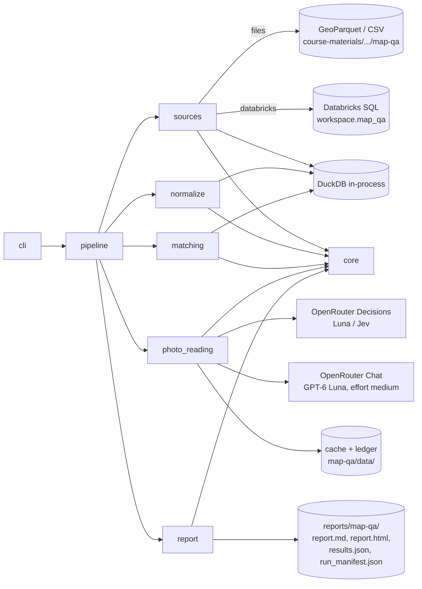
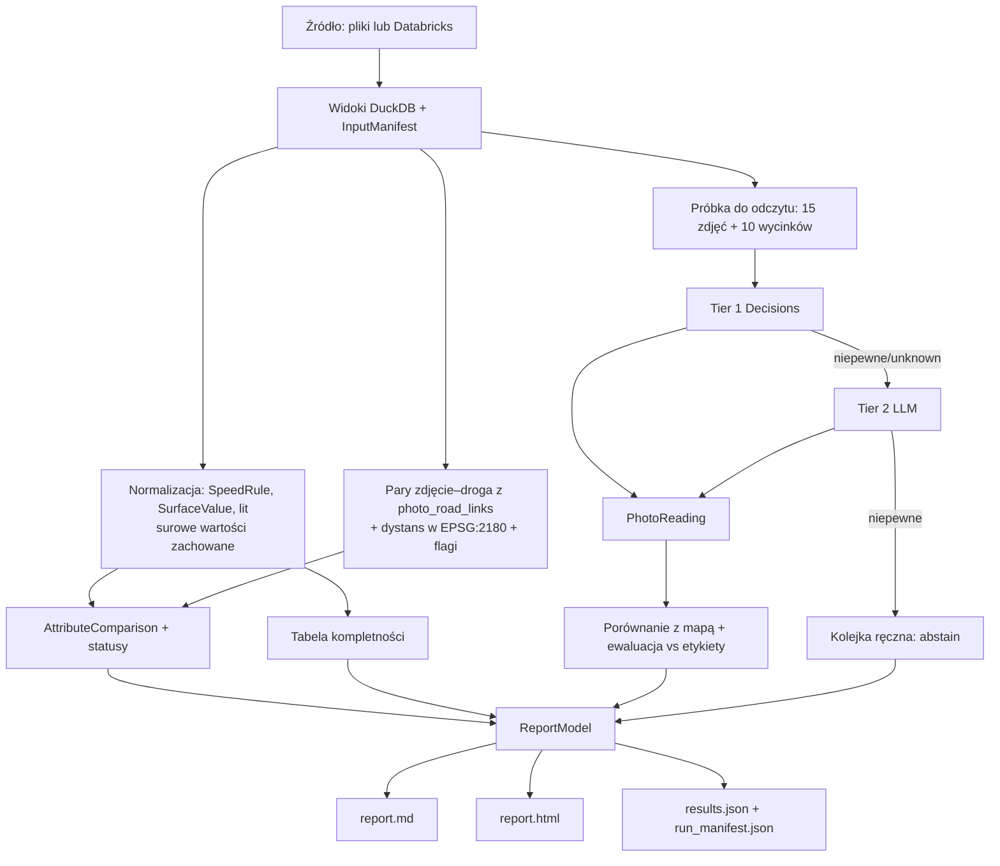
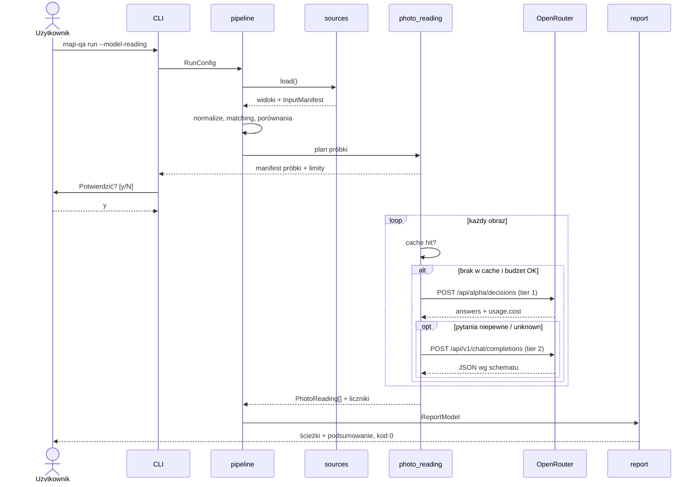
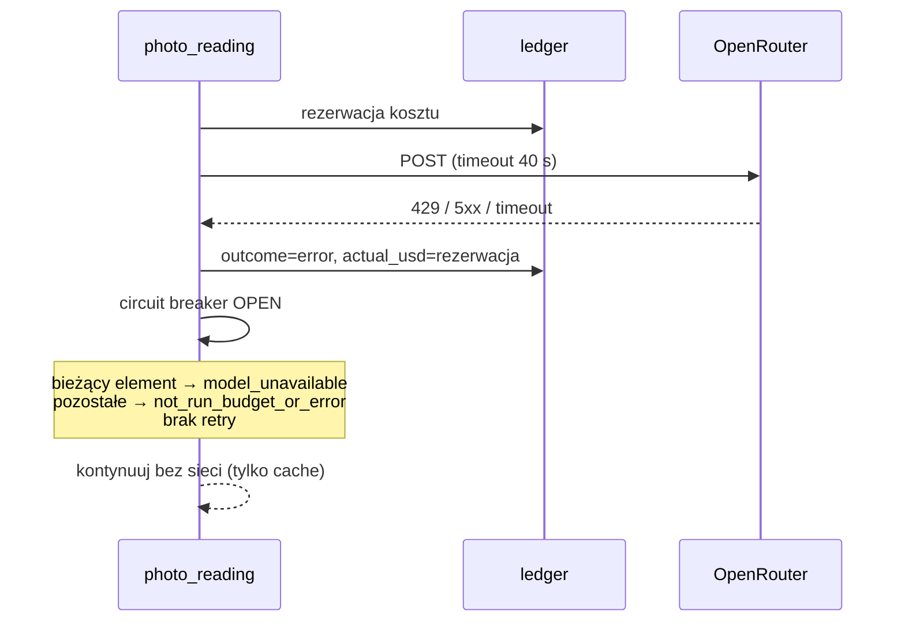

# ADR-000: Map QA – architektura główna

**Data:** 2026-11-03
**Status:** Accepted
**Aktualizacja:** 2026-11-12 – dostępny profil danych [`reports/map-qa/profile.md`](../../reports/map-qa/profile.md) i zweryfikowany dostęp do Databricks; spójność dokumentów: §3 (raporty w Git), §5 (modele), §10 (strategia testów, TAC-03, TAC-05)
**PRD:** [docs/PRD.md](../PRD.md)

Szczegóły poszczególnych obszarów opisują osobne ADR:

| ADR | Obszar |
|---|---|
| [001](001-data-sources-and-normalization.md) | Źródła danych (pliki / Databricks), normalizacja `maxspeed`, `speed_limits`, `surface`, `lit` |
| [002](002-spatial-matching.md) | CRS, metry w EPSG:2180, łączenie zdjęcia z drogą, statusy porównania |
| [003](003-photo-reading-decisions.md) | Odczyt zdjęć: tier 1 Decisions, tier 2 LLM, kontrakt, budżet, cache, capture |
| [004](004-report-and-cli.md) | CLI, konfiguracja, raport Markdown/HTML, artefakty wyjściowe |

---

## 1. Przegląd

Budujemy CLI w Pythonie 3.12, które porównuje atrybuty dróg OSM i Overture dla Krakowa i dołącza dowody ze zdjęć ulic. Opcjonalnie odczytuje widoczne cechy zdjęć trzystopniowo: model decyzyjny, potem ogólny LLM, a na końcu kolejka ręczna. Wynikiem jest raport Markdown i HTML. ADR przekłada wymagania z [PRD](../PRD.md) na decyzje techniczne, kontrakty i strategię testów. Nie zawiera kodu.

**Stan wejściowy (aktualizacja 2026-11-12).** Profil danych z kroku M2 jest w [`reports/map-qa/profile.md`](../../reports/map-qa/profile.md). Fakty o danych pochodzą teraz z tego profilu, a `course-materials/exercise-data/map-qa/README.md` i `sources.json` pozostają źródłem opisu i licencji. Najważniejsze ustalenia:

- **Databricks jest dostępny i zgodny z plikami.** Databricks CLI v1.26.0 jest zainstalowany i skonfigurowany, a zmienne `DATABRICKS_*` są ustawiane w terminalu (nie w repozytorium). Jeden odczyt `SELECT count(*)` przez SQL Statement Execution API zakończył się stanem `SUCCEEDED`. Liczności wszystkich pięciu tabel `workspace.map_qa.*` są równe plikom lokalnym: 99 768 / 85 405 / 561 / 561 / 1730 (`traffic_signs`). Porównano tylko liczby wierszy, nie zawartość.
- **Schematy są potwierdzone.** `DESCRIBE` na rzeczywistych plikach jest w profilu (§3). Kontrakt schematu z ADR-001 §3.1 pozostaje pierwszym testem implementacji.
- **Dane wejściowe są czyste strukturalnie.** Geometrie są poprawne, identyfikatory unikalne, a klucze `photo_id`, `osm_way_id` i `overture_id` nie mają sierot.

Każda rozbieżność względem tego ADR zatrzymuje pracę i wraca do uzgodnienia.

---

## 2. Dokumentacja technologii

| Biblioteka / usługa | Context7 ID lub oficjalna dokumentacja | Zastosowanie |
|---|---|---|
| DuckDB + spatial | `/websites/duckdb_current`; https://duckdb.org/docs/stable/core_extensions/spatial/overview | Odczyt GeoParquet/CSV, SQL, `ST_Transform`, `ST_Distance` |
| DuckDB Python | `/duckdb/duckdb-python` | Połączenie in-process z Pythona |
| GeoPandas | `/geopandas/geopandas`; https://geopandas.org/en/stable/docs.html | Wyłącznie niezależna wyrocznia w testach dystansu (nie w ścieżce produkcyjnej) |
| pyproj | https://pyproj4.github.io/pyproj/stable/ | Wyrocznia transformacji w testach |
| Databricks SQL Statement Execution API | `/databricks/databricks-sdk-py` (opis API); https://docs.databricks.com/aws/en/dev-tools/sql-execution-tutorial | Odczyt tabel `workspace.map_qa.*` przez REST |
| OpenRouter Decisions API | `/websites/openrouter_ai`; https://openrouter.ai/docs/api/api-reference/alphadecisions/submit-a-decisions-request ; https://openrouter.ai/docs/guides/community/multimodal-decisions | Tier 1: odczyt obrazu |
| Jev (TypeSafe) | https://openrouter.ai/docs/guides/community/jev | Model porównawczy na 5 obrazach |
| OpenRouter Chat Completions | `/websites/openrouter_ai`; https://openrouter.ai/docs/guides/features/structured-outputs | Tier 2: ogólny LLM z `reasoning.effort=medium` i `json_schema` |
| OpenRouter Python SDK (odrzucony jako klient) | `/openrouterteam/python-sdk` | Porównanie w §8 |
| httpx | https://www.python-httpx.org/ | Jedyny klient HTTP (OpenRouter, Databricks) |
| respx | https://lundberg.github.io/respx/ | Mock httpx w testach, wyłącznie z zapisanych capture |
| Jinja2 | https://jinja.palletsprojects.com/en/stable/ | Szablony raportu z autoescape |
| Pydantic v2 | https://docs.pydantic.dev/latest/ | Walidacja konfiguracji i odpowiedzi API |
| Pillow | https://pillow.readthedocs.io/ | Przygotowanie obrazu (EXIF, rozmiar) |
| pytest | https://docs.pytest.org/ | Testy |

### Przypięte wersje

Wersje sprawdzone 2026-11-03 na PyPI lub w poleceniach z README danych. Wpisujemy je dokładnie (`==`) w `pyproject.toml`, a `uv.lock` trafia do repo.

| Pakiet | Wersja | Źródło weryfikacji |
|---|---|---|
| Python | 3.12 | AGENTS.md |
| duckdb | 1.5.6 | README danych map-qa (zweryfikowane polecenie) |
| pyarrow | 23.0.1 | README danych map-qa |
| Pillow | 12.0.0 | README danych map-qa (zgodność hashy JPEG) |
| geopandas (dev) | 1.2.0 | README danych map-qa |
| pyproj (dev) | 3.8.0 | PyPI |
| httpx | 0.28.1 | PyPI |
| respx (dev) | 0.23.1 | PyPI |
| Jinja2 | 3.1.6 | PyPI |
| pydantic | 2.14.2 | Changelog PyPI; potwierdzić przy `uv lock` |
| pytest (dev) | 9.2.0 | PyPI |

Rozszerzenie DuckDB `spatial` instaluje się przy pierwszym uruchomieniu (wymaga internetu). Katalog rozszerzeń ustawiamy na ignorowany cache: `course-materials/exercise-data/map-qa/data/.duckdb_extensions/`.

---

## 3. Architektura systemu

### Wzorzec

Monolityczny pakiet Pythona z CLI i potokiem etapów (pipeline). Każdy etap ma jawne wejście i wyjście w postaci tabel DuckDB lub modeli Pydantic. Nie ma serwera ani bazy trwałej. Trwałe są wyłącznie: raporty, cache odpowiedzi modeli, księga budżetu (ledger) i capture.

### Struktura repozytorium

| Ścieżka | Zawartość |
|---|---|
| `app/pyproject.toml`, `app/uv.lock` | Projekt uv, pakiet `map_qa`, skrypt konsolowy `map-qa` |
| `app/src/map_qa/` | Kod (moduły z §4) |
| `app/src/map_qa/sql/` | Zapytania DuckDB jako pliki `.sql` |
| `app/src/map_qa/templates/` | `report.md.j2`, `report.html.j2` |
| `app/tests/unit/`, `app/tests/integration/`, `app/tests/e2e/` | Warstwy testów |
| `app/tests/fixtures/captures/` | Zapisane rzeczywiste odpowiedzi API (bez sekretów) z metadanymi |
| `app/tests/fixtures/rows/` | Wybrane prawdziwe wiersze z danych map-qa (kopie, nie modyfikacje) |
| `app/map_qa.example.toml` | Przykładowa konfiguracja |
| `app/AGENTS.md` | Zasady specyficzne dla stacku (zagnieżdżone, krótkie) |
| `reports/map-qa/` | Wyniki uruchomień: `summary.html`, `report.html`, `report.md`, `results.json`, `run_manifest.json`, `sample_manifest.json` i `thumbs/` (miniatury CC BY-SA z atrybucją). **Są wersjonowane w Git** (decyzja człowieka 2026-11-13, zastępuje wcześniejszą regułę o ignorowaniu): to produkt aplikacji pokazywany grupie, linkowany w PR i materiałach kursu, a VM kursu jest usuwana po szkoleniu. Commitujemy wyniki uzgodnionego przebiegu; pliki nie zawierają sekretów (strażnik TAC-06). `profile.md` jest wersjonowany jak dotąd |
| `course-materials/exercise-data/map-qa/data/` | Cache, ledger, rozszerzenia DuckDB, materializacja Databricks (ignorowane) |

Polecenia uruchamiamy z katalogu głównego repo: `uv run --project app map-qa …` oraz `uv run --project app pytest app/tests`.

### Stos technologiczny

| Warstwa | Technologia | Powód |
|---|---|---|
| Runtime | Python 3.12 + uv | Wymóg kursu, powtarzalne środowisko |
| Obliczenia przestrzenne i tabelaryczne | DuckDB 1.5.6 + spatial | Natywny odczyt GeoParquet i zagnieżdżonych struktur Overture, `ST_Transform` z `always_xy` (decyzja użytkownika) |
| Źródło danych | Pliki lokalne (domyślnie) lub Databricks REST zmaterializowany do lokalnego Parquet | Jedna ścieżka obliczeń dla obu źródeł (ADR-001) |
| AI tier 1 | OpenRouter Decisions: `openai/gpt-6-luna-decisions`; porównanie: `typesafe/jev-1.14` | Decyzja użytkownika; zamknięte odpowiedzi z prawdopodobieństwami |
| AI tier 2 | OpenRouter Chat Completions: GPT-6 Luna (ogólny), `reasoning.effort=medium`, `json_schema` strict | Decyzja użytkownika |
| Klient HTTP | httpx, surowe POST | Pełna kontrola timeoutu, zero retry, wierny capture (decyzja użytkownika) |
| Raport | Jinja2 (autoescape) → MD + statyczny HTML | Escapowanie niezaufanego tekstu, jeden model danych dla obu formatów |
| CLI | argparse (stdlib) | Brak dodatkowej zależności, łatwe testy `main(argv)` |
| Testy | pytest + respx; GeoPandas/pyproj jako wyrocznie | TDD, mock tylko z capture |

---

## 4. Moduły i zależności

Kierunek zależności: `cli → pipeline → (sources, normalize, matching, photo_reading, report) → core`. Moduł `core` nie zależy od żadnego innego. Zależności nie tworzą cykli.

| Moduł | Odpowiedzialność | Zależy od | Używany przez |
|---|---|---|---|
| `core` | Modele domenowe (Pydantic), enumy statusów, konfiguracja, ścieżki, hashowanie | – | wszystkie |
| `sources` | `FilesSource`, `DatabricksSource`; rejestracja tabel w DuckDB; manifest wejść | core, httpx, duckdb | pipeline |
| `normalize` | Parsowanie `maxspeed*`, `speed_limits`, `surface`, `road_surface`, `lit`; zachowanie surowych wartości | core, duckdb | pipeline |
| `matching` | Odczyt kandydatów z `photo_road_links`, weryfikacja dystansu w EPSG:2180, flagi, statusy porównania | core, duckdb | pipeline |
| `photo_reading` | Próbka, przygotowanie obrazu, klienci tier 1/2, budżet, cache, capture, ewaluacja względem etykiet | core, httpx, Pillow | pipeline |
| `report` | Model raportu, renderowanie Jinja2 MD/HTML, `results.json` | core, jinja2 | pipeline |
| `pipeline` | Orkiestracja etapów, manifest uruchomienia, kody wyjścia | wszystkie powyżej | cli |
| `cli` | argparse, ładowanie configu, potwierdzenie płatnych wywołań | pipeline, core | entry point |

---

## 5. Modele danych (koncepcyjnie)

| Model | Kluczowe pola | Relacje | Trwałość |
|---|---|---|---|
| `RunConfig` | `source` (`files`/`databricks`), ścieżki wejść, `output_dir`, `model_reading` (bool), limity, progi, ID modeli, `question_set_version`, `seed` | – | Plik TOML + env; kopia w `run_manifest.json` |
| `InputManifest` | źródło, tabela, liczba wierszy, sha256 pliku (pliki), `statement_id` (Databricks), daty snapshotów | 1 na uruchomienie | `run_manifest.json` |
| `SpeedRule` | `source` (osm/overture), `value_kmh` (float?), `unit_raw`, `kind`, `direction`, `condition_raw`, `between`, `raw`, `tag_key`; na poziomie drogi także `context_tags`. Definicja nadrzędna: ADR-001 §3.3 | N na drogę | W pamięci + `results.json` |
| `SurfaceValue` | `source`, `class` (paved/unpaved/unknown_value/missing), `raw`, `between` | N na drogę | jw. |
| `PhotoRoadPair` | `photo_id`, `osm_way_id`, `overture_id`, `distance_m`, `distance_m_recomputed`, `bearing_diff`, `directed_bearing_diff`, `heading`, `match_method`, `candidate_flags[]`, `flags[]`, `reasons[]`, `link_status`. Definicja nadrzędna: ADR-002 §4 | 1 na zdjęcie z kandydatem | `results.json` |
| `AttributeComparison` | `pair`, `attribute` (`speed`/`surface`; `lit` nie ma porównania OSM–Overture, ADR-001 §3.4), `status`, `osm_rules[]`, `overture_rules[]`, `reason` | 2 na parę | `results.json` |
| `PhotoReading` | `image_sha256`, `question_id`, `tier`, `model`, `answer`, `probabilities`, `decision` (answered/answered_tier2/abstain/model_unavailable/not_run_budget_or_error), `request_ids[]`, `cost_usd` | N na obraz | Cache + `results.json` |
| `LedgerEntry` | `run_id`, `ts`, `model`, `tier`, `reserved_usd`, `actual_usd`, `status_code`, `outcome` | dopisywane | `data/ledger.jsonl` (append-only) |
| `Capture` | data, endpoint, metoda, status, nagłówki odpowiedzi (bez `Authorization`/cookies), pełne body, wersje (httpx, model zwrócony), opis żądania bez obrazu (hash zamiast base64) | 1 na scenariusz | `app/tests/fixtures/captures/*.json` |
| `EvaluationResult` | pytanie, model, tier, `evaluated`, `correct`, `uncertain_excluded`, `abstained`, `unavailable`, accuracy przed i po abstencji | – | `results.json`, raport |

---

## 6. Kontrakty interfejsów

| Granica | Wejście | Wyjście | Błędy |
|---|---|---|---|
| CLI `map-qa run` / `capture` / `report` (ADR-004 §3.1) | `--config`, `--source`, `--output-dir`, `--model-reading`, `--yes`, `--max-requests`, `--max-cost-usd`, `--compare-sources`, flagi progów (pełna lista: ADR-004 §3.2) | Pliki w `output_dir`, podsumowanie na stdout, kod 0 | 2: błąd konfiguracji; 3: źródło niedostępne lub brak zmiennej; 4: niezgodność schematu wejścia; 5: wejście zmienione w trakcie uruchomienia. Płatne wywołanie przerwane błędem daje kod 0 i oznaczenie w raporcie |
| `DataSource.load(con)` | połączenie DuckDB | Zarejestrowane widoki `osm_roads`, `overture_segments`, `photos`, `photo_road_links` + `InputManifest` | `SourceUnavailable`, `MissingCredential(name)`, `SchemaMismatch(table, column)` |
| OpenRouter Decisions | ADR-003 §5.1 | ADR-003 §5.2 | ADR-003 §5.3 |
| OpenRouter Chat (tier 2) | ADR-003 §5.4 | ADR-003 §5.4 | jw. |
| Databricks Statement API | ADR-001 §5 | ADR-001 §5 | ADR-001 §5 |

---

## 7. Zmienne środowiskowe

Wartości sekretów nigdy nie trafiają do logów, cache, capture, raportu ani do kontekstu agenta. Kod sprawdza tylko obecność zmiennej. Nie czytamy `.env`.

| Zmienna | Cel | Wymagana | Przykład |
|---|---|---|---|
| `MAP_QA_CONFIG` | Ścieżka do pliku TOML | Nie | `app/map_qa.toml` |
| `MAP_QA_SOURCE` | Nadpisuje `source` z configu | Nie | `databricks` |
| `DATABRICKS_HOST` | URL workspace | Tak dla `databricks` | `https://dbc-….cloud.databricks.com` |
| `DATABRICKS_TOKEN` | Token SQL | Tak dla `databricks` | (sekret) |
| `DATABRICKS_SQL_WAREHOUSE_ID` | Warehouse | Tak dla `databricks` | `97c455ee6fb1fcb9` |
| `OPENROUTER_API_KEY` | Klucz OpenRouter | Tak dla `--model-reading` | (sekret) |

---

## 8. Decyzje techniczne

### D-01 Silnik przestrzenny: DuckDB spatial zamiast GeoPandas

**Status:** Accepted · **Data:** 2026-11-03

**Kontekst.** Potrzebujemy wczytać 99 768 dróg OSM z JSON `tags` i 85 405 segmentów Overture z zagnieżdżonymi listami struktur (`speed_limits`, `road_surface`, `sources`), przeliczyć je do EPSG:2180 i policzyć dystanse. Ta sama logika ma działać na danych z Databricks.

**Decyzja.** Główny silnik to DuckDB 1.5.6 + spatial. Normalizacja i agregaty kompletności są w SQL, `ST_Transform(geom, 'EPSG:4326', 'EPSG:2180', always_xy := true)`, `ST_Distance` w metrach. GeoPandas 1.2.0 i pyproj 3.8.0 służą tylko jako niezależna wyrocznia w testach.

**Odrzucone alternatywy:**
- GeoPandas + Shapely + pyproj jako silnik główny: zagnieżdżone listy Overture wymagają rozpakowywania w pandas, wszystko ładuje się do pamięci, a agregaty kompletności trzeba by liczyć drugi raz w innym narzędziu.
- Hybryda (DuckDB do odczytu, GeoPandas do joinów): dwa modele CRS i dwie konwencje osi zwiększają ryzyko błędu, którego dotyczy AC-09.

**Konsekwencje:**
- (+) Odczyt kolumnowy i zapytania zagnieżdżone bez kopiowania, jeden SQL dla obu źródeł.
- (+) `always_xy` usuwa dwuznaczność kolejności osi EPSG:4326.
- (-) DuckDB ma własną kopię bazy PROJ, a wynik może różnić się od pyproj w dalszych miejscach po przecinku. Pokrywa to test-wyrocznia z tolerancją 0,01 m.
- (-) Pierwsza instalacja `spatial` wymaga sieci.

**Warunek rewizji:** potrzeba operacji niedostępnych w DuckDB spatial (np. map-matching sekwencji) albo dashboard wymagający GeoDataFrame.

### D-02 Jedna ścieżka obliczeń dla plików i Databricks

Patrz ADR-001 D-11. Databricks materializuje tabele do lokalnego Parquet, a potem pipeline działa identycznie.

### D-03 Klient HTTP: surowe POST przez httpx zamiast OpenRouter SDK

**Status:** Accepted · **Data:** 2026-11-03

**Kontekst.** PRD wymaga zera automatycznych ponowień, timeoutu 40 s, liczenia każdej próby i wiernego capture odpowiedzi (status, nagłówki, body).

**Decyzja.** Jeden `httpx.Client` dla OpenRouter i Databricks. Ustawienia: `timeout=40 s` (connect, read, write, pool), transport bez retry, `follow_redirects=False` dla OpenRouter. Nagłówek `Authorization` budowany wyłącznie w funkcji klienta, z wartością nigdy nie logowaną. Odpowiedzi walidują modele Pydantic.

**Odrzucone alternatywy:**
- Oficjalny SDK `openrouter` (`open_router.alpha.decisions.create`): domyślnie robi retry z backoff (`RetryConfig("backoff", …)`, wyłączalne przez `RetryConfig("none", …)`). Dokumentacja metody decisions nie wymienia `timeout_ms`, a metadane PyPI mają niespójną numerację wersji (1.3.107 kontra 0.11.x). Każdy z tych punktów to ryzyko złamania AC-13, AC-17 i AC-18.
- Natywny klient OpenAI: wykluczony przez użytkownika, a endpoint Decisions to nie Chat Completions.

**Konsekwencje:**
- (+) Brak ukrytych ponowień, capture 1:1 z tym, co poszło po sieci.
- (-) Typy błędów i odpowiedzi definiujemy sami na podstawie capture.

**Warunek rewizji:** SDK udokumentuje timeout i domyślne `retries=none` dla decisions albo API wyjdzie z wersji alpha ze zmianą kontraktu.

### D-04 Raport: Jinja2 z autoescape zamiast składania stringów w Pythonie

**Status:** Accepted · **Data:** 2026-11-03

**Kontekst.** Raport zawiera niezaufany tekst: tagi OSM, nazwy autorów, nazwy ulic. Musi wyglądać tak samo w MD i HTML (AC-23).

**Decyzja.** Jeden obiekt `ReportModel` renderowany dwoma szablonami Jinja2. HTML używa `autoescape=True`. W MD filtr escapuje znaki tabeli (`|`, nowe linie).

**Odrzucone alternatywy:**
- Czysty Python (f-stringi): łatwo zapomnieć o escapowaniu, a logika miesza się z prezentacją.
- Dashboard Streamlit lub PySide6: dashboard jest poza zakresem PRD (§7), więc decyzja jest odroczona. Wstępna preferencja na przyszłość to Streamlit (przeglądarka, szybkie przyciski decyzji). PySide6 wymagałby dystrybucji aplikacji desktopowej.

**Konsekwencje:** (+) Bezpieczny HTML, jeden model danych. (-) Dodatkowa zależność (Jinja2 3.1.6).

**Warunek rewizji:** dashboard wchodzi do PRD.

### D-05 Bezpieczeństwo danych wejściowych i sekretów

**Status:** Accepted · **Data:** 2026-11-03

**Decyzja.**
- Wejścia w `course-materials/exercise-data/` są otwierane tylko do odczytu, a pipeline liczy ich sha256 przed i po uruchomieniu (AC-04).
- Zapisy są dozwolone tylko w `output_dir` i w `course-materials/exercise-data/map-qa/data/`.
- Sekrety pochodzą wyłącznie ze zmiennych środowiskowych.
- Logger ma filtr, który maskuje wartości znanych zmiennych sekretów, gdyby trafiły do komunikatu.
- Test e2e przeszukuje wszystkie pliki wyjściowe pod kątem wartości tokenów z env (AC-05).

**Warunek rewizji:** dodanie trybu wieloużytkownikowego.

---

## 9. Diagramy

### 9.1 Komponenty

### 9.2 Przepływ danych

### 9.3 Sekwencja: pełne uruchomienie z odczytem modelem

### 9.4 Sekwencja: błąd API w trakcie płatnej pętli

---

## 10. Strategia testów

### Filozofia

TDD jest obowiązkowe. Każdy etap zaczyna się testem napisanym na podstawie PRD/ADR. Uruchamiamy go i pokazujemy oczekiwany Red, potem minimum kodu do Green, potem Refactor przy zielonych testach. Testów nie osłabiamy pod implementację. Każdy etap kończy się **rzeczywistym uruchomieniem CLI na danych map-qa** i ręczną kontrolą jednego wyniku (AGENTS.md, Manual QA). Kompilacja i importy, testy (z liczbą przypadków i pominięć) oraz start CLI to trzy osobne kontrole w raporcie z etapu.

Mocki API powstają **wyłącznie z zapisanego rzeczywistego capture**. Najpierw wykonujemy jedno prawdziwe żądanie (wliczone do budżetu), zapisujemy capture zgodnie z §5 i dopiero na jego podstawie tworzymy fixture. Brak capture oznacza, że testu integracyjnego API nie piszemy, a brak prerekwizytu zgłaszamy w raporcie etapu.

### Doprecyzowanie tabeli strategii testów z AGENTS.md (2026-11-12)

AGENTS.md mówi „Integration: mocks only external LLM API” i każe tworzyć capture z danych syntetycznych. Ten projekt świadomie odchodzi od tego w dwóch punktach:

- **Databricks.** W testach integracyjnych mockujemy też zewnętrzne HTTP Databricks (respx). Robimy to wyłącznie na podstawie rzeczywistego capture, tak samo jak dla OpenRouter. Lokalne zależności (DuckDB, pliki) nie są mockowane.
- **Dane w capture.** Capture zawierają rzeczywiste wiersze i zdjęcia z publicznego snapshotu (ODbL, CC BY-SA). Nie ma ich syntetycznego odpowiednika z tym samym schematem. Capture nie zawierają sekretów ani danych osobowych poza atrybucją autora, wymaganą licencją.

E2E nie mockuje niczego. Ponowne uruchomienie „z cache” używa wyłącznie cache zapisanego z rzeczywistych odpowiedzi, nigdy cache spreparowanego ręcznie.

**Zasada użytkownika: rzeczywiste modele w testach E2E i ręcznych (2026-11-12).**
- Testy ręczne i E2E z odczytem modelem **zawsze** wywołują rzeczywiste endpointy: OpenRouter Decisions (`openai/gpt-6-luna-decisions`, `typesafe/jev-1.14`) i Chat Completions (`openai/gpt-6-luna`). Nie używają mocków, spreparowanych odpowiedzi ani wyłącznie cache. Test cache jest **drugim** przebiegiem tego samego testu, po rzeczywistych wywołaniach.
- Mocki są dozwolone tylko w testach unit i integracyjnych. Powstają **po** rzeczywistym wywołaniu, które ustala zaakceptowany format żądania, dane żądania i rzeczywistą strukturę odpowiedzi (capture, ADR-003 §5.8).
- Koszt wywołań tych trzech modeli w testach jest pomijalny (łącznie < 1 USD), więc testy nie oszczędzają na rzeczywistych wywołaniach. Limity budżetu w aplikacji (PRD AC-13, ADR-003 §5.5) pozostają wymaganiem produktu i są testowane jak każda inna funkcja.

### Warstwy testów

| Warstwa | Zakres | Mocki | Narzędzia |
|---|---|---|---|
| Unit | Parsery `maxspeed`/`speed_limits`/`surface`, reguły statusów, różnica kątów, budżet/ledger, klucz cache, filtr sekretów, budowa payloadu (bez wycieku), modele odpowiedzi | Wszystkie zależności | pytest |
| Integration | DuckDB na prawdziwych wierszach (fixtures z `signs/*.csv`, wybrane `osm_id`/`id` z GeoParquet), transformacja CRS kontra pyproj, adapter Databricks i klient OpenRouter z respx odtwarzającym capture | Tylko HTTP (z capture) | pytest, respx, geopandas/pyproj jako wyrocznia |
| E2E | Rzeczywiste CLI na plikach map-qa. Z odczytem modelem: rzeczywiste wywołania Luna Decisions, Jev i GPT-6 Luna, a potem drugi przebieg z cache (0 nowych żądań) | Nic | pytest + `subprocess`, ręczna kontrola HTML |

### Kluczowe scenariusze

Szczegółowe tabele są w ADR-001 do ADR-004. Przekrojowo:
1. **Niezmienność wejść:** sha256 wszystkich plików wejściowych jest równe przed i po uruchomieniu.
2. **Brak wycieku sekretów:** po uruchomieniu z ustawionymi fałszywymi wartościami tokenów żaden plik w `output_dir`, cache i capture nie zawiera tych wartości.
3. **Budżet:** przy limicie 3 żądań i 5 elementach wykonują się dokładnie 3 próby, a 2 elementy dostają `not_run_budget_or_error`.
4. **Cache:** drugie uruchomienie daje 0 nowych żądań i identyczne predykcje.
5. **Spójność raportu:** liczniki MD = HTML = `results.json`, a suma statusów **dla każdego atrybutu** = liczba par (PRD AC-06, AC-23).

### Techniczne kryteria akceptacji

- **TAC-01:** `uv run --project app pytest app/tests` przechodzi z 0 błędów i 0 nieoczekiwanych pominięć. Pominięcia mają powód (np. brak capture) widoczny w `-rs`.
- **TAC-02:** `uv run --project app map-qa run` na plikach kończy się kodem 0 w czasie poniżej 120 s na VM kursu i tworzy 4 pliki: `report.md`, `report.html`, `results.json`, `run_manifest.json`.
- **TAC-03:** `run_manifest.json` zawiera sha256 każdego pliku wejściowego odczytanego w uruchomieniu. Dla plików z wpisem w `sources.json` → `files` hash jest z nim zgodny albo raport pokazuje ostrzeżenie (ADR-001 §3.2).
- **TAC-04:** Żaden moduł poza `photo_reading` i `sources` nie importuje `httpx` (test importów).
- **TAC-05:** Każdy fixture w `app/tests/fixtures/captures/` ma wszystkie pola wymagane schematem capture z ADR-003 §5.8, a w nagłówkach nie ma `authorization` ani `set-cookie` (test meta).
- **TAC-06:** Wartość żadnej zmiennej z §7 oznaczonej jako sekret nie występuje w żadnym pliku wyjściowym (test e2e z fałszywymi wartościami).

---

## 11. Otwarte kwestie

- **ID modelu tier 2.** Użytkownik wybrał „GPT 6 Luna” jako ogólny LLM. Domyślnie przyjmujemy `openai/gpt-6-luna`, ale **przed pierwszym płatnym wywołaniem** trzeba potwierdzić ten identyfikator w katalogu modeli OpenRouter, razem z obsługą obrazów, `json_schema` i `reasoning`. Strony modeli i filtr Models API nie zwróciły danych 2026-11-03.
- **Ceny i opóźnienia Luna Decisions i Jev 1.14.** ~~Strony modeli zwróciły 404 przy pobieraniu.~~ **Ceny częściowo rozstrzygnięte 2026-11-12:** użytkownik podał cennik i kontekst (ADR-003 §2): Luna Decisions $0.10 / $0 za 1M tokenów, 1,1M kontekstu; Jev $0.042 / $0, 262K kontekstu. Oba modele przyjmują obrazy. Opóźnienia, tokeny na obraz i koszt tier 2 zapiszemy z pierwszych rzeczywistych wywołań w ADR-003 §9.
- ~~**Model tier 2.**~~ **Zamknięte 2026-11-12 (T43).** `openai/gpt-6-luna` przez OpenRouter przyjmuje obraz, `response_format=json_schema` (strict) i `reasoning.effort=medium`; koszty i czasy w ADR-003 §9.
- ~~**Profil danych.** Brak `reports/map-qa/profile.md`.~~ **Zamknięte 2026-11-12.** Profil istnieje, a dostęp do Databricks jest zweryfikowany (§1). Wnioski z profilu są wpisane do ADR-001 §3.1, §3.3 i §5 oraz ADR-002 §3.4.
- **Decyzje wynikające z profilu (pytania do człowieka, `profile.md` §11):**
  1. **Limity implikowane.** 1453 drogi mają tylko typ limitu bez liczby (1452 `implicit_only`, głównie `PL:urban` i `PL:rural`; ADR-001 §3.3). Trzeba zdecydować, czy pozostają `not_comparable` (obecnie D-13), czy dostają wartości ustawowe. Trzeba też ustalić, czy `PL:urban` + 70 (55 dróg) to konflikt.
  2. **Zakres klas dróg.** Trzeba ustalić, czy `service`, `track` i drogi z `access=private/no` mają być w kontroli prędkości, osobno czy poza nią. Te klasy dają 74 410 z 83 478 braków `maxspeed`.
  3. **Wiek dowodów i rola Databricks.** 45,6% zdjęć i 51% obserwacji znaków pochodzi sprzed 2024 r., więc trzeba ustalić maksymalny wiek dowodu. Trzeba też potwierdzić, że Databricks pozostaje źródłem alternatywnym i kontrolą parzystości (D-02), a nie wymaganym wejściem.
