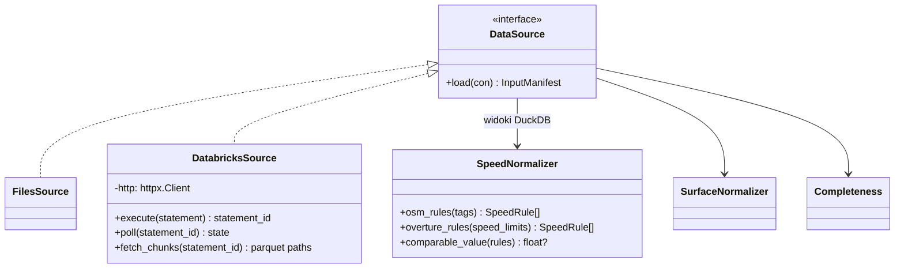
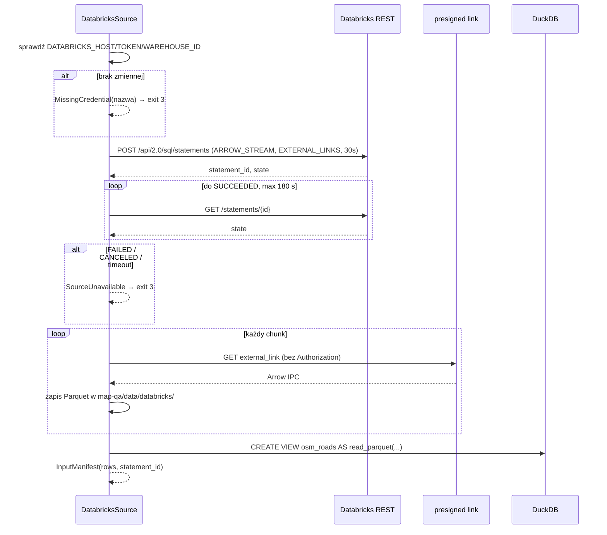

# ADR-001: Źródła danych i normalizacja atrybutów

**Data:** 2026-11-03
**Status:** Accepted
**Aktualizacja:** 2026-11-12 – fakty z [`reports/map-qa/profile.md`](../../reports/map-qa/profile.md) i zweryfikowany dostęp do Databricks (§3.1, §3.2, §3.3, §5, D-12); spójność dokumentów: etykiety tylko w `Evaluator` (§3.2), zakres hashy (§3.2), typ limitu bez liczby i kolejność statusów (§3.3–3.4), TAC-001-03, kompletność (§3.5)
**Dotyczy:** [000-main-architecture.md](000-main-architecture.md)

---

## 1. Zakres

**Obejmuje:**
- wybór i ładowanie źródła (pliki lokalne lub Databricks);
- manifest wejść;
- normalizację OSM `maxspeed*`, `surface`, `lit` oraz Overture `speed_limits` i `road_surface`, bez utraty surowych wartości;
- tabelę kompletności.

**Nie obejmuje:**
- CRS, dystansów i dopasowań (ADR-002);
- odczytu zdjęć (ADR-003);
- raportu (ADR-004).

---

## 2. Dokumentacja

| Biblioteka / usługa | Context7 ID lub dokumentacja | Zastosowanie |
|---|---|---|
| DuckDB | `/websites/duckdb_current` | `read_parquet`, `read_csv`, `json_extract_string`, `unnest`, struktury |
| Databricks Statement Execution | `/databricks/databricks-sdk-py`; https://docs.databricks.com/aws/en/dev-tools/sql-execution-tutorial | `POST /api/2.0/sql/statements`, `GET /api/2.0/sql/statements/{id}`, chunki wyników |
| Databricks CLI | https://docs.databricks.com/aws/en/dev-tools/cli/ | Odrzucony jako transport w CLI aplikacji (D-12) |
| Databricks SQL MCP | https://docs.databricks.com/aws/en/agents/mcp-tools/databricks-sql | Opcjonalnie, tylko do eksploracji przez agenta |
| OSM `maxspeed` | https://wiki.openstreetmap.org/wiki/Key:maxspeed | Składnia wartości, jednostki, wartości implikowane `PL:*` |
| OSM conditional restrictions | https://wiki.openstreetmap.org/wiki/Conditional_restrictions | Składnia `value @ (condition)` |
| Overture transportation segment | https://docs.overturemaps.org/schema/reference/transportation/segment/ | `speed_limits`, `road_surface`, `when`, `between` |

---

## 3. Projekt komponentów

### 3.1 Kontrakt schematu (pierwszy krok implementacji)

Zanim powstanie normalizacja, test integracyjny wykonuje `DESCRIBE` na `osm_roads.parquet`, `overture_segments.parquet`, `photos.csv` i `photo_road_links.csv`. Porównuje wynik z oczekiwaną listą kolumn i typów zapisaną w `app/tests/fixtures/schema_expected.json`. Tę listę tworzymy z pierwszego rzeczywistego `DESCRIBE`, a nie z dokumentacji.

Oczekujemy co najmniej:
- **OSM:** `osm_id`, `geometry`, `highway`, `maxspeed`, `surface`, `lanes`, `lit`, `tags` (JSON string), `node_ids`, `boundary_crossing`;
- **Overture:** `id`, `geometry`, `class`, `subclass`, `speed_limits`, `road_surface`, `sources`, `connectors`, `access_restrictions`, `level_rules`, `bbox`, `version` (zgodnie z `sources.json`).

Każda rozbieżność daje `SchemaMismatch` i kod wyjścia 4.

**Potwierdzone w profilu (2026-11-12, `profile.md` §3).** Rzeczywisty `DESCRIBE` zawiera wszystkie kolumny wymienione wyżej. Dla implementacji ważne są typy:

- **OSM.** `maxspeed`, `lanes` i pozostałe wyodrębnione tagi są typu `VARCHAR`, nie liczbowego. `osm_timestamp` jest `VARCHAR`. `tags` to JSON zapisany jako tekst. Geometria ma typ `GEOMETRY('EPSG:4326')`.
- **Overture.** Geometria ma typ `GEOMETRY('OGC:CRS84')`. Element `speed_limits` ma postać `{min_speed{value,unit}, max_speed{value,unit}, is_max_speed_variable, when{during, heading, using[], recognized[], mode[], vehicle[]}, between DOUBLE[]}`, czyli nazwy pól są zgodne z §3.3.
- **`photos.csv`.** `captured_at` ma typ `TIMESTAMPTZ`, a `heading` i `horizontal_accuracy_m` typ `DOUBLE`.
- **`photo_road_links.csv`.** `osm_way_id` ma typ `BIGINT`, a `candidate_flags` to `VARCHAR` z separatorem `;`.

`schema_expected.json` nadal powstaje z pierwszego `DESCRIBE` wykonanego przez test, a profil służy jako punkt odniesienia do przeglądu.

### 3.2 Źródła danych

Interfejs `DataSource` ma metodę `load(con) -> InputManifest`. Po jej wykonaniu w połączeniu DuckDB istnieją widoki o stałych nazwach: `osm_roads`, `overture_segments`, `photos`, `photo_road_links`, `signs`, `signs_nearest_osm`.

**Etykiety referencyjne (decyzja 2026-11-12, usuwa sprzeczność z ADR-003 TAC-003-03).** `DataSource` **nie** rejestruje widoków z etykietami. Pliki `reference_labels.csv` i `signs/labels.csv` otwiera wyłącznie `Evaluator` (ADR-003 §3), który udostępnia `SamplePlanner` tylko warstwy losowania, bez wartości etykiet.

- **`FilesSource` (domyślny):** widoki na plikach w `course-materials/exercise-data/map-qa/` (ścieżka bazowa z configu). Manifest zawiera sha256 **każdego pliku odczytanego w uruchomieniu** (w tym `offline/`, `signs/`). Hash jest porównywany z `sources.json → files` tylko dla plików, które mają tam wpis (8 plików, m.in. GeoParquet, CSV, `traffic_signs.geojson`). Pozostałe pliki mają w manifeście sam hash, bez wzorca. Niezgodność ze wzorcem to ostrzeżenie w raporcie, nie błąd: dane mogły zostać świadomie odświeżone. Niezależnie od tego hash przed i po uruchomieniu musi być równy (AC-04, kod 5).
  - **Końce linii (ustalone przy implementacji T10, 2026-11-12).** Na Windows z `core.autocrlf=true` Git zapisuje pliki tekstowe (`photos.csv`, `photo_road_links.csv`, `reference_labels.csv`, `osm_roads_sample.geojson`) z CRLF, a `sources.json` zawiera hashe wersji LF. Manifest zapisuje surowy `sha256` (podstawa AC-04) i, tylko dla plików tekstowych niezgodnych ze wzorcem, `sha256_lf` po zamianie CRLF → LF. Zgodność ze wzorcem ma trzy stany: `exact`, `lf_normalized` (bez ostrzeżenia) i `mismatch` (ostrzeżenie).
- **`DatabricksSource`:** materializuje tabele `workspace.map_qa.{osm_roads, overture_segments, photos, photo_road_links}` do Parquet w `course-materials/exercise-data/map-qa/data/databricks/<statement_id>/`, a potem rejestruje te same widoki. Geometria przychodzi jako WKB (`sources.json`: „BINARY WKB; construct GEOMETRY with explicit SRID 4326”) i jest konwertowana `ST_GeomFromWKB`. Etykiety referencyjne i `signs/` są zawsze lokalne, bo nie ma ich w Databricks.
- **`--compare-sources`:** ładuje oba źródła do osobnych schematów DuckDB i porównuje liczby wierszy oraz zbiory kluczy (`osm_id`, `id`, `photo_id`). Raportuje różnice. Pipeline działa dalej na źródle wybranym w configu.
- **Brak cichego fallbacku:** jeśli brakuje zmiennej `DATABRICKS_*`, CLI zwraca kod 3 i nazwę zmiennej. Jeśli żądanie zwróci błąd HTTP albo stan `FAILED`/`CANCELED`, CLI zwraca kod 3 i bezpieczny komunikat (bez tokenu).
- **Stan dostępu (2026-11-12):** wspólny workspace, token SQL i warehouse działają. Liczności tabel w Databricks są równe plikom lokalnym (`profile.md` §2):

  | Tabela | Pliki | Databricks |
  |---|---:|---:|
  | `osm_roads` | 99 768 | 99 768 |
  | `overture_segments` | 85 405 | 85 405 |
  | `photos` | 561 | 561 |
  | `photo_road_links` | 561 | 561 |
  | `traffic_signs` | 1730 | 1730 |

  Tabela `traffic_signs` też istnieje w Databricks, ale MVP jej nie materializuje (poza zakresem PRD). Geometria w Databricks to WKB bez SRID, zgodnie z założeniem wyżej. `reference_labels` i `signs/` są tylko lokalne.

### 3.3 Normalizacja prędkości

**Zasada nadrzędna.** Każda reguła zachowuje surowy tekst lub strukturę (`raw`). Wartość liczbowa jest polem pochodnym i nigdy nie zastępuje surowej.

**Model `SpeedRule`:**

| Pole | Znaczenie |
|---|---|
| `source` | `osm` / `overture` |
| `kind` | `numeric`, `implicit` (np. `PL:urban`), `none` (brak ograniczenia, OSM `none`), `signals`, `walk`, `variable`, `unparseable` |
| `value_kmh` | float lub NULL; wypełnione tylko dla `numeric` |
| `unit_raw` | `km/h` (domyślnie w OSM), `mph`, `knots` itp. – zachowane |
| `direction` | `both`, `forward`, `backward` (względem kolejności węzłów / geometrii) |
| `condition_raw` | tekst warunku OSM (`@ (...)`) albo JSON pola `when` Overture bez `heading`; NULL = bezwarunkowa |
| `between` | `[start, end]` jako ułamek długości segmentu Overture; NULL = cały segment |
| `raw` | pełna surowa wartość |
| `tag_key` | dla OSM: klucz źródłowy (`maxspeed`, `maxspeed:forward`, `maxspeed:conditional`, …) |

**Parsowanie OSM.** Bierzemy wszystkie klucze z JSON `tags` pasujące do `maxspeed` lub `maxspeed:*`, a nie tylko kolumnę `maxspeed`.

| Klucz / wartość | Wynik |
|---|---|
| `maxspeed=50` | `numeric`, 50 km/h, `both` |
| `maxspeed=30 mph` | `numeric`, 48,28 km/h (×1,609344, zaokrąglenie do 0,01), `unit_raw=mph` |
| `maxspeed=PL:urban`, `PL:rural`, `PL:motorway`, `PL:living_street`, `PL:zone30` itd. | `implicit`, `value_kmh=NULL`. Nie podstawiamy wartości ustawowych w MVP |
| `maxspeed=none` | `none` |
| `maxspeed=signals` / `walk` | `signals` / `walk` |
| `maxspeed=50;70` | dwie reguły `numeric` z tym samym `tag_key` |
| `maxspeed:forward` / `:backward` | `direction=forward/backward` |
| `maxspeed:conditional=30 @ (Mo-Fr 07:00-17:00)` | `numeric` 30, `condition_raw` = tekst w nawiasie; wiele warunków rozdzielonych `;` daje wiele reguł |
| `maxspeed:type`, `source:maxspeed`, `zone:maxspeed`, `maxspeed:variable` | nie tworzą reguły; trafiają do `context_tags` i do raportu |
| `maxspeed:source` (niestandardowy), `check_date:maxspeed`, `source:maxspeed:*` | jak wyżej: `context_tags`, bez reguły (dopisane po profilu) |
| `maxspeed:hgv`, `:bus`, `:trailer` (także z `:forward`/`:backward`) | `numeric`, `condition_raw` = typ pojazdu (np. `vehicle=hgv`). Tak samo jak Overture `when.mode`, więc nie wchodzą do wartości porównywalnej (dopisane po profilu) |
| `maxspeed:lanes=120\|120\|120\|80` | jedna reguła na pas, `condition_raw` = `lane=<n>`. Nie wchodzi do wartości porównywalnej (dopisane po profilu) |
| `maxspeed:forward=PL:urban` | `implicit` z `direction=forward` |
| wartość nieparsowalna | `unparseable`, `raw` zachowane, licznik w raporcie |

**Fakty z profilu (2026-11-12, `profile.md` §8).** Profil sprawdzał, które przypadki z tabeli występują w aktualnym snapshocie:

- **Kolumna `maxspeed`.** Zawiera wyłącznie liczby całkowite: 16 290 dróg, wartości 4–140. Brak jej w 83 478 drogach. W snapshocie **nie ma** jednostek (`mph`), wartości `none`/`signals`/`walk` ani wielu wartości po `;`. Parser nadal je obsługuje, bo `refresh_sources.py` może dać nowszy snapshot, a testy jednostkowe pokrywają je danymi syntetycznymi.
- **Wartości tekstowe w innych kluczach.** Występują wyłącznie w innych kluczach `maxspeed*`:
  - `source:maxspeed`: 11 671, w tym `PL:zone30;sign` (wiele wartości) i `zone30` (bez prefiksu kraju);
  - `maxspeed:type`: 2578;
  - `maxspeed:source`: 23, w tym `pl:zone30` (małe litery);
  - `zone:maxspeed`: 19, wartość `PL:30`.
- **Typ limitu bez liczby.** 1475 dróg nie ma liczby w `maxspeed`, a ma `source:maxspeed`/`maxspeed:type`: `PL:urban` 1401, `PL:rural` 46, `sign` 19, `PL:expressway` 7, `PL:zone40` 2. Status to `not_comparable`, nie `missing_osm`, zgodnie z regułą „Typ limitu bez liczby” niżej. Po uwzględnieniu wszystkich kluczy `maxspeed*` reguła obejmuje 1453 drogi.
- **Niespójności typu i liczby.** Przykłady: `PL:urban` + 70 (55), + 30 (24), + 40 (19); `PL:rural` + 70 (15); `PL:zone30` + 50 (4). 18 dróg ma sprzeczne `source:maxspeed` i `maxspeed:type`. W MVP to tylko informacja w `context_tags` i w raporcie. Status pary nie zmienia się (D-13).
- **Pozostałe klucze.** Kierunkowe: `forward` 261, `backward` 247. 4 drogi mają jednocześnie `maxspeed` i `maxspeed:forward/backward`. Warunkowe: `maxspeed:conditional` 92, jedyna wartość to `110 @ (Mo-Fr 06:00-18:00)`. Zmienne: `maxspeed:variable=yes` 82. Pojazdy: `hgv`/`bus`/`trailer` po około 1000. Pasy: `maxspeed:lanes` 10.
- **Overture.** 12 847 segmentów ma reguły. Wszystkie jednostki to `km/h` i nie ma `min_speed`. `when.heading`: `forward` 218, `backward` 216. `when.mode`: `[bus, hgv]` 401, `[bus]` 30, `[hgv]` 9. `when.during`: 19 reguł. `is_max_speed_variable`: 16 reguł.
- **Overture jako dowód.** 99,1% segmentów ma w `sources` OpenStreetMap. Zgodność OSM–Overture jest więc słabym, niezależnym dowodem. Raport opisuje ją jako „zgodność snapshotów”, nie potwierdzenie poprawności.

**Parsowanie Overture.** Każdy element listy `speed_limits` daje jedną lub dwie reguły:
- `max_speed.value` + `max_speed.unit` → `numeric` (przeliczenie jak wyżej);
- `min_speed` trafia do `context` i nie jest porównywane w MVP;
- `is_max_speed_variable=true` → `kind=variable`;
- `when.heading` (`forward`/`backward`) → `direction`;
- pozostałe pola `when` (`during`, `mode`, `using`, `recognized`, `vehicle`) → `condition_raw` jako stabilnie posortowany JSON;
- `between` → zachowane.

Lista pusta lub NULL oznacza brak reguł (`missing_overture`). Dokładne nazwy pól potwierdza test schematu z §3.1. Jeśli rzeczywisty schemat się różni, aktualizujemy ten ADR, a nie zgadujemy.

**Wartość porównywalna.** Strona (OSM lub Overture) ma *wartość porównywalną* tylko wtedy, gdy jej reguły bezwarunkowe (`condition_raw IS NULL`) mają dokładnie jedną różną wartość `numeric`, która dotyczy całego segmentu (`between` NULL lub `[0,1]`) i obu kierunków (albo `forward` = `backward`).

**Typ limitu bez liczby (doprecyzowane 2026-11-12).** OSM ma *typ limitu bez liczby*, gdy nie ma żadnej reguły `numeric`, a co najmniej jeden z kluczy `maxspeed:type`, `source:maxspeed`, `maxspeed:source`, `zone:maxspeed` (także z `:forward`/`:backward`) ma wartość. Wartości dzielimy po `;` i porównujemy bez rozróżniania wielkości liter:
- `implicit_only`: wartość z prefiksem kraju (`^[a-z]{2}:`, np. `PL:urban`, `pl:zone30`, `PL:30`) albo strefa bez prefiksu (`^zone\d+$`, np. `zone30`);
- `type_without_value`: `sign`, `survey` i inne wartości bez liczby i bez prefiksu kraju.

W snapshocie 2026-11-01 ta reguła daje **1453 drogi: 1452 `implicit_only` i 1 `type_without_value` (`sign`)**. Zmierzono to 2026-11-12 skryptem tylko do odczytu. Profil (`profile.md` §8.2) podaje 1475, bo liczył drogi bez kolumny `maxspeed`. 22 z nich mają jednak liczbę w `maxspeed:forward`/`:backward` lub w kluczach dla pojazdów, więc mają reguły `numeric`. Test integracyjny odtwarza 1452/1. Inny wynik oznacza błąd parsera albo zmianę danych i wymaga aktualizacji tego ADR.

**Kolejność ustalania statusu `speed`** dla pary zdjęcie–droga (liczone w ADR-002). Obowiązuje **pierwsza** pasująca reguła, więc każda para ma dokładnie jeden status dla atrybutu (PRD AC-06):

| # | Warunek | Status |
|---|---|---|
| 1 | Para ma `link_status=ambiguous` | `ambiguous_link` |
| 2 | OSM nie ma żadnej reguły ani typu limitu bez liczby | `missing_osm` (brak po stronie Overture jest wtedy widoczny tylko w kompletności) |
| 3 | Brak kandydata Overture (`overture_id` NULL) albo segment nie ma reguł | `missing_overture` |
| 4 | Którakolwiek strona nie ma wartości porównywalnej: OSM `implicit_only` / `type_without_value`, reguły tylko warunkowe, kierunkowe różne, częściowe `between`, wiele wartości, `unparseable` | `not_comparable` + powód |
| 5 | Obie wartości porównywalne, \|Δ\| < 0,5 km/h | `agree` |
| 6 | Obie wartości porównywalne, \|Δ\| ≥ 0,5 km/h | `disagree` |

Reguły warunkowe (np. `maxspeed:conditional`, `maxspeed:hgv`, Overture `when.mode`) **nie blokują** porównania, jeśli obie strony mają wartość porównywalną z reguł bezwarunkowych (PRD AC-07: „unless an unconditional value exists on both sides”). Surowe reguły warunkowe są zawsze pokazywane w raporcie.

Brak tagu nigdy nie jest równy 0 ani `none` (AC-08).

### 3.4 Normalizacja nawierzchni i oświetlenia

**Klasy nawierzchni** (`paved`, `unpaved`, `unknown_value`, `missing`). Mapowanie jest stałą w kodzie, a każda wartość spoza tabeli trafia do `unknown_value` z zachowaniem `raw`.

| Klasa | OSM `surface` | Overture `road_surface.value` |
|---|---|---|
| `paved` | `asphalt`, `concrete`, `concrete:plates`, `concrete:lanes`, `paved`, `paving_stones`, `sett`, `unhewn_cobblestone`, `cobblestone`, `bricks`, `metal`, `wood`, `chipseal` | `paved`, `paving_stones`, `metal` |
| `unpaved` | `unpaved`, `compacted`, `fine_gravel`, `gravel`, `pebblestone`, `ground`, `dirt`, `earth`, `grass`, `grass_paver`, `mud`, `sand`, `rock`, `woodchips` | `unpaved`, `gravel`, `dirt` |

`grass_paver` jest graniczny. Klasyfikujemy go jako `unpaved`, zgodnie z definicją z README danych: „Paved obejmuje asfalt, beton i kostkę”. Pełna lista wartości Overture zostanie potwierdzona testem kontraktu na `SELECT DISTINCT`, a nieznane wartości dają `unknown_value`.

Statusy dla `surface` działają analogicznie do prędkości, z tą samą kolejnością reguł 1–6 z §3.3:
- porównujemy klasy, nie surowe stringi;
- brak `surface` w OSM → `missing_osm`; brak kandydata Overture albo pusta lista `road_surface` → `missing_overture`;
- `between` częściowe → `not_comparable`;
- `unknown_value` po którejkolwiek stronie → `not_comparable`.

**`lit`.** Bierzemy tylko OSM: `yes` / `no` / inne (`automatic`, `24/7`, `sunset-sunrise` → klasa `yes_conditional`) / `missing`. Porównujemy wyłącznie z odczytem zdjęcia (ADR-003). Nie ma porównania OSM–Overture. Wartości spoza tej listy (w snapshocie: `disused`, 1 droga) dostają klasę `unknown_value` z zachowaniem `raw` (ustalone przy implementacji T20, 2026-11-12). Overture `road_surface.value=unknown` (53 elementy) to również `unknown_value`.

### 3.5 Kompletność

Jedno zapytanie SQL liczy, dla każdego atrybutu i źródła, `count`, `with_value` i `pct` w dwóch populacjach: wszystkie drogi oraz drogi połączone ze zdjęciem.

| Atrybut | Kolumna lub klucz w JSON `tags` |
|---|---|
| OSM `maxspeed*` | dowolny klucz `maxspeed*` w `tags` |
| OSM `surface` | kolumna `surface` |
| OSM `lit` | kolumna `lit` |
| OSM `lanes` | kolumna `lanes`; klucze `lanes:forward`, `lanes:backward` tylko w `tags` |
| OSM `sidewalk*` | kolumny `sidewalk`, `sidewalk:left`, `sidewalk:right`; klucz `sidewalk:both` tylko w `tags` |
| Overture | `len(speed_limits) > 0`, `len(road_surface) > 0` |

Mianowniki są jawne w raporcie (AC-11).

---

## 4. Struktury danych

- `InputManifest`: `{source, tables: [{name, rows, sha256?, statement_id?, path?}], snapshots: {osm_extract_date, overture_release}, warnings[]}`.
- `SpeedRule`, `SurfaceValue`: §3.3 i §3.4.
- `CompletenessRow`: `{source, attribute, population (all/linked), with_value, total, pct}`.

---

## 5. Kontrakty interfejsów

### Databricks Statement Execution (REST, httpx)

- **Wykonanie:** `POST {DATABRICKS_HOST}/api/2.0/sql/statements` z body:
  - `warehouse_id`, `statement` (stałe zapytanie `SELECT … FROM workspace.map_qa.<tabela>`, bez interpolacji danych użytkownika);
  - `format=ARROW_STREAM`, `disposition=EXTERNAL_LINKS`;
  - `wait_timeout=30s`, `on_wait_timeout=CONTINUE`.
- **Polling:** `GET /api/2.0/sql/statements/{statement_id}` co 2 s, łącznie do 180 s. Polling nie jest retry: nie wysyłamy ponownie `POST`.
- **Chunki:** każdy `external_link` pobieramy **bez** nagłówka `Authorization` (to presigned URL) i zapisujemy jako Arrow IPC → Parquet. Kolejne chunki wskazuje `next_chunk_index` albo `GET …/result/chunks/{n}`.
- **Wyjście:** pliki Parquet + `statement_id` + `manifest.total_row_count` (porównywany z liczbą wczytanych wierszy).
- **Błędy:**
  - HTTP ≠ 200 → `SourceUnavailable(status)`;
  - `status.state ∈ {FAILED, CANCELED, CLOSED}` → `SourceUnavailable(state, error.message bez sekretów)`;
  - przekroczenie 180 s → próba `POST …/cancel`, potem `SourceUnavailable(timeout)`.
- **Zapis testowy:** pierwsze rzeczywiste wywołanie `SELECT … LIMIT 5` z `photos` zapisujemy jako capture (status, nagłówki bez `Authorization`, body, `captured_at`, host zamaskowany do domeny). Mock w testach integracyjnych powstaje z tego capture.
- **Zweryfikowane 2026-11-12:**
  - `POST /api/2.0/sql/statements` z `disposition=INLINE`, `format=JSON_ARRAY` (przez `query_databricks.py`) zwraca `SUCCEEDED`. Wynik ma schemat `[{name, type_text, type_name, position}]`, a liczby `BIGINT` przychodzą w `data_array` jako **stringi** (np. `"99768"`).
  - Kombinacja `ARROW_STREAM` + `EXTERNAL_LINKS` z tym tokenem **nie została jeszcze sprawdzona**. Pierwszy capture adaptera musi ją potwierdzić. Jeśli workspace jej odmówi, wracamy do decyzji D-11.
  - Capture z tego odczytu nie został zapisany, bo był to odczyt profilujący, nie test adaptera.
- **Zweryfikowane capture adaptera (T30, 2026-11-12)** – `app/tests/fixtures/captures/databricks-{photos,osm_roads}-limit5*.json`:
  - `ARROW_STREAM` + `EXTERNAL_LINKS` **działa** z tym tokenem: `POST` zwraca od razu `SUCCEEDED` (`wait_timeout=30s`), `manifest.total_chunk_count`, `manifest.chunks[]`, `result.external_links[]` z `chunk_index`, `row_count`, `external_link` (presigned, z `expiration`). Chunk pobrany bez `Authorization` to strumień Arrow IPC. D-11 pozostaje bez zmian.
  - Tabele w Databricks mają dodatkową kolumnę `_rescued_data` (artefakt ingestu), której nie ma w plikach. `DatabricksSource` ją pomija.
  - Typy różnią się od plików: `geometry` to `BINARY` (WKB), `photos.captured_at` to `TIMESTAMP` (pliki: `TIMESTAMPTZ`), `photos.bytes/width/height` i `photo_road_links.osm_way_id/osm_candidate_count` to `INT` (pliki: `BIGINT`). `DatabricksSource` rzutuje je w widokach DuckDB do typów z plików, żeby pipeline był jeden.
  - Capture nie zawiera tokenu, hosta (maskowany do `*.cloud.databricks.com`), `warehouse_id` ani podpisu presigned URL (query string zastąpiony `<redacted-presigned-query>`).

---

## 6. Decyzje techniczne

### D-11 Databricks materializowany lokalnie, jeden pipeline

**Status:** Accepted · **Data:** 2026-11-03

**Kontekst.** PRD wymaga wyboru źródła w configu i identycznego wyniku dla obu źródeł. DuckDB i Databricks SQL mają różne dialekty: JSON (`json_extract_string` kontra `get_json_object`), funkcje ST i struktury.

**Decyzja.** `DatabricksSource` pobiera całe tabele przez Statement Execution API (`ARROW_STREAM` + `EXTERNAL_LINKS`) do lokalnego Parquet w cache. Pipeline DuckDB jest jeden, a Databricks jest tylko transportem.

**Odrzucone alternatywy:**
- Obliczenia po stronie Databricks SQL (pushdown): dwie wersje zapytań w dwóch dialektach i ryzyko rozbieżności wyników, którą AC-02 i tak musiałby wykrywać.
- `INLINE` + `JSON_ARRAY`: limit 25 MiB na odpowiedź, a geometria WKB w JSON jest tekstowa i nieefektywna.

**Konsekwencje:**
- (+) Identyczna logika, parzystość weryfikowalna liczbami i zbiorami kluczy.
- (+) Uruchomienie powtórne może użyć tej samej materializacji (klucz: `statement_id` + data).
- (-) Pobranie około 25–30 MB przy pierwszym odczycie. Zapytanie może uruchomić współdzielony warehouse.

**Warunek rewizji:** tabele przekroczą 1 GB albo pojawi się wymóg zawsze świeżych danych.

### D-12 Transport Databricks: REST przez httpx, nie CLI ani SDK

**Status:** Accepted · **Data:** 2026-11-03

**Decyzja.** Bezpośredni REST (ten sam `httpx.Client` co OpenRouter). Databricks CLI zostaje narzędziem człowieka i agenta do ręcznego sprawdzania i eksploracji. MCP (`/ai-gateway/mcp-services/system.ai.dbsql`) jest opcjonalny wyłącznie dla agenta w eksploracji. Wspólny token z zakresem `sql` dostaje na MCP HTTP 403 (DATABRICKS.md).

**Stan 2026-11-12.** Databricks CLI v1.26.0 jest zainstalowany na VM kursu. `sources.json` odnotowuje weryfikację z wersją 1.23.0. Agenci mogą używać CLI i `query_databricks.py` do eksploracji, ale tylko `SELECT` i bez dostępu do wartości tokenu. Decyzja się nie zmienia: aplikacja nie wywołuje CLI. Powody (testowalność przez respx, brak parsowania stdout, brak zależności od instalacji na innych maszynach) pozostają aktualne.

**Odrzucone alternatywy:**
- Databricks CLI wywoływany przez `subprocess`: dodatkowa instalacja na VM, trudne testowanie, parsowanie stdout.
- `databricks-sdk`: wbudowane ponowienia i ciężka zależność. Do 3 endpointów wystarczy httpx.

**Konsekwencje:**
- (+) Jedna polityka timeoutów i zero retry dla wszystkich usług.
- (-) Paginację chunków utrzymujemy sami.

**Warunek rewizji:** potrzebne inne API Databricks (Volumes, Jobs).

### D-13 Surowe wartości zawsze obok znormalizowanych

**Status:** Accepted · **Data:** 2026-11-03

**Decyzja.** Normalizacja nie usuwa ani nie nadpisuje surowych pól. `results.json` i raport pokazują `raw` dla każdej reguły, a OSM `tags` pozostaje w całości dostępny dla pary. Wartości `implicit` (`PL:urban`) nie są zamieniane na liczby w MVP.

**Odrzucone alternatywy:**
- Mapowanie `PL:urban → 50`: limit ustawowy zależy od pory doby i typu obszaru. To fałszywa precyzja.
- Pierwsza liczba z listy: łamie AC-07.

**Konsekwencje:** (+) Analityk widzi pełny kontekst. (-) Więcej przypadków `not_comparable`, widocznych z powodem.

**Warunek rewizji:** PRD doda tabelę wartości domyślnych z uzgodnionym źródłem prawnym.

---

## 7. Diagramy

### Komponenty

### Sekwencja: źródło Databricks

---

## 8. Strategia testów

| Scenariusz | Typ | Wejście | Oczekiwany wynik | Przypadki brzegowe |
|---|---|---|---|---|
| Kontrakt schematu | Integration | Prawdziwe pliki map-qa | `DESCRIBE` = `schema_expected.json` | Brak kolumny → `SchemaMismatch`, exit 4 |
| `maxspeed` liczbowy | Unit | `{"maxspeed":"50"}` | 1 reguła numeric 50, both | `" 50 "` ze spacjami |
| Jednostka mph | Unit | `"30 mph"` | 48,28 km/h, `unit_raw=mph` | `"30mph"` bez spacji |
| Implikowany | Unit | `"PL:urban"` | `implicit`, `value_kmh=NULL` | `"PL:zone30"` |
| Wiele wartości | Unit | `"50;70"` | 2 reguły, porównywalna = brak | – |
| Kierunkowe | Unit | `maxspeed:forward=50`, `:backward=70` | 2 reguły, `not_comparable` | `forward = backward` → porównywalne |
| Warunkowe | Unit | `maxspeed:conditional=30 @ (Mo-Fr 07:00-17:00)` + `maxspeed=50` | warunkowa zachowana; porównywalna = 50 | Kilka warunków po `;` |
| `none` / brak | Unit | `"none"`; brak klucza | `kind=none`; brak reguł → `missing_osm` | Brak ≠ 0 ≠ none |
| Overture `when`/`between` | Unit | Element z `when.heading=forward`, `between=[0,0.4]` | `direction=forward`, `between` zachowane, `not_comparable` | `between=[0,1]` → cały segment |
| Prawdziwe wiersze | Integration | 6 wierszy z `signs/nearest_osm.csv` (wybranych tak, by objąć: brak, tekst, PL:urban, kierunkowe, warunkowe, wiele wartości) połączonych z `signs/signs.csv` po `photo_id` | Reguły zgodne z ręcznie spisanym oczekiwaniem w teście | Jeśli któryś typ nie występuje, test to raportuje, nie wymyśla wiersza |
| Nawierzchnia | Unit | `asphalt`, `gravel`, `grass_paver`, `xyz` | paved, unpaved, unpaved, unknown_value | Wielkość liter |
| Kompletność | Integration | Pliki map-qa | Suma `total` = liczby wierszy z manifestu | Populacja „linked” ≤ 561 |
| Databricks brak zmiennej | Unit | env bez `DATABRICKS_TOKEN` | exit 3, komunikat zawiera nazwę zmiennej, brak raportu | – |
| Databricks z capture | Integration | respx z capture `photos LIMIT 5` | 5 wierszy, geometrie poprawne | Stan `FAILED` z capture lub z udokumentowanego body |
| Parzystość źródeł | E2E (ręczne, z tokenem) | `--compare-sources` | Liczby 99 768 / 85 405 / 561 / 561 lub lista różnic (liczności potwierdzone ręcznie 2026-11-12) | Warehouse uśpiony → polling, nie błąd |
| Limit tylko implikowany | Unit | `maxspeed` brak, `source:maxspeed=PL:urban` | brak reguły `numeric`, `context_tags` zawiera `PL:urban`, status `not_comparable` (`implicit_only`) | `PL:zone30;sign` → oba wpisy zachowane |
| Prędkość dla pojazdów | Unit | `maxspeed=50`, `maxspeed:hgv=40` | wartość porównywalna = 50, reguła hgv z `condition_raw=vehicle=hgv` | `maxspeed:bus:forward` |
| Pasy | Unit | `maxspeed:lanes=120\|120\|120\|80` | 4 reguły z `condition_raw=lane=<n>`, nie wpływają na wartość porównywalną | – |

### Techniczne kryteria akceptacji

- **TAC-001-01:** Dla każdego wiersza OSM suma `raw` reguł odtwarza wszystkie klucze `maxspeed*` z `tags`, bez utraty żadnego klucza (test własności na całym pliku).
- **TAC-001-02:** Dla każdego segmentu Overture liczba wyprodukowanych reguł ≥ `len(speed_limits)`.
- **TAC-001-03:** Status `disagree` (i `agree`) powstaje **tylko** wtedy, gdy obie strony mają wartość porównywalną, czyli wyliczoną wyłącznie z reguł `numeric` bezwarunkowych (`condition_raw IS NULL`), obejmujących cały segment i oba kierunki (§3.3). Reguły warunkowe obok takiej wartości nie zmieniają statusu (test własności na całym zbiorze). Doprecyzowane 2026-11-12: poprzednie brzmienie było sprzeczne z AC-07 i testami „Warunkowe” i „Prędkość dla pojazdów”.
- **TAC-001-04:** `DatabricksSource` nigdy nie wysyła drugiego `POST /statements` dla tej samej tabeli w jednym uruchomieniu (asercja respx).
