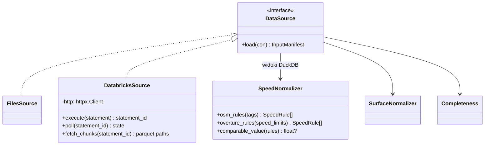
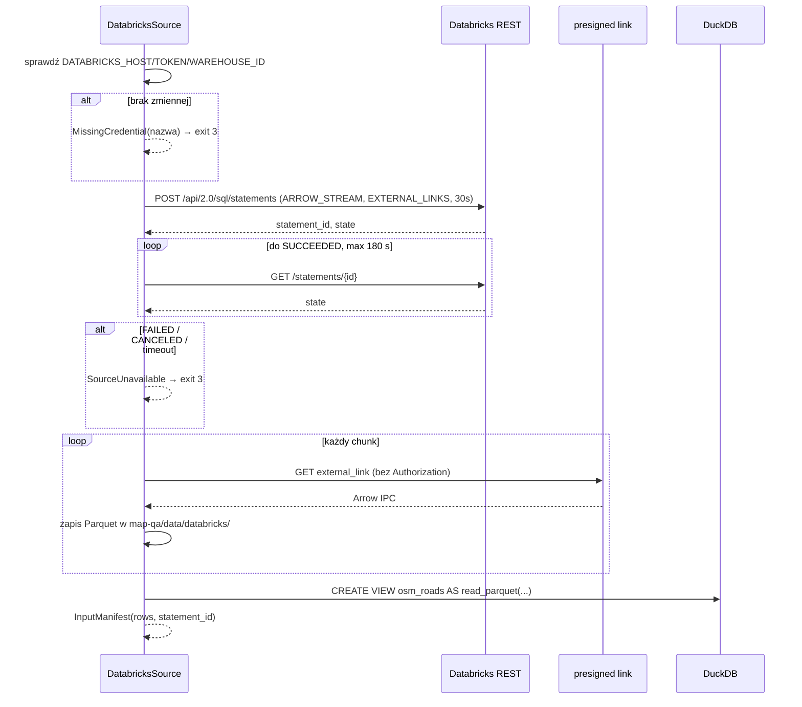

# ADR-001: Źródła danych i normalizacja atrybutów

**Data:** 2026-11-03
**Status:** Accepted
**Dotyczy:** [000-main-architecture.md](000-main-architecture.md)

---

## 1. Zakres

**Obejmuje:**
- wybór i ładowanie źródła (pliki lokalne lub Databricks);
- manifest wejść;
- normalizację OSM `maxspeed*`, `surface`, `lit` oraz Overture `speed_limits` i `road_surface`, bez utraty surowych wartości;
- tabelę kompletności.

**Nie obejmuje:**
- CRS, dystansów i dopasowań (ADR-002);
- odczytu zdjęć (ADR-003);
- raportu (ADR-004).

---

## 2. Dokumentacja

| Biblioteka / usługa | Context7 ID lub dokumentacja | Zastosowanie |
|---|---|---|
| DuckDB | `/websites/duckdb_current` | `read_parquet`, `read_csv`, `json_extract_string`, `unnest`, struktury |
| Databricks Statement Execution | `/databricks/databricks-sdk-py`; https://docs.databricks.com/aws/en/dev-tools/sql-execution-tutorial | `POST /api/2.0/sql/statements`, `GET /api/2.0/sql/statements/{id}`, chunki wyników |
| Databricks CLI | https://docs.databricks.com/aws/en/dev-tools/cli/ | Odrzucony jako transport w CLI aplikacji (D-12) |
| Databricks SQL MCP | https://docs.databricks.com/aws/en/agents/mcp-tools/databricks-sql | Opcjonalnie, tylko do eksploracji przez agenta |
| OSM `maxspeed` | https://wiki.openstreetmap.org/wiki/Key:maxspeed | Składnia wartości, jednostki, wartości implikowane `PL:*` |
| OSM conditional restrictions | https://wiki.openstreetmap.org/wiki/Conditional_restrictions | Składnia `value @ (condition)` |
| Overture transportation segment | https://docs.overturemaps.org/schema/reference/transportation/segment/ | `speed_limits`, `road_surface`, `when`, `between` |

---

## 3. Projekt komponentów

### 3.1 Kontrakt schematu (pierwszy krok implementacji)

Zanim powstanie normalizacja, test integracyjny wykonuje `DESCRIBE` na `osm_roads.parquet`, `overture_segments.parquet`, `photos.csv` i `photo_road_links.csv`. Porównuje wynik z oczekiwaną listą kolumn i typów zapisaną w `app/tests/fixtures/schema_expected.json`. Tę listę tworzymy z pierwszego rzeczywistego `DESCRIBE`, a nie z dokumentacji.

Oczekujemy co najmniej:
- **OSM:** `osm_id`, `geometry`, `highway`, `maxspeed`, `surface`, `lanes`, `lit`, `tags` (JSON string), `node_ids`, `boundary_crossing`;
- **Overture:** `id`, `geometry`, `class`, `subclass`, `speed_limits`, `road_surface`, `sources`, `connectors`, `access_restrictions`, `level_rules`, `bbox`, `version` (zgodnie z `sources.json`).

Każda rozbieżność daje `SchemaMismatch` i kod wyjścia 4.

### 3.2 Źródła danych

Interfejs `DataSource` ma metodę `load(con) -> InputManifest`. Po jej wykonaniu w połączeniu DuckDB istnieją widoki o stałych nazwach: `osm_roads`, `overture_segments`, `photos`, `photo_road_links`, `reference_labels`, `signs`, `sign_labels`, `signs_nearest_osm`.

- **`FilesSource` (domyślny):** widoki na plikach w `course-materials/exercise-data/map-qa/` (ścieżka bazowa z configu). Manifest zawiera sha256 każdego pliku, porównany z `sources.json → files`. Niezgodność hasha to ostrzeżenie w raporcie, nie błąd: dane mogły zostać świadomie odświeżone.
- **`DatabricksSource`:** materializuje tabele `workspace.map_qa.{osm_roads, overture_segments, photos, photo_road_links}` do Parquet w `course-materials/exercise-data/map-qa/data/databricks/<statement_id>/`, a potem rejestruje te same widoki. Geometria przychodzi jako WKB (`sources.json`: „BINARY WKB; construct GEOMETRY with explicit SRID 4326”) i jest konwertowana `ST_GeomFromWKB`. Etykiety referencyjne i `signs/` są zawsze lokalne, bo nie ma ich w Databricks.
- **`--compare-sources`:** ładuje oba źródła do osobnych schematów DuckDB i porównuje liczby wierszy oraz zbiory kluczy (`osm_id`, `id`, `photo_id`). Raportuje różnice. Pipeline działa dalej na źródle wybranym w configu.
- **Brak cichego fallbacku:** jeśli brakuje zmiennej `DATABRICKS_*`, CLI zwraca kod 3 i nazwę zmiennej. Jeśli żądanie zwróci błąd HTTP albo stan `FAILED`/`CANCELED`, CLI zwraca kod 3 i bezpieczny komunikat (bez tokenu).

### 3.3 Normalizacja prędkości

**Zasada nadrzędna.** Każda reguła zachowuje surowy tekst lub strukturę (`raw`). Wartość liczbowa jest polem pochodnym i nigdy nie zastępuje surowej.

**Model `SpeedRule`:**

| Pole | Znaczenie |
|---|---|
| `source` | `osm` / `overture` |
| `kind` | `numeric`, `implicit` (np. `PL:urban`), `none` (brak ograniczenia, OSM `none`), `signals`, `walk`, `variable`, `unparseable` |
| `value_kmh` | float lub NULL; wypełnione tylko dla `numeric` |
| `unit_raw` | `km/h` (domyślnie w OSM), `mph`, `knots` itp. – zachowane |
| `direction` | `both`, `forward`, `backward` (względem kolejności węzłów / geometrii) |
| `condition_raw` | tekst warunku OSM (`@ (...)`) albo JSON pola `when` Overture bez `heading`; NULL = bezwarunkowa |
| `between` | `[start, end]` jako ułamek długości segmentu Overture; NULL = cały segment |
| `raw` | pełna surowa wartość |
| `tag_key` | dla OSM: klucz źródłowy (`maxspeed`, `maxspeed:forward`, `maxspeed:conditional`, …) |

**Parsowanie OSM.** Bierzemy wszystkie klucze z JSON `tags` pasujące do `maxspeed` lub `maxspeed:*`, a nie tylko kolumnę `maxspeed`.

| Klucz / wartość | Wynik |
|---|---|
| `maxspeed=50` | `numeric`, 50 km/h, `both` |
| `maxspeed=30 mph` | `numeric`, 48,28 km/h (×1,609344, zaokrąglenie do 0,01), `unit_raw=mph` |
| `maxspeed=PL:urban`, `PL:rural`, `PL:motorway`, `PL:living_street`, `PL:zone30` itd. | `implicit`, `value_kmh=NULL`. Nie podstawiamy wartości ustawowych w MVP |
| `maxspeed=none` | `none` |
| `maxspeed=signals` / `walk` | `signals` / `walk` |
| `maxspeed=50;70` | dwie reguły `numeric` z tym samym `tag_key` |
| `maxspeed:forward` / `:backward` | `direction=forward/backward` |
| `maxspeed:conditional=30 @ (Mo-Fr 07:00-17:00)` | `numeric` 30, `condition_raw` = tekst w nawiasie; wiele warunków rozdzielonych `;` daje wiele reguł |
| `maxspeed:type`, `source:maxspeed`, `zone:maxspeed`, `maxspeed:variable` | nie tworzą reguły; trafiają do `context_tags` i do raportu |
| wartość nieparsowalna | `unparseable`, `raw` zachowane, licznik w raporcie |

**Parsowanie Overture.** Każdy element listy `speed_limits` daje jedną lub dwie reguły:
- `max_speed.value` + `max_speed.unit` → `numeric` (przeliczenie jak wyżej);
- `min_speed` trafia do `context` i nie jest porównywane w MVP;
- `is_max_speed_variable=true` → `kind=variable`;
- `when.heading` (`forward`/`backward`) → `direction`;
- pozostałe pola `when` (`during`, `mode`, `using`, `recognized`, `vehicle`) → `condition_raw` jako stabilnie posortowany JSON;
- `between` → zachowane.

Lista pusta lub NULL oznacza brak reguł (`missing_overture`). Dokładne nazwy pól potwierdza test schematu z §3.1. Jeśli rzeczywisty schemat się różni, aktualizujemy ten ADR, a nie zgadujemy.

**Wartość porównywalna.** Strona (OSM lub Overture) ma *wartość porównywalną* tylko wtedy, gdy jej reguły bezwarunkowe (`condition_raw IS NULL`) mają dokładnie jedną różną wartość `numeric`, która dotyczy całego segmentu (`between` NULL lub `[0,1]`) i obu kierunków (albo `forward` = `backward`).

Statusy dla atrybutu `speed`, liczone w ADR-002 dla pary zdjęcie–droga:

| Warunek | Status |
|---|---|
| Para ma `link_status=ambiguous` | `ambiguous_link` |
| OSM nie ma żadnej reguły | `missing_osm` (gdy brak też w Overture: `missing_osm`, a `missing_overture` liczony w kompletności) |
| Overture nie ma żadnej reguły | `missing_overture` |
| Którakolwiek strona nie ma wartości porównywalnej (implicit, warunkowe, kierunkowe różne, częściowe `between`, wiele wartości, `unparseable`) | `not_comparable` + powód |
| Obie wartości porównywalne, \|Δ\| < 0,5 km/h | `agree` |
| Obie wartości porównywalne, \|Δ\| ≥ 0,5 km/h | `disagree` |

Brak tagu nigdy nie jest równy 0 ani `none` (AC-08).

### 3.4 Normalizacja nawierzchni i oświetlenia

**Klasy nawierzchni** (`paved`, `unpaved`, `unknown_value`, `missing`). Mapowanie jest stałą w kodzie, a każda wartość spoza tabeli trafia do `unknown_value` z zachowaniem `raw`.

| Klasa | OSM `surface` | Overture `road_surface.value` |
|---|---|---|
| `paved` | `asphalt`, `concrete`, `concrete:plates`, `concrete:lanes`, `paved`, `paving_stones`, `sett`, `unhewn_cobblestone`, `cobblestone`, `bricks`, `metal`, `wood`, `chipseal` | `paved`, `paving_stones`, `metal` |
| `unpaved` | `unpaved`, `compacted`, `fine_gravel`, `gravel`, `pebblestone`, `ground`, `dirt`, `earth`, `grass`, `grass_paver`, `mud`, `sand`, `rock`, `woodchips` | `unpaved`, `gravel`, `dirt` |

`grass_paver` jest graniczny. Klasyfikujemy go jako `unpaved`, zgodnie z definicją z README danych: „Paved obejmuje asfalt, beton i kostkę”. Pełna lista wartości Overture zostanie potwierdzona testem kontraktu na `SELECT DISTINCT`, a nieznane wartości dają `unknown_value`.

Statusy dla `surface` działają analogicznie do prędkości:
- porównujemy klasy, nie surowe stringi;
- `between` częściowe → `not_comparable`;
- `unknown_value` po którejkolwiek stronie → `not_comparable`.

**`lit`.** Bierzemy tylko OSM: `yes` / `no` / inne (`automatic`, `24/7`, `sunset-sunrise` → klasa `yes_conditional`) / `missing`. Porównujemy wyłącznie z odczytem zdjęcia (ADR-003). Nie ma porównania OSM–Overture.

### 3.5 Kompletność

Jedno zapytanie SQL liczy, dla każdego atrybutu i źródła, `count`, `with_value` i `pct` w dwóch populacjach: wszystkie drogi oraz drogi połączone ze zdjęciem.

| Atrybut | Kolumny |
|---|---|
| OSM `maxspeed*` | dowolny klucz `maxspeed*` w `tags` |
| OSM `surface` | `surface` |
| OSM `lit` | `lit` |
| OSM `lanes` | `lanes`, `lanes:forward`, `lanes:backward` |
| OSM `sidewalk*` | `sidewalk`, `sidewalk:left`, `sidewalk:right`, `sidewalk:both` |
| Overture | `len(speed_limits) > 0`, `len(road_surface) > 0` |

Mianowniki są jawne w raporcie (AC-11).

---

## 4. Struktury danych

- `InputManifest`: `{source, tables: [{name, rows, sha256?, statement_id?, path?}], snapshots: {osm_extract_date, overture_release}, warnings[]}`.
- `SpeedRule`, `SurfaceValue`: §3.3 i §3.4.
- `CompletenessRow`: `{source, attribute, population (all/linked), with_value, total, pct}`.

---

## 5. Kontrakty interfejsów

### Databricks Statement Execution (REST, httpx)

- **Wykonanie:** `POST {DATABRICKS_HOST}/api/2.0/sql/statements` z body:
  - `warehouse_id`, `statement` (stałe zapytanie `SELECT … FROM workspace.map_qa.<tabela>`, bez interpolacji danych użytkownika);
  - `format=ARROW_STREAM`, `disposition=EXTERNAL_LINKS`;
  - `wait_timeout=30s`, `on_wait_timeout=CONTINUE`.
- **Polling:** `GET /api/2.0/sql/statements/{statement_id}` co 2 s, łącznie do 180 s. Polling nie jest retry: nie wysyłamy ponownie `POST`.
- **Chunki:** każdy `external_link` pobieramy **bez** nagłówka `Authorization` (to presigned URL) i zapisujemy jako Arrow IPC → Parquet. Kolejne chunki wskazuje `next_chunk_index` albo `GET …/result/chunks/{n}`.
- **Wyjście:** pliki Parquet + `statement_id` + `manifest.total_row_count` (porównywany z liczbą wczytanych wierszy).
- **Błędy:**
  - HTTP ≠ 200 → `SourceUnavailable(status)`;
  - `status.state ∈ {FAILED, CANCELED, CLOSED}` → `SourceUnavailable(state, error.message bez sekretów)`;
  - przekroczenie 180 s → próba `POST …/cancel`, potem `SourceUnavailable(timeout)`.
- **Zapis testowy:** pierwsze rzeczywiste wywołanie `SELECT … LIMIT 5` z `photos` zapisujemy jako capture (status, nagłówki bez `Authorization`, body, `captured_at`, host zamaskowany do domeny). Mock w testach integracyjnych powstaje z tego capture.

---

## 6. Decyzje techniczne

### D-11 Databricks materializowany lokalnie, jeden pipeline

**Status:** Accepted · **Data:** 2026-11-03

**Kontekst.** PRD wymaga wyboru źródła w configu i identycznego wyniku dla obu źródeł. DuckDB i Databricks SQL mają różne dialekty: JSON (`json_extract_string` kontra `get_json_object`), funkcje ST i struktury.

**Decyzja.** `DatabricksSource` pobiera całe tabele przez Statement Execution API (`ARROW_STREAM` + `EXTERNAL_LINKS`) do lokalnego Parquet w cache. Pipeline DuckDB jest jeden, a Databricks jest tylko transportem.

**Odrzucone alternatywy:**
- Obliczenia po stronie Databricks SQL (pushdown): dwie wersje zapytań w dwóch dialektach i ryzyko rozbieżności wyników, którą AC-02 i tak musiałby wykrywać.
- `INLINE` + `JSON_ARRAY`: limit 25 MiB na odpowiedź, a geometria WKB w JSON jest tekstowa i nieefektywna.

**Konsekwencje:**
- (+) Identyczna logika, parzystość weryfikowalna liczbami i zbiorami kluczy.
- (+) Uruchomienie powtórne może użyć tej samej materializacji (klucz: `statement_id` + data).
- (-) Pobranie około 25–30 MB przy pierwszym odczycie. Zapytanie może uruchomić współdzielony warehouse.

**Warunek rewizji:** tabele przekroczą 1 GB albo pojawi się wymóg zawsze świeżych danych.

### D-12 Transport Databricks: REST przez httpx, nie CLI ani SDK

**Status:** Accepted · **Data:** 2026-11-03

**Decyzja.** Bezpośredni REST (ten sam `httpx.Client` co OpenRouter). Databricks CLI zostaje narzędziem człowieka do ręcznego sprawdzenia w M2. MCP (`/ai-gateway/mcp-services/system.ai.dbsql`) jest opcjonalny wyłącznie dla agenta w eksploracji. Wspólny token z zakresem `sql` dostaje na MCP HTTP 403 (DATABRICKS.md).

**Odrzucone alternatywy:**
- Databricks CLI wywoływany przez `subprocess`: dodatkowa instalacja na VM, trudne testowanie, parsowanie stdout.
- `databricks-sdk`: wbudowane ponowienia i ciężka zależność. Do 3 endpointów wystarczy httpx.

**Konsekwencje:**
- (+) Jedna polityka timeoutów i zero retry dla wszystkich usług.
- (-) Paginację chunków utrzymujemy sami.

**Warunek rewizji:** potrzebne inne API Databricks (Volumes, Jobs).

### D-13 Surowe wartości zawsze obok znormalizowanych

**Status:** Accepted · **Data:** 2026-11-03

**Decyzja.** Normalizacja nie usuwa ani nie nadpisuje surowych pól. `results.json` i raport pokazują `raw` dla każdej reguły, a OSM `tags` pozostaje w całości dostępny dla pary. Wartości `implicit` (`PL:urban`) nie są zamieniane na liczby w MVP.

**Odrzucone alternatywy:**
- Mapowanie `PL:urban → 50`: limit ustawowy zależy od pory doby i typu obszaru. To fałszywa precyzja.
- Pierwsza liczba z listy: łamie AC-07.

**Konsekwencje:** (+) Analityk widzi pełny kontekst. (-) Więcej przypadków `not_comparable`, widocznych z powodem.

**Warunek rewizji:** PRD doda tabelę wartości domyślnych z uzgodnionym źródłem prawnym.

---

## 7. Diagramy

### Komponenty

### Sekwencja: źródło Databricks

---

## 8. Strategia testów

| Scenariusz | Typ | Wejście | Oczekiwany wynik | Przypadki brzegowe |
|---|---|---|---|---|
| Kontrakt schematu | Integration | Prawdziwe pliki map-qa | `DESCRIBE` = `schema_expected.json` | Brak kolumny → `SchemaMismatch`, exit 4 |
| `maxspeed` liczbowy | Unit | `{"maxspeed":"50"}` | 1 reguła numeric 50, both | `" 50 "` ze spacjami |
| Jednostka mph | Unit | `"30 mph"` | 48,28 km/h, `unit_raw=mph` | `"30mph"` bez spacji |
| Implikowany | Unit | `"PL:urban"` | `implicit`, `value_kmh=NULL` | `"PL:zone30"` |
| Wiele wartości | Unit | `"50;70"` | 2 reguły, porównywalna = brak | – |
| Kierunkowe | Unit | `maxspeed:forward=50`, `:backward=70` | 2 reguły, `not_comparable` | `forward = backward` → porównywalne |
| Warunkowe | Unit | `maxspeed:conditional=30 @ (Mo-Fr 07:00-17:00)` + `maxspeed=50` | warunkowa zachowana; porównywalna = 50 | Kilka warunków po `;` |
| `none` / brak | Unit | `"none"`; brak klucza | `kind=none`; brak reguł → `missing_osm` | Brak ≠ 0 ≠ none |
| Overture `when`/`between` | Unit | Element z `when.heading=forward`, `between=[0,0.4]` | `direction=forward`, `between` zachowane, `not_comparable` | `between=[0,1]` → cały segment |
| Prawdziwe wiersze | Integration | 6 wierszy z `signs/nearest_osm.csv` (wybranych tak, by objąć: brak, tekst, PL:urban, kierunkowe, warunkowe, wiele wartości) połączonych z `signs/signs.csv` po `photo_id` | Reguły zgodne z ręcznie spisanym oczekiwaniem w teście | Jeśli któryś typ nie występuje, test to raportuje, nie wymyśla wiersza |
| Nawierzchnia | Unit | `asphalt`, `gravel`, `grass_paver`, `xyz` | paved, unpaved, unpaved, unknown_value | Wielkość liter |
| Kompletność | Integration | Pliki map-qa | Suma `total` = liczby wierszy z manifestu | Populacja „linked” ≤ 561 |
| Databricks brak zmiennej | Unit | env bez `DATABRICKS_TOKEN` | exit 3, komunikat zawiera nazwę zmiennej, brak raportu | – |
| Databricks z capture | Integration | respx z capture `photos LIMIT 5` | 5 wierszy, geometrie poprawne | Stan `FAILED` z capture lub z udokumentowanego body |
| Parzystość źródeł | E2E (ręczne, z tokenem) | `--compare-sources` | Liczby 99 768 / 85 405 / 561 / 561 lub lista różnic | Warehouse uśpiony → polling, nie błąd |

### Techniczne kryteria akceptacji

- **TAC-001-01:** Dla każdego wiersza OSM suma `raw` reguł odtwarza wszystkie klucze `maxspeed*` z `tags`, bez utraty żadnego klucza (test własności na całym pliku).
- **TAC-001-02:** Dla każdego segmentu Overture liczba wyprodukowanych reguł ≥ `len(speed_limits)`.
- **TAC-001-03:** Żaden status `disagree` nie powstaje, gdy którakolwiek strona ma `condition_raw`, częściowe `between` lub `kind ≠ numeric` (test na całym zbiorze).
- **TAC-001-04:** `DatabricksSource` nigdy nie wysyła drugiego `POST /statements` dla tej samej tabeli w jednym uruchomieniu (asercja respx).
