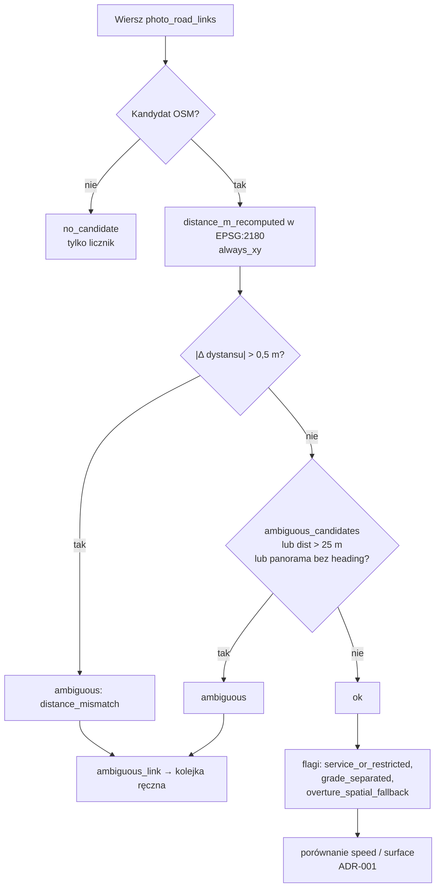
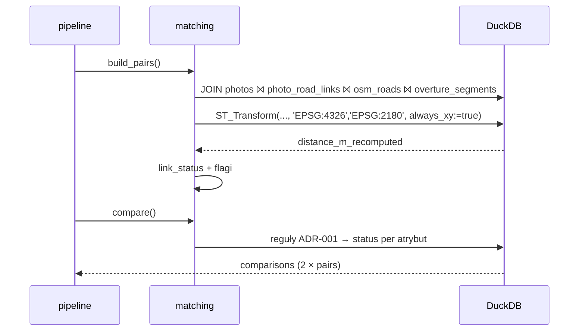

# ADR-002: CRS, metry i łączenie zdjęcia z drogą

**Data:** 2026-11-03
**Status:** Accepted
**Aktualizacja:** 2026-11-12 – rzeczywiste nazwy flag i fakty o połączeniach z [`reports/map-qa/profile.md`](../../reports/map-qa/profile.md) (§3.1, §3.4); decyzja o `poor_heading_alignment` i kolejność statusów `missing_*` (§3.4)
**Dotyczy:** [000-main-architecture.md](000-main-architecture.md)

---

## 1. Zakres

**Obejmuje:**
- transformację do EPSG:2180;
- weryfikację dystansu;
- interpretację kierunku kamery;
- obsługę remisów, alternatyw, dróg serwisowych, mostów i tuneli;
- wyznaczenie `link_status` i przypisanie statusów porównania (reguły wartości z ADR-001 §3.3–3.4).

**Nie obejmuje:**
- własnego map-matchingu (poza zakresem PRD §7);
- topologii `node_ids`/`connectors`.

---

## 2. Dokumentacja

| Biblioteka | Context7 ID lub dokumentacja | Zastosowanie |
|---|---|---|
| DuckDB spatial | `/websites/duckdb_current` (`ST_Transform`, `always_xy`) | Transformacja i dystans |
| pyproj | https://pyproj4.github.io/pyproj/stable/ (`Transformer.from_crs(..., always_xy=True)`) | Wyrocznia w testach |
| GeoPandas | `/geopandas/geopandas` (`to_crs`, `sjoin_nearest(max_distance=…)`) | Wyrocznia dystansu w testach |
| EPSG:2180 | https://epsg.io/2180 | PUWG 1992, metry |

---

## 3. Projekt

### 3.1 CRS

- OSM ma EPSG:4326, Overture OGC:CRS84. W obu plikach kolejność współrzędnych to (lon, lat) (`sources.json: coordinate_order`). Profil (2026-11-12) potwierdza typy `GEOMETRY('EPSG:4326')` i `GEOMETRY('OGC:CRS84')`, zero błędnych geometrii i wszystkie 561 pozycji aparatu w bbox. W Databricks geometria jest WKB bez SRID, ale ADR-001 D-11 materializuje ją lokalnie przed tym krokiem.
- Każda transformacja w DuckDB używa `ST_Transform(geom, 'EPSG:4326', 'EPSG:2180', always_xy := true)`. Bez `always_xy` DuckDB traktuje EPSG:4326 jako (lat, lon), co da błędny wynik bez komunikatu.
- Pozycję aparatu z `photos.csv` budujemy jako punkt (lon, lat) i transformujemy tak samo.
- **Dystanse i bufory liczymy wyłącznie na geometrii w EPSG:2180.** Funkcje dystansu na stopniach są zakazane. Test-strażnik grepuje pliki `.sql` w poszukiwaniu `ST_Distance` na kolumnach bez transformacji (konwencja nazw: kolumny metryczne mają przyrostek `_2180`).

### 3.2 Para zdjęcie–droga (MVP)

Kandydatów **nie liczymy od nowa**: źródłem jest `photo_road_links.csv` (PRD §7). Dla każdego zdjęcia bierzemy wiersz kandydata i:

1. Przeliczamy dystans aparat → wybrana droga OSM w EPSG:2180 (`distance_m_recomputed`) i porównujemy z `distance_m`. Różnica > 0,5 m to flaga `distance_mismatch` (AC-09).
2. Przenosimy `bearing_diff` (0–90°, oba kierunki geometrii), `directed_bearing_diff`, `match_method` (referencja OSM z `sources.record_id` albo `spatial_fallback`), liczbę alternatyw i `candidate_flags`.
3. Wyznaczamy `link_status` (§3.4).

**Reguła rankingu źródłowego** (`sources.json`, opis dla testu charakteryzującego, nie do reimplementacji w MVP):
- `rank = distance_m + bearing_diff / 9`;
- brak kierunku dodaje 5 m;
- remis rozstrzyga mniejszy dystans, potem mniejsze `osm_id`;
- alternatywa z wynikiem w granicy 2 m daje `ambiguous_candidates`;
- promień 25 m.

Test charakteryzujący sprawdza na 10 losowych (seed 42) zdjęciach z alternatywami, że wybrany kandydat ma minimalny `rank`. Niezgodność nie zmienia pipeline'u, ale jest raportowana jako problem danych wejściowych.

### 3.3 Kierunek kamery

- `heading = 0.0` oznacza północ, a nie brak. Brak to pusta wartość lub NULL i nie zamieniamy go na 0.
- Różnicę kątów liczymy na okręgu: `d = |a − b| mod 360`, potem `min(d, 360 − d)`. Dla 359° i 1° wynik to 2°.
- Dla nieskierowanej geometrii drogi: `min(d, 180 − d)` → zakres 0–90°, zgodnie z `bearing_diff`.
- Kierunek kamery **nie jest** kierunkiem jazdy. `camera_against_way_direction` i `oneway=-1` są tylko informacją w raporcie i nie wpływają na status.
- Panorama (`is_panorama`, heurystyka proporcji > 2,5) nie ma jednego kierunku. Takie zdjęcie dostaje flagę `panorama`.

### 3.4 Status połączenia (`link_status`)

| Warunek (dowolny) | `link_status` | Skutek |
|---|---|---|
| Brak kandydata OSM | `no_candidate` | Para nie powstaje. Zdjęcie liczone w kompletności „bez kandydata”, nie trafia do kolejki ręcznej (brak dopasowania to stan danych, nie błąd mapy) |
| `ambiguous_candidates` w `candidate_flags` | `ambiguous` | Wszystkie porównania pary = `ambiguous_link`, kolejka ręczna |
| `distance_m > 25` (kandydat awaryjny) | `ambiguous` | jw. |
| `distance_mismatch` (§3.2) | `ambiguous` | jw., powód `distance_mismatch` |
| `panorama` przy braku kierunku | `ambiguous` | jw. |
| Droga `service` lub `access`/`motor_vehicle` ∈ {`private`, `no`, `destination`} | `ok` + flaga `service_or_restricted` | Porównanie wykonywane, flaga widoczna w raporcie |
| `bridge`, `tunnel` lub `layer ≠ 0` w tagach OSM, albo `level_rules` w Overture | `ok` + flaga `grade_separated` | jw. Kadr może pokazywać inny poziom |
| Overture dopasowane przez `spatial_fallback` | `ok` + flaga `overture_spatial_fallback` | Porównanie OSM–Overture wykonywane, oznaczone jako słabsze |
| Brak kandydata Overture | `ok` | Status `missing_overture`, z powodem `no_overture_candidate`, chyba że wcześniejsza reguła z kolejności ADR-001 §3.3 dała już `missing_osm` |
| Pozostałe | `ok` | – |

**Uwaga do implementacji.** Dokładne nazwy flag w `candidate_flags` (separator, pisownia) potwierdza test kontraktu na rzeczywistym `photo_road_links.csv` (`SELECT DISTINCT` po rozbiciu). Tabela powyżej zostanie zaktualizowana do rzeczywistych nazw przed implementacją reguł.

**Rzeczywiste flagi (profil 2026-11-12, `profile.md` §7).** Separator to `;`. Wartości i ich mapowanie na tabelę powyżej:

| Flaga w danych | Zdjęcia | Mapowanie |
|---|---:|---|
| `ambiguous_candidates` | 65 | `ambiguous` (bez zmian) |
| `camera_against_way_direction` | 35 | tylko informacja (§3.3) |
| `panorama_heading_ambiguous` | 31 | odpowiednik `panorama`; `ambiguous` tylko przy braku kierunku |
| `poor_heading_alignment` | 27 | tylko informacja; `link_status` bez zmian (decyzja 2026-11-12: kandydata wybrano po dystansie, a kierunek kamery nie jest kierunkiem jazdy, §3.3) |
| `boundary_crossing` | 27 | tylko informacja |
| `missing_heading` | 15 | tylko informacja; w połączeniu z panoramą → `ambiguous` |
| `service_way` | 14 | odpowiednik `service_or_restricted` |
| `no_osm_within_25m` | 3 | `no_candidate` (`match_method=none`) |
| `overture_spatial_only` | 1 | odpowiednik `overture_spatial_fallback` |

**Inne fakty z profilu:**

- **Dystanse.** Maksymalny `distance_m` to 22,17 m, mediana 2,43 m. W snapshocie nie ma kandydatów spoza 25 m, a reguła `distance_m > 25` pozostaje zabezpieczeniem na nowy snapshot.
- **Kandydaci.** 558 zdjęć ma kandydata OSM i Overture. `match_method`: `osm_source_reference` 557, `spatial_fallback` 1, `none` 3.
- **Podejrzane metadane.** 3 zdjęcia Panoramax mają identyczną pozycję i czas `2021-11-27 12:00:00` oraz brak kierunku (`profile.md` §6). Dostają flagę `suspect_position`. Ich `link_status` wynika z reguł powyżej, a flaga jest widoczna w raporcie.
- **Skupienie zdjęć.** Zdjęcia nie są niezależną próbą sieci: 112 dróg ma więcej niż jedno zdjęcie, a najwięcej 55. Raport liczy statusy zarówno per zdjęcie, jak i per droga (`osm_way_id`). Pola dla raportu są w ADR-004 §4.

### 3.5 Przypisanie statusów porównania

Dla pary z `link_status=ok` i każdego atrybutu (`speed`, `surface`) stosujemy reguły z ADR-001 §3.3 i §3.4 na regułach drogi OSM (`osm_way_id`) i segmentu Overture (`overture_id`). Każda para ma dla każdego atrybutu **dokładnie jeden** status (AC-06).

---

## 4. Struktury danych

`PhotoRoadPair`:

| Pole | Opis |
|---|---|
| `photo_id`, `osm_way_id`, `overture_id` | identyfikatory |
| `distance_m`, `distance_m_recomputed` | metry |
| `bearing_diff`, `directed_bearing_diff`, `heading` | stopnie (heading może być NULL) |
| `match_method`, `candidate_flags[]` | z wejścia |
| `link_status` | `ok`, `ambiguous`, `no_candidate` |
| `flags[]` | flagi wyznaczone w §3.4 |
| `reasons[]` | powody `ambiguous` |

---

## 5. Kontrakty interfejsów

- `matching.build_pairs(con) -> relation pairs`: widok DuckDB `pairs` z kolumnami jak w §4.
- `matching.compare(con) -> relation comparisons`: `pairs × {speed, surface}` → `(photo_id, attribute, status, reason)`.
- Inwarianty:
  - `count(comparisons) = 2 × count(pairs)`;
  - każdy `status` należy do zbioru dozwolonych.

---

## 6. Decyzje techniczne

### D-21 Kandydaci z `photo_road_links.csv`, weryfikacja zamiast reimplementacji

**Status:** Accepted · **Data:** 2026-11-03

**Kontekst.** PRD wyłącza własny map-matching z MVP. Dostarczone połączenia to kandydaci, a nie prawda.

**Decyzja.** Używamy kandydatów z pliku, przeliczamy dystans w EPSG:2180 jako kontrolę i oznaczamy niepewność flagami.

**Odrzucone alternatywy:**
- Własny `ST_DWithin` + ranking w DuckDB: więcej kodu i ryzyko innych wyników niż wejście. Odłożone na etap po MVP.
- `sjoin_nearest` w GeoPandas: ignoruje kierunek i remisy.

**Konsekwencje:**
- (+) Mały, testowalny zakres.
- (-) Jakość zależy od wejścia. Raport musi to mówić.

**Warunek rewizji:** nowy snapshot danych bez aktualnego `photo_road_links` albo PRD z własnym dopasowaniem.

### D-22 Niepewne połączenie wyklucza wnioski, nie dane

**Status:** Accepted · **Data:** 2026-11-03

**Decyzja.**
- Para `ambiguous` nie dostaje statusów `agree` ani `disagree`, tylko `ambiguous_link`. Trafia do kolejki ręcznej, a liczniki pokazują ją osobno.
- Drogi serwisowe i warstwy nie są wykluczane, tylko flagowane, bo analityk może chcieć je zobaczyć.

**Odrzucone alternatywy:**
- Usuwanie niepewnych par: łamie PRD (nic nie znika po cichu).
- Traktowanie flag serwisowych jako `ambiguous`: zawyża kolejkę.

**Warunek rewizji:** kolejka ręczna przekroczy 50% par.

---

## 7. Diagramy

### Decyzja o statusie połączenia

### Sekwencja

---

## 8. Strategia testów

| Scenariusz | Typ | Wejście | Oczekiwany wynik | Przypadki brzegowe |
|---|---|---|---|---|
| Kolejność osi | Unit/Integration | Punkt Rynek Główny (19.9372, 50.0617) | X/Y w EPSG:2180 zgodne z pyproj `always_xy=True` do 0,01 m | Bez `always_xy` test strażnik wykrywa zamianę osi (wynik poza Polską) |
| Znany dystans | Integration | Dwa punkty 100,00 m od siebie (wygenerowane w EPSG:2180, odwrócone do 4326) | 100,00 ± 0,01 m | – |
| Spot-check AC-09 | Integration | 3 losowe pary (seed 42) z prawdziwych danych | \|recomputed − distance_m\| ≤ 0,5 m | Para przekraczająca → `distance_mismatch` |
| Różnica kątów | Unit | (359, 1), (0, 180), (90, 270), (10, NULL) | 2; 0 (nieskierowane); 0; NULL i flaga | heading 0.0 ≠ NULL |
| Remis | Unit | Dwie alternatywy o równym `rank` | Wybór mniejszego dystansu, potem `osm_id` (charakteryzacja) | Różnica < 2 m → ambiguous |
| Odwrotna geometria / `oneway=-1` | Unit | Droga z odwróconymi węzłami | `bearing_diff` bez zmian, status niezależny od kierunku | `directed_bearing_diff` się zmienia |
| Serwisowa / access | Integration | Wiersz z `highway=service`, `access=private` | `ok` + `service_or_restricted` | `motor_vehicle=destination` |
| Most / tunel | Unit | `bridge=yes`, `layer=1` | `ok` + `grade_separated` | `layer=0` bez flagi |
| Brak Overture | Unit | `overture_id` NULL | `missing_overture` dla obu atrybutów, powód | – |
| Inwariant | Integration | Pełne dane | `count(comparisons) = 2 × count(pairs)`, każdy status z listy | – |

### Techniczne kryteria akceptacji

- **TAC-002-01:** Żadne zapytanie `.sql` nie wywołuje funkcji dystansu na kolumnie bez przyrostka `_2180` (test statyczny).
- **TAC-002-02:** Dla 100% par `link_status ∈ {ok, ambiguous}` i para `ambiguous` nigdy nie ma statusu `agree`/`disagree`.
- **TAC-002-03:** Mediana `|distance_m_recomputed − distance_m|` na pełnych danych < 0,05 m (sanity check zgodności z przygotowaniem danych).
