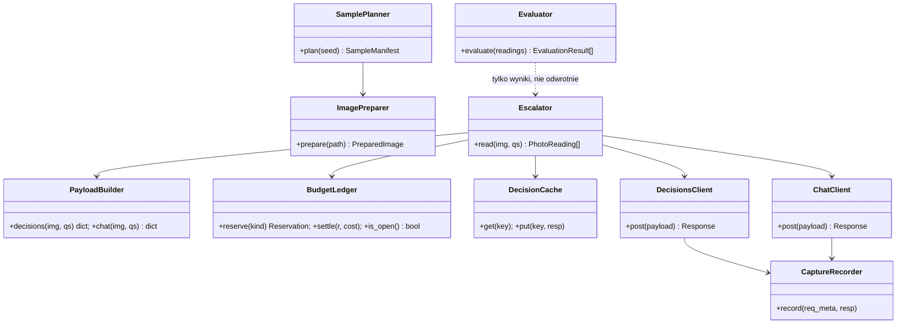
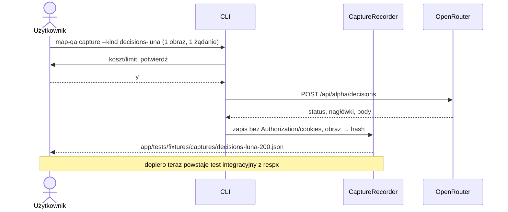

# ADR-003: Odczyt zdjęć – model decyzyjny, eskalacja, budżet i cache

**Data:** 2026-11-03
**Status:** Accepted
**Aktualizacja:** 2026-11-12 – spójność dokumentów: cache tier 2 per pytanie i skutki zmiany progów (§5.4, §5.6), nazwy progów (§5.7), koszt w najgorszym przypadku (§5.5), jeden schemat capture (§5.8), wartości B-33 5/15/25 km/h (§4.1; `qs-v1` nie było jeszcze użyte, więc wersja bez zmian); dostęp wyłącznie przez OpenRouter (§1), ceny i kontekst modeli decyzyjnych (§2, §9)
**Dotyczy:** [000-main-architecture.md](000-main-architecture.md), PRD §4.2, §11

---

## 1. Zakres

**Dostęp do modeli (potwierdzone przez użytkownika 2026-11-12).** Wszystkie trzy modele (`openai/gpt-6-luna-decisions`, `typesafe/jev-1.14`, `openai/gpt-6-luna`) wywołujemy **wyłącznie przez API OpenRouter**:
- `POST https://openrouter.ai/api/alpha/decisions` dla modeli decyzyjnych;
- `POST https://openrouter.ai/api/v1/chat/completions` dla tier 2.

Nie używamy bezpośrednich API dostawców (OpenAI, TypeSafe) ani ich SDK (ADR-000 D-03). Klucz pochodzi wyłącznie ze zmiennej `OPENROUTER_API_KEY`, ustawionej na poziomie użytkownika systemu. Aplikacja nie czyta `.env` (PRD §8, ADR-000 §7).

**Obejmuje:**
- próbkę obrazów i przygotowanie obrazu;
- kontrakt pytań i odpowiedzi tier 1 (OpenRouter Decisions) i tier 2 (OpenRouter Chat Completions);
- progi abstencji, timeout, limity żądań i kosztu, ledger, cache, capture;
- brak automatycznych ponowień;
- ewaluację względem etykiet;
- porównanie Luna i Jev na 5 obrazach.

**Nie obejmuje:**
- porównania odczytu z mapą (ADR-001/002 dostarczają wartości mapy, raport je zestawia);
- interfejsu użytkownika.

---

## 2. Dokumentacja

| Usługa | Context7 ID lub dokumentacja | Zastosowanie |
|---|---|---|
| OpenRouter Decisions API | `/websites/openrouter_ai`; https://openrouter.ai/docs/api/api-reference/alphadecisions/submit-a-decisions-request | Kontrakt `POST /api/alpha/decisions` |
| Decisions z obrazami | https://openrouter.ai/docs/guides/community/multimodal-decisions | `state` z `image_url` (data URL), limity obrazów |
| Jev | https://openrouter.ai/docs/guides/community/jev | Wymagania obrazów Jev, typy pytań |
| Chat Completions + structured outputs | https://openrouter.ai/docs/guides/features/structured-outputs ; https://openrouter.ai/docs/api/api-reference/chat/create-a-chat-completion | Tier 2: `response_format=json_schema` (`strict`), `reasoning.effort=medium` |
| OpenRouter Python SDK (nieużywany) | `/openrouterteam/python-sdk` | Uzasadnienie D-03 w ADR-000 |
| respx | https://lundberg.github.io/respx/ | Odtwarzanie capture w testach |
| Pillow 12.0.0 | https://pillow.readthedocs.io/ | `ImageOps.exif_transpose`, skalowanie |

### Zweryfikowane fakty (dokumentacja z 2026-11-03)

- Endpoint: `POST https://openrouter.ai/api/alpha/decisions`. Body: `model`, `state`, `questions`.
- `state` to tablica: tekst jako zwykłe stringi, obraz jako `{"type":"image_url","image_url":{"url":"data:image/jpeg;base64,…"}}`. Zdalne URL nie są pobierane. Pole `images` na najwyższym poziomie daje 400.
- Typy pytań: `choice` (zwraca `choice`, `probabilities`, `confidence`), `noul` (prawdopodobieństwo „tak”), `score`, `box` (tylko Jev 1.14).
- Odpowiedź: `answers`, `usage` (`input_tokens`, `output_tokens`, `cost`), `id`, `model`, `provider`.
- Błędy: 400, 401, 402, 403, 404, 413, 429, 500, 502, 503, 524 (timeout), 529 (provider).
- **GPT-6 Luna Decisions:** do 128 obrazów w żądaniu, bez podanego limitu rozmiaru.
- **Jev 1.13/1.14:** tylko PNG/JPEG; 256–1568 px na bok; 78 400–2 458 624 px łącznie; 16 MiB na plik; 32 MiB body; brak obrotu EXIF. Żądania z obrazem idą w trybie long-context, który TypeSafe opisuje jako wolniejszy i mniej dokładny. Prawdopodobieństwa różnią się między modelami, więc progi ustawia się osobno dla każdego modelu.
- **Ceny i kontekst (podane przez użytkownika 2026-11-12 ze stron modeli OpenRouter):**

  | Model (OpenRouter ID) | Rola | Wejście | Cena in / out za 1M tokenów | Kontekst | Strona |
  |---|---|---|---|---|---|
  | `openai/gpt-6-luna-decisions` | tier 1, model decyzyjny | tekst + obraz | $0.10 / $0 | 1,1M | https://openrouter.ai/openai/gpt-6-luna-decisions |
  | `typesafe/jev-1.14` | model decyzyjny porównawczy (5 obrazów) | tekst + obraz | $0.042 / $0 | 262K | https://openrouter.ai/typesafe/jev-1.14 |
  | `openai/gpt-6-luna` | tier 2, ogólny LLM (chat) | tekst + obraz (do potwierdzenia pierwszym wywołaniem) | – (do pomiaru z `usage.cost`) | – | – |

  Próba pobrania katalogu `GET /api/v1/models` w tej sesji nie doszła do skutku: odmowa uprawnień narzędzia, nie błąd API. Ceny pochodzą więc od użytkownika. Funkcje `openai/gpt-6-luna` (obraz, `json_schema`, `reasoning`) potwierdzają pierwsze rzeczywiste wywołania w T43.
- **Nieznane:** opóźnienia wszystkich trzech modeli, liczba tokenów, którą OpenRouter nalicza za obraz, i koszt tier 2. Uzupełnimy je z `usage` i pomiaru czasu w pierwszych rzeczywistych wywołaniach (§9).

---

## 3. Projekt komponentów

| Komponent | Odpowiedzialność |
|---|---|
| `SamplePlanner` | Deterministyczny wybór próbki (seed 42) i zapis `sample_manifest.json` przed jakimkolwiek wywołaniem |
| `ImagePreparer` | Odczyt bajtów, `exif_transpose`, normalizacja rozmiaru, zapis JPEG (quality 92, Pillow 12.0.0), `image_sha256` przygotowanego obrazu |
| `PayloadBuilder` | Buduje `state` i `questions` wyłącznie z neutralnego tekstu i obrazu (allowlista) |
| `BudgetLedger` | Limity, rezerwacja przed wywołaniem, rozliczenie po, trwały `ledger.jsonl`, circuit breaker |
| `DecisionCache` | Klucz → zapisana odpowiedź. Odczyt przed budżetem: hit nie zużywa limitu |
| `DecisionsClient` | Surowe POST httpx do Decisions (tier 1 i model porównawczy) |
| `ChatClient` | Surowe POST httpx do Chat Completions (tier 2) |
| `Escalator` | Logika tier 1 → tier 2 → abstain/model_unavailable |
| `CaptureRecorder` | Zapis bezpiecznego capture przy pierwszym żądaniu danego typu, gdy fixture nie istnieje |
| `Evaluator` | Jedyny komponent czytający `reference_labels.csv` i `signs/labels.csv`. Liczy metryki |

### 3.1 Próbka (AC-14, AC-15)

- **15 zdjęć ulic:** z `reference_labels.csv`, wśród zdjęć Panoramax z etykietą `certain` dla co najmniej jednego z pytań `surface`, `junction_visible`, `street_lighting_visible`. Losowanie warstwowe po `sequence` (maks. 2 zdjęcia z jednej sekwencji), seed 42.
  - **Źródło obrazu:** `offline/` (40 miniatur) albo `data/photos/` po `download_photos.py`. Zdjęcie bez pliku na dysku jest pomijane z licznikiem `image_missing`, a w jego miejsce wchodzi kolejne z losowania.
- **10 wycinków znaków:** z `signs/crops/`, w proporcji 6 pozytywów B-33 i 4 trudne negatywy (inne znaki zakazu, koniec ograniczenia, strefa, brak znaku), według `signs/labels.csv`, tylko `certain`. Dobór warstwowy po `sequence`, seed 42.
  - Evaluator czyta etykiety, żeby wylosować warstwy, ale nie przekazuje ich dalej. `sample_manifest.json` zawiera wyłącznie identyfikatory i ścieżki.
- **Podzbiór porównawczy:** pierwsze 5 obrazów z manifestu w ustalonej kolejności (3 zdjęcia ulic + 2 wycinki). Trafia zarówno do Luna, jak i do Jev.

### 3.2 Przygotowanie obrazu

Jeden przygotowany obraz na plik, używany przez **wszystkie** modele, żeby porównanie było sprawiedliwe:

1. `exif_transpose` (Jev nie obraca według EXIF).
2. Gdy krótszy bok < 256 px **albo obraz ma < 78 400 px**, powiększenie Lanczos tak, by spełnić oba warunki (doprecyzowane przy implementacji T40, 2026-11-12: samo 256 px dawało dla prawie kwadratowych wycinków np. 256×299 = 76 544 px i odrzucało 99 ze 119 wycinków). Gdy dłuższy bok > 1568 px, zmniejszenie do 1568 px. Proporcje zachowane. Jeśli po skalowaniu suma pikseli wypada poza 78 400–2 458 624, obraz jest odrzucany z powodem `image_out_of_bounds` i trafia do `not_run`.
3. Zapis JPEG, quality 92, bez metadanych EXIF (usuwa też ewentualne GPS z pliku).
4. `image_sha256` liczony z przygotowanych bajtów. Przygotowany plik trafia do cache.

Bajty obrazu i base64 nigdy nie są logowane. Payload jest budowany w pamięci.

---

## 4. Struktury danych

### 4.1 Pytania (`question_set_version = "qs-v1"`)

Pytania są po angielsku, neutralne i stałe. Każda zmiana treści podnosi wersję i unieważnia cache. Kryteria pochodzą z definicji w README danych.

| ID | Dotyczy | Typ Decisions | Instrukcja | Opcje (`criteria`) |
|---|---|---|---|---|
| `surface` | zdjęcie ulicy | `choice` | "What is the surface of the main road visible in the photo?" | `paved`: asphalt, concrete or paving stones/sett; `unpaved`: gravel, dirt, grass, sand or compacted earth; `unknown`: the road surface is not visible or cannot be determined |
| `junction_visible` | zdjęcie ulicy | `choice` | "Is a junction of roads for vehicles visible in the photo?" | `yes`: two or more roads for vehicles visibly join or split; `no`: no such junction is visible (a pedestrian crossing or an overpass alone is not a junction); `unknown`: cannot be determined |
| `street_lighting_visible` | zdjęcie ulicy | `choice` | "Is a street lamp fitting visible in the photo?" | `yes`: a recognizable street lamp fitting is visible; `no`: no street lamp fitting is visible (a utility pole alone does not count); `unknown`: cannot be determined |
| `speed_limit_value` | wycinek znaku | `choice` | "What maximum speed value is shown on a round speed limit sign with a red border (Polish B-33) in the image?" | `5`, `10`, `15`, `20`, `25`, `30`, `40`, `50`, `60`, `70`, `80`, `90`, `100`, `110`, `120`, `130`, `140`: the value on a B-33 sign; `none`: no B-33 sign is visible (zone signs, end-of-limit signs and other signs count as none); `unreadable`: a B-33 sign is visible but its value cannot be read |

Jeden request = jeden obraz + wszystkie pytania dla jego typu. Zdjęcie ulicy ma 3 pytania, wycinek 1.

### 4.2 Decyzja (`PhotoReading.decision`)

| Wartość | Kiedy |
|---|---|
| `answered` | Tier 1: `max(probabilities) ≥ T1` i wybór ≠ `unknown` |
| `answered_tier2` | Tier 2: odpowiedź ≠ `unknown` i `certainty = high` |
| `abstain` | Tier 2 zwrócił `unknown` albo `certainty ∈ {medium, low}` |
| `model_unavailable` | Błąd HTTP, timeout, błąd walidacji odpowiedzi na dowolnym poziomie dla tego pytania |
| `not_run_budget_or_error` | Limit wyczerpany, circuit breaker otwarty albo obraz odrzucony przy przygotowaniu |

Dla wycinka znaku `none` i `unreadable` to **odpowiedzi**, a nie abstencje (AC-20). `unknown` jako odpowiedź modelu zawsze eskaluje do tier 2.

---

## 5. Kontrakty interfejsów

### 5.1 Tier 1 – żądanie Decisions

- `POST https://openrouter.ai/api/alpha/decisions`
- Nagłówki: `Authorization: Bearer <OPENROUTER_API_KEY>` (wartość nigdy nie jest logowana), `Content-Type: application/json`.
- Body:
  - `model`: `openai/gpt-6-luna-decisions` (tier 1), `typesafe/jev-1.14` (porównanie, tylko 5 obrazów);
  - `state`: **dokładnie** dwa elementy: neutralny tekst `"A photograph taken from a street-level camera."` (wycinek: `"A cropped image from a street-level photograph."`) oraz część `image_url` z data URL `image/jpeg`;
  - `questions`: mapa pytań z §4.1 dla typu obrazu.
- Zakazane w `state`, `questions` i nagłówkach: `photo_id`, nazwy plików, ścieżki, etykiety, `mapillary_value`, detekcje, atrybuty OSM/Overture, współrzędne, daty, autor. Wymusza to allowlista w `PayloadBuilder` i test AC-12.
- Opcjonalne pola API (`provider`, `session_id`, `trace`, `user`, `assets`) **nie są wysyłane**.

### 5.2 Tier 1 – odpowiedź

- Walidacja Pydantic:
  - `answers` zawiera **każde** wysłane pytanie;
  - `type == "choice"`;
  - `choice` ∈ opcje;
  - `probabilities` ma **wszystkie** opcje, każda w [0,1], a suma w [0,99; 1,01];
  - `usage.cost` liczba ≥ 0 albo brak.
- Niezgodność → `model_unavailable` (powód `invalid_response`). Body trafia do capture błędu.
- Pewność = `max(probabilities)`, a nie pole `confidence`. Pole `confidence` jest zapisywane, ale nie używane do decyzji.

### 5.3 Błędy (oba poziomy)

| Sytuacja | Zachowanie |
|---|---|
| HTTP 400/413 | `model_unavailable`, circuit breaker OPEN (błąd kontraktu: dalsze wywołania nie mają sensu) |
| 401/402/403 | `model_unavailable`, OPEN, komunikat o kluczu lub kredytach bez wartości klucza |
| 429/5xx/524/529 | `model_unavailable`, OPEN, **bez ponowienia** |
| Timeout 40 s (connect+read+write+pool) | jw., ledger rozlicza pełną rezerwację |
| Błąd sieci | jw. |

Po OPEN pozostałe elementy dostają `not_run_budget_or_error`. Pipeline kończy raport (AC-17).

### 5.4 Tier 2 – Chat Completions

- `POST https://openrouter.ai/api/v1/chat/completions`.
- Model: z configu `tier2_model`, domyślnie `openai/gpt-6-luna`. **Przed pierwszym płatnym uruchomieniem ID musi zostać potwierdzone w katalogu modeli razem z obsługą obrazów, `structured_outputs` i `reasoning`** (otwarta kwestia w ADR-000 §11).
- `reasoning: {"effort": "medium"}`. Pole `reasoning_effort` nie jest wysyłane równolegle.
- `messages`: jedna wiadomość `user` z dwiema częściami: tekst (pytania niepewne z §4.1, ich opcje i definicje, prośba o wybór jednej opcji i ocenę pewności) oraz `image_url` z tym samym przygotowanym obrazem. Tier 2 nie dostaje odpowiedzi ani prawdopodobieństw tier 1, żeby nie zakotwiczać.
- `response_format`: `json_schema`, `strict: true`. Schemat ma obiekt z kluczem na każde pytanie, wartość `{answer: enum(opcje), certainty: enum(high, medium, low)}` i `additionalProperties: false`.
- Walidacja: JSON parsowalny, zgodny ze schematem i z opcjami. Niezgodność → `model_unavailable` (`invalid_response`).
- Tier 2 wysyłamy **raz na obraz**, ze wszystkimi pytaniami, które w tier 1 były niepewne i nie mają jeszcze odpowiedzi tier 2 w cache (§5.6). Odpowiedź dzielimy i zapisujemy w cache osobno dla każdego pytania.

### 5.5 Budżet i ledger (AC-13)

- Limity z configu (domyślne):
  - `max_images = 25`;
  - `max_requests = 100` (tier 1 + tier 2 + porównanie, łącznie z błędami);
  - `max_cost_usd = 1.00`.
- Rezerwacja przed każdym wywołaniem: `reserve_usd_tier1 = 0.02`, `reserve_usd_tier2 = 0.04`, `reserve_usd_compare = 0.02` (konserwatywne, konfigurowalne). Wywołanie dochodzi do skutku tylko wtedy, gdy `requests_used + 1 ≤ max_requests` i `spent + reserved_open + reserve ≤ max_cost_usd`.
- Po odpowiedzi: `actual_usd = usage.cost`, gdy jest liczbą. W przeciwnym razie zostaje pełna rezerwacja. Błąd i timeout: pełna rezerwacja.
- `ledger.jsonl` (append-only, `course-materials/exercise-data/map-qa/data/ledger.jsonl`) jest sumowany przy starcie **per `run_id`**. Limity dotyczą uruchomienia, a raport pokazuje też sumę historyczną.
- Oczekiwane zużycie domyślnej próbki: 25 (tier 1) + 5 (Jev) + ≤ 25 (tier 2) = maks. 55 żądań.
- **Koszt w najgorszym przypadku (dopisane 2026-11-12).** Gdyby każde wywołanie rozliczało pełną rezerwację, wyszłoby 25 × 0,02 + 5 × 0,02 + 25 × 0,04 = **1,60 USD**, więcej niż limit 1,00 USD. Limit może więc zatrzymać próbkę (`not_run_budget_or_error`), zanim przejdzie całą. Po pomiarze kosztu w T43 (§9) rezerwacje ustawiamy na zmierzony koszt z zapasem, a oczekiwany koszt próbki wpisujemy tutaj przed płatnym uruchomieniem.

### 5.6 Cache (AC-18, PRD §4.4)

- Klucz (doprecyzowane 2026-11-12):
  - tier 1 i model porównawczy: `sha256(image_sha256 | model | question_set_version | tier | sorted(question_ids))`. Zbiór pytań zależy tylko od typu obrazu, więc jest stały;
  - tier 2: **osobny wpis dla każdego pytania**, `sha256(image_sha256 | model | question_set_version | tier2 | question_id)`. Zbiór pytań w żądaniu tier 2 zależy od progu T1, więc klucz od zbioru psułby trafienia w cache po zmianie progu.
- Lokalizacja: `course-materials/exercise-data/map-qa/data/cache/decisions/<klucz>.json`. Zawartość: odpowiedź (body), `captured_at`, `model` zwrócony, koszt, czas. **Bez** base64 i bez nagłówków żądania.
- Cache jest sprawdzany **przed** budżetem. Hit nie zużywa limitu i nie wymaga potwierdzenia.
- Błędy nie są cache'owane. Kolejne uruchomienie, po świadomej decyzji użytkownika i w ramach budżetu, może spróbować ponownie.
- Zmiana progów przelicza decyzje z cache bez sieci, o ile wszystkie potrzebne odpowiedzi są w cache. Dotyczy to obniżenia T1 i każdej zmiany `tier2_accept`. **Podniesienie T1** może sprawić, że pytanie, które wcześniej nie trafiło do tier 2, teraz tam trafi. Takie pytania CLI wylicza przed uruchomieniem jako „wymagające nowych wywołań”. Wywołania podlegają potwierdzeniu i budżetowi, a raport podaje ich liczbę (PRD §4.4).

### 5.7 Progi (AC-16)

- `t1_threshold = 0.80` dla Luna, `t1_threshold_compare = 0.80` dla Jev (osobny parametr, bo prawdopodobieństwa różnych modeli nie są porównywalne; nazwy kluczy zgodne z ADR-004 §3.2).
- Tier 2 akceptuje tylko `certainty = high`.
- Wartości są w configu, zapisywane w `run_manifest.json` i raporcie, i zamrażane w momencie potwierdzenia płatnego uruchomienia. Zmiana progu po pomiarze to nowe uruchomienie z cache, opisane w raporcie jako analiza po fakcie.

### 5.8 Capture (mock tylko z rzeczywistej odpowiedzi)

Dla każdego typu interakcji (Decisions Luna, Decisions Jev, Chat tier 2, każdy zaobserwowany błąd):

1. Pierwsze **rzeczywiste** żądanie (wliczone do budżetu) wykonujemy przed napisaniem mocka.
2. `CaptureRecorder` zapisuje `app/tests/fixtures/captures/<nazwa>.json`. **Schemat capture** (jedyny obowiązujący, także dla Databricks; ADR-000 TAC-05 odwołuje się do niego):

   | Pole | Zawartość |
   |---|---|
   | `captured_at` | UTC, ISO 8601 |
   | `target` | usługa: `openrouter` / `databricks` |
   | `endpoint`, `method` | ścieżka bez hosta (host Databricks zamaskowany do domeny), metoda HTTP |
   | `model_sent`, `model_returned` | ID modelu (NULL dla Databricks) |
   | `client_version` | wersja httpx i, gdy dotyczy, wersja API/CLI usługi |
   | `request_meta` | opis żądania bez sekretów; obraz zastąpiony `{"image_sha256": …, "bytes": …}`; SQL zapytania dla Databricks |
   | `status` | kod HTTP |
   | `response_headers` | bez `set-cookie` i `authorization` |
   | `response_body` | pełne body (JSON) albo, dla danych binarnych, plik obok z `body_file` i `body_sha256` |
   | `elapsed_ms` | czas odpowiedzi |
3. Testy integracyjne odtwarzają capture przez respx. Fixture zmyślony lub przepisany z dokumentacji jest zakazany. Test meta sprawdza obecność pól z pkt 2.
4. Gdy capture nie da się uzyskać (brak klucza lub budżetu), test oznaczamy `skip` z powodem `missing_capture`, a raport etapu zgłasza brak prerekwizytu.
5. **Najpierw rzeczywiste endpointy (zasada użytkownika, 2026-11-12).** Każdy kontrakt (żądanie, dane żądania, odpowiedź, błędy) ustalamy rzeczywistymi wywołaniami przed napisaniem mocka. Ponieważ wywołania są tanie, wykonujemy ich tyle, ile trzeba, żeby poznać rzeczywistą strukturę: także warianty pytań, typy obrazów (zdjęcie i wycinek) i zaobserwowane błędy. E2E i testy ręczne nigdy nie używają mocków (ADR-000 §10).

### 5.9 Ewaluacja (AC-19)

- Tylko `Evaluator` czyta etykiety. Do metryk biorą udział wyłącznie etykiety `certain`, a `uncertain` jest liczone jako wykluczenie.
- Na pytanie, model i poziom liczymy:
  - `evaluated`, `correct`, `accuracy_all = correct/evaluated`, gdzie abstain i model_unavailable liczą się jako błędne;
  - `coverage = answered/evaluated`;
  - `selective_accuracy = correct_answered/answered`, przy `answered = 0` „nieokreślone”, nie 100%.
- Pustej etykiety nie zamieniamy na `no` ani `none`.
- **Porównanie Luna i Jev:** te same 5 obrazów i pytania, tier 1 bez eskalacji. Liczba zgodnych odpowiedzi oraz różnice w `max(probabilities)`.
- **Porównanie z mapą po odczycie:**
  - `surface` predykcji kontra klasa OSM i Overture pary;
  - `street_lighting_visible` kontra OSM `lit`;
  - `speed_limit_value` kontra surowe `maxspeed*` z `signs/nearest_osm.csv` oraz `mapillary_value` z `signs/signs.csv`.
  
  Wynik pokazujemy jako zestawienie, nie werdykt (PRD §11).

---

## 6. Decyzje techniczne

### D-31 Tier 1: GPT-6 Luna Decisions, Jev 1.14 jako porównanie

**Status:** Accepted · **Data:** 2026-11-03

**Kontekst.** Potrzebujemy zamkniętych odpowiedzi z prawdopodobieństwami dla obrazów: zdjęć ulic do 1024 px i małych wycinków znaków.

**Decyzja.** Tier 1 to `openai/gpt-6-luna-decisions` (decyzja użytkownika). `typesafe/jev-1.14` dostaje te same 5 obrazów do porównania.

**Odrzucone alternatywy:**
- Jev jako główny: obrazy w trybie long-context (według TypeSafe wolniej i mniej dokładnie), twarde limity rozmiaru wymagają powiększania wycinków. Typ `box` nie jest potrzebny w MVP.
- Jeden model bez porównania: PRD (AC-15) wymaga porównania.

**Konsekwencje:**
- (+) Brak limitu rozmiaru dla Luna, ten sam kontrakt API dla obu modeli.
- (-) Nieznana cena i opóźnienie do pierwszego capture. Progi trzeba ustawiać per model.

**Warunek rewizji:** capture pokaże koszt > 0,02 USD na żądanie albo accuracy tier 1 poniżej accuracy Jev na podzbiorze porównawczym.

### D-32 Tier 2: ogólny LLM przez Chat Completions ze schematem

**Status:** Accepted · **Data:** 2026-11-03

**Decyzja.** GPT-6 Luna (ogólny) przez `POST /api/v1/chat/completions`, z `reasoning.effort=medium` i `response_format=json_schema` (strict). Odpowiedź to zamknięta opcja + `certainty`. Tylko `high` jest akceptowane.

**Odrzucone alternatywy:**
- Natywny klient OpenAI: wykluczony przez użytkownika.
- Swobodny tekst parsowany regexem: brak gwarancji zamkniętej odpowiedzi.
- Tier 2 przez Decisions innym modelem: PRD wymaga „zwykłego modelu z rozumowaniem”.

**Konsekwencje:**
- (+) Odpowiedź walidowalna.
- (-) `certainty` to samoocena modelu, nie skalibrowane prawdopodobieństwo. Raport musi to zaznaczyć.

**Warunek rewizji:** `openai/gpt-6-luna` nie obsługuje obrazów lub `json_schema`. Wtedy wybór innego ID z katalogu i aktualizacja ADR.

### D-33 Zero automatycznych ponowień i circuit breaker po pierwszym błędzie

**Status:** Accepted · **Data:** 2026-11-03

**Decyzja.** Każda próba jest liczona. Pierwszy błąd zatrzymuje płatne wywołania w danym uruchomieniu. Ponowienie wymaga nowego uruchomienia z decyzją człowieka.

**Odrzucone alternatywy:** retry z backoff (domyślne w SDK): ukryte koszty, łamie AC-13 i AC-17.

**Konsekwencje:** (+) Przewidywalny koszt. (-) Jedno przejściowe 429 kończy pomiar. Uzupełnienie robimy kolejnym uruchomieniem z cache.

**Warunek rewizji:** budżet produkcyjny i SLA.

### D-34 Wspólny przygotowany obraz dla wszystkich modeli

**Decyzja.** Jedna transformacja: EXIF, skala 256–1568 px, JPEG q92, bez metadanych. Ten sam obraz idzie do wszystkich modeli i tierów.

**Odrzucone alternatywy:** oryginalne bajty dla Luna i przeskalowane dla Jev, przez co porównanie mierzyłoby różne wejścia.

**Konsekwencje:** (+) Uczciwe porównanie, usunięte metadane. (-) Powiększone wycinki mogą być rozmyte. Raport pokazuje oryginalny rozmiar.

---

## 7. Diagramy

### Komponenty



### Sekwencja: eskalacja jednego obrazu

```mermaid
sequenceDiagram
    participant E as Escalator
    participant C as Cache
    participant B as Ledger
    participant D as Decisions (Luna)
    participant T as Chat (GPT-6 Luna)
    E->>C: get(img, luna, qs-v1, tier1)
    alt hit
        C-->>E: odpowiedź
    else miss
        E->>B: reserve(tier1)
        alt brak budżetu / OPEN
            B-->>E: odmowa → not_run_budget_or_error
        else OK
            E->>D: POST (state = tekst + obraz)
            D-->>E: answers + usage.cost
            E->>B: settle(cost)
            E->>C: put
        end
    end
    E->>E: pytania z max(p) < T1 lub unknown
    opt są niepewne pytania
        E->>C: get(img, tier2, pytania)
        alt miss
            E->>B: reserve(tier2)
            E->>T: POST chat (json_schema, effort medium)
            T-->>E: {pytanie: answer, certainty}
            E->>B: settle
            E->>C: put
        end
        E->>E: high → answered_tier2; inaczej → abstain (kolejka)
    end
```

### Sekwencja: pierwszy capture przed mockiem



---

## 8. Strategia testów

| Scenariusz | Typ | Wejście | Oczekiwany wynik | Przypadki brzegowe |
|---|---|---|---|---|
| Brak wycieku (AC-12) | Unit | Obraz z metadanymi EXIF i ścieżką zawierającą `photo_id`; rekord z etykietą i atrybutami w kontekście | Zserializowany payload nie zawiera `photo_id`, nazwy pliku, etykiety, `mapillary_value`, `maxspeed`, współrzędnych; `state` ma dokładnie 2 elementy | EXIF GPS usunięty z bajtów obrazu |
| Walidacja odpowiedzi | Unit | Body z capture z usuniętą opcją; suma prawdopodobieństw 0,9; brak pytania | `model_unavailable/invalid_response` | `usage.cost` brak → pełna rezerwacja |
| Próg i eskalacja | Unit | `max(p)=0.79`, `0.80`, `unknown` z 0,95 | tier2, answered, tier2 | `none`/`unreadable` z 0,85 → answered |
| Tier 2 | Unit | `certainty=high/medium`, `answer=unknown` | answered_tier2 / abstain / abstain | JSON niezgodny ze schematem → model_unavailable |
| Limit żądań | Unit | `max_requests=3`, 5 obrazów, brak cache | Dokładnie 3 POST (asercja respx), 2× not_run | Błąd w 2. żądaniu → 1 sukces, 1 unavailable, 3 not_run |
| Limit kosztu | Unit | `max_cost_usd=0.05`, rezerwacja 0,02 | Maks. 2 żądania | Koszt zwrócony 0 → rezerwacja zwolniona |
| Brak retry | Integration | respx: 1. odpowiedź 429, kolejne 200 | Wykonane dokładnie 1 żądanie | 524 i timeout identycznie |
| Timeout | Unit | Transport z opóźnieniem > 40 s (zegar wstrzyknięty) | model_unavailable, OPEN | – |
| Cache | Integration | Dwa uruchomienia, respx z capture | 2. uruchomienie: 0 POST, identyczne predykcje | Zmiana `question_set_version` → miss; obniżenie T1 → 0 POST; podniesienie T1 → POST tier 2 tylko dla pytań bez wpisu w cache, wyliczonych przed potwierdzeniem |
| Przygotowanie obrazu | Unit | Wycinek 120×140 px, zdjęcie 4000×3000, PNG z EXIF rotate | 256 px krótszy bok; 1568 px dłuższy; poprawna orientacja | Obraz poza zakresem pikseli → not_run |
| Próbka | Unit | Etykiety z fixture | 15+10, maks. 2 na sekwencję, deterministyczna dla seed 42 | Brak pliku obrazu → zastępstwo + licznik |
| Ewaluacja | Unit | Predykcje + etykiety `certain`/`uncertain`/puste | Mianowniki jawne; uncertain wykluczone; puste ≠ no | `answered=0` → selective „nieokreślone” |
| Kontrakt Decisions | Integration | respx z `decisions-luna-200.json` (capture) | Parsowanie wszystkich pól zgodnie z §5.2 | Capture 4xx, jeśli zaobserwowany |
| Rzeczywisty odczyt | E2E (rzeczywiste endpointy, bez mocków, `--yes`; ADR-000 §10) | Domyślna próbka | ≤ 100 żądań, < 1 USD, raport z metrykami | Drugie uruchomienie: 0 żądań |

### Techniczne kryteria akceptacji

- **TAC-003-01:** W żadnym pliku logu, cache, capture ani raportu nie występuje fragment base64 dłuższy niż 64 znaki (test e2e skanujący wyjścia).
- **TAC-003-02:** Liczba wpisów w `ledger.jsonl` dla `run_id` = liczba faktycznych POST (respx/serwer) = licznik w raporcie.
- **TAC-003-03:** Żaden moduł poza `Evaluator` nie otwiera `reference_labels.csv` ani `signs/labels.csv` (test importów i ścieżek).
- **TAC-003-04:** Dla każdego obrazu w próbce istnieje dokładnie jeden `PhotoReading` na pytanie, z decyzją z listy §4.2.

---

## 9. Pomiary do uzupełnienia po pierwszym capture

| Model | Cennik (in / out za 1M) | Koszt na żądanie (`usage.cost`) | Tokeny wejścia na żądanie | Czas odpowiedzi | Data |
|---|---|---|---|---|---|
| `openai/gpt-6-luna-decisions` | $0.10 / $0 | do uzupełnienia | do uzupełnienia | do uzupełnienia | – |
| `typesafe/jev-1.14` | $0.042 / $0 | do uzupełnienia | do uzupełnienia | do uzupełnienia | – |
| `openai/gpt-6-luna` (tier 2) | do uzupełnienia | do uzupełnienia | do uzupełnienia | do uzupełnienia | – |

Przy tych cenach żądanie z jednym obrazem kosztuje prawdopodobnie ułamek centa (inferencja, do pomiaru). Rezerwacje z §5.5 (0,02–0,04 USD) pozostają konserwatywne do czasu pomiaru.

Jeśli zmierzony koszt przekroczy rezerwację z §5.5, rezerwację podnosimy przed kolejnym uruchomieniem.
