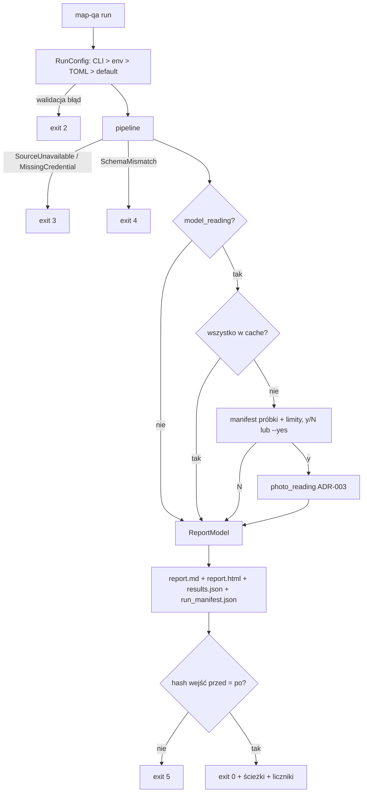

# ADR-004: CLI, konfiguracja i raport

**Data:** 2026-11-03
**Status:** Accepted
**Dotyczy:** [000-main-architecture.md](000-main-architecture.md), PRD §9

---

## 1. Zakres

**Obejmuje:**
- polecenia CLI, konfigurację (TOML + env), kody wyjścia;
- potwierdzenie płatnych wywołań;
- artefakty wyjściowe i szablony Markdown/HTML;
- miniatury, atrybucje, escapowanie.

**Nie obejmuje:** dashboardu (poza zakresem PRD).

---

## 2. Dokumentacja

| Biblioteka | Context7 ID lub dokumentacja | Zastosowanie |
|---|---|---|
| argparse | https://docs.python.org/3.12/library/argparse.html | CLI |
| tomllib | https://docs.python.org/3.12/library/tomllib.html | Odczyt configu (stdlib) |
| Jinja2 3.1.6 | https://jinja.palletsprojects.com/en/stable/api/#autoescaping | Szablony, `autoescape` dla HTML |
| Pydantic 2 | https://docs.pydantic.dev/latest/concepts/pydantic_settings/ (wzorzec), https://docs.pydantic.dev/latest/ | Walidacja `RunConfig` |

---

## 3. Projekt

### 3.1 Polecenia

| Polecenie | Działanie |
|---|---|
| `map-qa run` | Pełny pipeline: źródło, normalizacja, pary, porównania, opcjonalny odczyt modelem i raport |
| `map-qa capture --kind {decisions-luna, decisions-jev, chat-tier2, databricks}` | Jedno rzeczywiste żądanie (po potwierdzeniu, w ramach budżetu) i zapis capture do `app/tests/fixtures/captures/` (ADR-003 §5.8) |
| `map-qa report --from <results.json>` | Ponowne renderowanie raportu z zapisanych wyników, bez sieci |

### 3.2 Konfiguracja

Pierwszeństwo, od najwyższego: flagi CLI > zmienne `MAP_QA_*` > plik TOML (`--config` lub `MAP_QA_CONFIG`) > wartości domyślne.

| Klucz | Domyślnie |
|---|---|
| `source` | `files` |
| `data_dir` | `course-materials/exercise-data/map-qa` |
| `output_dir` | `reports/map-qa` |
| `cache_dir` | `course-materials/exercise-data/map-qa/data` |
| `model_reading` | `false` |
| `max_images` / `max_requests` / `max_cost_usd` | `25` / `100` / `1.00` |
| `tier1_model` / `compare_model` / `tier2_model` | `openai/gpt-6-luna-decisions` / `typesafe/jev-1.14` / `openai/gpt-6-luna` |
| `t1_threshold` / `t1_threshold_compare` | `0.80` / `0.80` |
| `tier2_accept` | `high` |
| `timeout_s` | `40` |
| `question_set_version` | `qs-v1` |
| `seed` | `42` |

Sekretów nie ma w TOML. Jeśli plik konfiguracji zawiera klucz o nazwie pasującej do `*token*`, `*key*` lub `*secret*`, CLI kończy się błędem konfiguracji (kod 2).

### 3.3 Potwierdzenie płatnego uruchomienia

Przy `model_reading=true` i braku pełnego pokrycia z cache CLI wypisuje:
- liczbę obrazów, pytań i przewidywanych żądań;
- limity żądań i kosztu;
- modele i progi.

Potem czeka na `y/N`. `--yes` pomija pytanie (dla agenta), ale **nie** zmienia limitów. Odmowa oznacza raport bez odczytu (sekcje modelu: „Odczyt modelem nie był uruchomiony”).

### 3.4 Artefakty wyjściowe

W `output_dir`, nadpisywane przy kolejnym uruchomieniu:

| Plik | Zawartość |
|---|---|
| `report.md` | Raport (PRD §9.2) |
| `report.html` | Ten sam model danych, statyczny, bez JS i zasobów zewnętrznych |
| `results.json` | Pary, porównania, reguły z `raw`, odczyty, ewaluacja, liczniki |
| `run_manifest.json` | `run_id`, data, config (bez sekretów), `InputManifest`, wersje pakietów, progi, licznik żądań i koszt |
| `sample_manifest.json` | Tylko przy odczycie modelem |

### 3.5 Miniatury i atrybucja

- Ścieżka miniatury jest **względna** od `output_dir`: najpierw `data/photos/<photo_id>.jpg`, potem `offline/<photo_id>.jpg`, dla wycinków `signs/crops/<photo_id>.jpg`.
- Gdy pliku brak, wyświetlamy tekst „Miniatura niedostępna” i link do źródła z `photos.csv`.
- Obrazów nie osadzamy jako base64.
- Pod każdą miniaturą: autor, źródło (Panoramax/Mapillary), licencja z `photos.csv`/`signs.csv` (CC BY-SA 4.0).
- W stopce: „© OpenStreetMap contributors, ODbL 1.0” i „Overture Maps Foundation, ODbL 1.0 (release 2026-10-21.0)”.
- Stały disclaimer z PRD §11 jest na górze raportu.

### 3.6 Escapowanie i język

- HTML: Jinja2 `autoescape=True`. Żaden fragment nie jest oznaczany jako `safe`, z wyjątkiem stałych elementów szablonu.
- Linki zewnętrzne dostają `rel="noopener noreferrer"`. Dozwolone są tylko schematy `https` (`http` i `javascript:` są odrzucane).
- Markdown: filtr escapuje `|`, `` ` ``, `<`, `>` i zamienia nowe linie na spację w komórkach tabel.
- Teksty raportu są po polsku, kodowanie UTF-8, a HTML ma `<meta charset="utf-8">` i `lang="pl"`.

---

## 4. Struktury danych

`ReportModel` jest budowany raz i przekazywany obu szablonom:
- `header`: data, źródło, snapshoty, hashe, config;
- `summary`: liczniki statusów, kompletność, model;
- `candidates[]`: pary ze statusem `disagree`, `missing_*`, `not_comparable`, `ambiguous_link`;
- `manual_queue[]`: `abstain`, `model_unavailable`, `ambiguous_link` z powodem;
- `evaluation`: metryki i porównanie 5 obrazów;
- `limitations[]`, `attributions[]`.

Wszystkie liczniki są liczone raz, w modelu, a nie w szablonach (AC-23).

---

## 5. Kontrakty

| Kod wyjścia | Znaczenie |
|---|---|
| 0 | Raport wygenerowany, także gdy płatna pętla została przerwana błędem API (oznaczone w raporcie) |
| 2 | Błąd konfiguracji (walidacja `RunConfig`, sekret w TOML, nieznany klucz) |
| 3 | Źródło niedostępne lub brak wymaganej zmiennej środowiskowej |
| 4 | Niezgodny schemat wejścia |
| 5 | Wejście zmienione w trakcie uruchomienia (hash przed ≠ po) |

Komunikaty błędów są jednolinijkowe, po polsku, bez wartości sekretów, i trafiają na stderr.

---

## 6. Decyzje techniczne

### D-41 argparse zamiast Typer/Click

**Status:** Accepted · **Data:** 2026-11-03

**Decyzja.** argparse ze stdlib: trzy polecenia i kilkanaście opcji. Funkcja `main(argv) -> int` jest testowalna bez subprocess.

**Odrzucone alternatywy:** Typer lub Click to dodatkowa zależność bez potrzeby przy tak małym CLI.

**Warunek rewizji:** więcej niż 5 poleceń albo interaktywne prompty wieloetapowe.

### D-42 Jeden `ReportModel`, dwa szablony

Patrz ADR-000 D-04.

### D-43 Odczyt modelem domyślnie wyłączony

**Decyzja.** `model_reading=false` domyślnie. Płatne wywołanie wymaga jawnej flagi i potwierdzenia.

**Konsekwencje:** (+) Uruchomienie przez agenta nie wydaje pieniędzy przypadkiem. (-) Jedna flaga więcej przy M6.

---

## 7. Diagramy

---

## 8. Strategia testów

| Scenariusz | Typ | Wejście | Oczekiwany wynik | Przypadki brzegowe |
|---|---|---|---|---|
| Pierwszeństwo configu | Unit | TOML `source=files`, env `MAP_QA_SOURCE=databricks`, flaga `--source files` | `files` | Brak TOML → default |
| Sekret w TOML | Unit | `api_key = "x"` | exit 2 | Klucz `token_limit` też odrzucony (konserwatywnie) |
| Raport bez modelu | E2E | Pliki map-qa | 4 pliki, kod 0, sekcja „Odczyt modelem nie był uruchomiony” | – |
| Escapowanie | Unit | Tag OSM `name=`, autor z `|` | HTML zawiera `&lt;script&gt;`; MD tabela niezłamana | Link `javascript:` usunięty |
| Spójność liczników (AC-23) | Integration | `ReportModel` z fixture | Liczby w MD = HTML = `results.json`; suma statusów = liczba par | Zero kandydatów → „Brak kandydatów” i 0 (AC-26) |
| Miniatury i atrybucja (AC-22) | Integration | Para z miniaturą w `offline/` i para bez pliku | `` względny, istnieje na dysku; podpis autor/źródło/licencja; placeholder dla brakującej | Brak base64 w HTML |
| Polskie znaki (AC-25) | E2E | Pełny raport | `report.html` zawiera „Źródło danych”, renderuje się poprawnie (ręczna kontrola + zrzut) | – |
| Kody wyjścia | Unit | Każdy scenariusz z §5 | Odpowiedni kod | – |
| Re-render | Integration | `map-qa report --from results.json` | Identyczny `report.md` (bajt w bajt, poza datą renderu) | – |

### Ręczna kontrola końcowa (każdy etap)

1. `uv run --project app map-qa run` na plikach: zapisz stdout i kod wyjścia.
2. Otwórz `reports/map-qa/report.html` w przeglądarce (Playwright CLI, zrzut ekranu).
3. Prześledź jeden wiersz: zdjęcie → `photo_road_links` → `osm_roads.tags` → reguły → status. Porównaj z wartościami w surowych plikach.
4. Porównaj liczniki MD/HTML, sprawdź atrybucje i polskie znaki.

### Techniczne kryteria akceptacji

- **TAC-004-01:** `report.html` nie zawiera `<script` ani zewnętrznych URL zasobów (`src="http`).
- **TAC-004-02:** Każdy `` w `report.html` ma względny `src` wskazujący istniejący plik albo jest zastąpiony placeholderem.
- **TAC-004-03:** `run_manifest.json` nie zawiera żadnej wartości ze zmiennych sekretów (test z fałszywymi wartościami).
