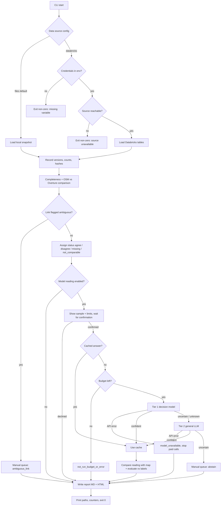

# PRD — Map QA: road attribute review with street photos (Kraków)

---

## 1. Executive Summary

A command-line MVP for a map QA analyst. It compares road attributes (speed limit, surface, street lighting and attribute completeness) between OpenStreetMap and Overture Maps for Kraków. It also uses street photos and a tiered AI reading of those photos to produce a Markdown and static HTML report of candidates for manual review. The tool collects evidence and does not decide whether the map is wrong: every disagreement is a candidate, and every unresolved case ends up in an explicit manual review queue.

---

## 2. Problem Statement

OSM and Overture describe the same roads with different segmentation, different snapshot dates and partly shared lineage (Overture derives part of its data from older OSM). Attributes such as `maxspeed`, `surface` and `lit` are often missing, textual, conditional or directional. Today an analyst has to:

- join the two sources by hand, in metres, after converting coordinates;
- find a street photo near the road and work out whether it shows the same carriageway;
- read the sign or the surface from the photo themselves;
- keep track of why a case could not be decided.

There is no repeatable way to list where the sources disagree or are incomplete, with photo evidence attached, while keeping "disagreement", "missing" and "unknown" apart. Disagreement between the sources is not proof of a map error, and the current manual process does not keep that distinction.

---

## 3. Users / Personas

**Map QA analyst (primary).** Works through a list of candidates, opens the photo thumbnail and the map attributes side by side, and marks each case outside the tool as confirmed, rejected or needing a field check. Expects every number in the report to be traceable to input rows, and expects uncertain cases to be labelled as uncertain, not hidden or forced into a verdict.

**Course participant / developer (secondary).** Runs the CLI against local files or the shared Databricks tables and changes the configuration (data source, sample size, budget). Expects identical results from both data sources and a hard stop when the model budget is reached.

**Coding agent using the tool (secondary).** Invokes the CLI non-interactively with a config file or environment variables naming the data source. Expects a clear exit code and machine-readable output paths.

---

## 4. Main Flows

### 4.1 Map-only comparison (no model calls)

1. The user runs the CLI with a configuration that names the data source (local files by default) and an output directory.
2. The system loads OSM roads, Overture segments, the photo manifest and the provided photo–road links from the selected source.
3. The system records the input versions: source name, snapshot dates, row counts and file hashes (for local files).
4. For each road linked to a photo, and for all roads in aggregate, the system computes attribute completeness for `maxspeed*`, `surface`, `lit`, `lanes` and `sidewalk*` in OSM, and `speed_limits` and `road_surface` in Overture.
5. For each photo with a link candidate, the system compares the OSM and Overture values for speed limit and surface. It keeps all raw values, including conditional (`when`/`between`), directional and multi-value rules, and does not reduce them to a single number.
6. The system assigns each comparison one status: `agree`, `disagree`, `missing_osm`, `missing_overture`, `not_comparable` (for example, conditional versus unconditional rule) or `ambiguous_link`.
7. The system writes the Markdown and HTML report and a machine-readable result file, and prints the output paths and summary counts.

### 4.2 Photo reading with tiered escalation (model calls enabled)

1. The user runs the CLI with model reading enabled and an explicit request budget.
2. Before any call, the system shows the sample manifest (photo IDs, questions per photo) and the request and cost limits, and waits for confirmation (or proceeds if confirmation was passed as a flag).
3. For each photo and question in the sample, the system checks the cache. A cached answer for the same image, model and question version is reused and does not count against the budget.
4. **Tier 1, decision model.** The system sends only the neutral question text and the image. The model returns a closed answer with probabilities.
5. If the highest probability is at or above the configured threshold, the answer is accepted as `answered`.
6. **Tier 2, general LLM (medium reasoning).** If tier 1 is below the threshold or returns `unknown`, the system asks the same question with the same image to a general model. If that model gives a confident closed answer, the result is `answered_tier2`.
7. **Tier 3, human.** If tier 2 also abstains or is uncertain, the case goes to the manual review queue with reason `abstain`. A tier-2 failure is handled by step 8, not here.
8. An API error, timeout or invalid response at either tier is recorded as `model_unavailable`. It is never converted into an answer. After the first error in a run, further paid calls stop and the remaining items are marked `not_run_budget_or_error`.
9. After reading, the system compares the photo answers with the map attributes (Flow 4.1). Separately, it compares them with the reference labels, which only the evaluator reads.
10. The report shows coverage, accuracy (certain labels only, with explicit denominators), escalations per tier, abstentions, errors and the request and cost counters for each model and question.

### 4.3 Data source selection

1. The user sets the data source in a config file or an environment variable: `files` (default) or `databricks`.
2. For `databricks`, connection settings and the token come only from environment variables. The token is never printed, logged or written to output.
3. If the selected source is unreachable or the credentials are missing, the system exits with a non-zero code and a message naming the missing setting. It does not silently fall back to another source.
4. An optional `--compare-sources` mode loads both sources and reports row counts per table side by side. Any difference is reported, and the run continues with the selected source.

### 4.4 Re-run from cache

1. The user re-runs the same configuration.
2. Every model answer comes from the cache. The report states that no new requests were made (request counter = 0 for this run).
3. A threshold change re-evaluates the stored answers without new model calls when every needed answer is cached (lowering the tier-1 threshold, changing the tier-2 acceptance level). Raising the tier-1 threshold can send questions to tier 2 that were never escalated before; the CLI lists them as needing new calls, and they run only after confirmation and within the budget.

---

## 5. User Stories

1. As a map QA analyst, I want a list of roads where OSM and Overture speed limits disagree, with the photo and both raw values, so that I can decide which cases need a field check.
2. As a map QA analyst, I want missing attributes reported separately from disagreements, so that a missing tag is not presented as a conflict.
3. As a map QA analyst, I want every case the system could not decide to appear in a manual queue with its reason (`ambiguous_link`, `abstain`, `model_unavailable`), so that nothing is silently dropped.
4. As a map QA analyst, I want the AI reading of a photo shown next to the map value but labelled as a prediction, so that I do not mistake it for ground truth.
5. As a course participant, I want to switch between local files and Databricks with one setting, so that the same tool works offline and in the cloud.
6. As a course participant, I want the run to stop at a hard request and cost limit, including failed attempts, so that I cannot exceed the assigned budget.
7. As a course participant, when the model API returns an error, I want the run to stop paid calls and still produce a report from what was collected, so that one outage does not lose the work.
8. As a coding agent, I want a non-zero exit code and a specific message when the data source is unavailable, so that I can report the missing prerequisite instead of guessing.

---

## 6. Acceptance Criteria

### Input and data source

- **AC-01:** With no configuration, the CLI reads the local files and the report header states `Źródło danych: pliki lokalne`, with the snapshot dates of OSM (`2026-11-01`) and Overture (`2026-10-21.0`).
- **AC-02:** With the source set to `databricks` and the credentials present, the row counts for `osm_roads`, `overture_segments`, `photos` and `photo_road_links` equal the local-file counts (99 768, 85 405, 561, 561), or the report lists each difference.
- **AC-03:** With the source set to `databricks` and the token variable missing, the CLI exits with a non-zero code, names the missing variable and creates no report.
- **AC-04:** No input file under `course-materials/exercise-data/` changes during a run (hashes before = hashes after).
- **AC-05:** The token value never appears in stdout, logs, cache or report files.

### Map comparison

- **AC-06:** Each compared photo–road pair has exactly one status per compared attribute (speed limit, surface) from: `agree`, `disagree`, `missing_osm`, `missing_overture`, `not_comparable`, `ambiguous_link`.
- **AC-07:** For a road with a conditional or multi-value speed rule (OSM `maxspeed:conditional` or Overture `speed_limits` with `when`/`between`), the report shows every raw rule and the status is `not_comparable` unless an unconditional value exists on both sides.
- **AC-08:** A missing tag is reported as `missing_*`, never as `disagree`, and never as the value `0` or `none`.
- **AC-09:** Distances in the report are in metres and computed after both layers are converted to EPSG:2180. Spot check: the recomputed distance for 3 randomly chosen photo–road pairs matches `photo_road_links.csv` within 0.5 m.
- **AC-10:** A photo whose link has `ambiguous_candidates` or another review flag from `candidate_flags` gets status `ambiguous_link` and appears in the manual queue.
- **AC-11:** The completeness table gives, for each attribute and source, the count and percentage of roads with a value, both for all roads and for photo-linked roads, with explicit denominators.

### Photo reading (AI)

- **AC-12:** The model request contains only the neutral question text and the image. A test inspects the outgoing payload and fails if it contains a file name, photo ID, reference label, Mapillary detection value or any map attribute.
- **AC-13:** Total model requests in one run (tier 1 + tier 2, including failed attempts) never exceed the configured limit (default 100). The run stops before exceeding a cost of 1 USD, using a conservative reservation when the API does not return a cost.
- **AC-14:** Default sample: at most 25 images: 15 street photos with reference labels (questions: surface paved/unpaved, junction visible, street lighting visible) and 10 sign crops (question: B-33 speed limit value). The sample is split by `sequence`, not by neighbouring frames.
- **AC-15:** A second decision model is run on the same 5 images and the same questions, and the report compares both models only on those images.
- **AC-16:** A tier-1 answer below the threshold, or `unknown`, is sent to tier 2. A tier-2 answer below its acceptance level (self-reported certainty, default: only `high` is accepted) or `unknown` becomes `abstain` and enters the manual queue. The thresholds are read from configuration, written in the report and not changed after the evaluation run starts.
- **AC-17:** After an API error, timeout or invalid response, the item is `model_unavailable`, no further paid calls are made in that run, and the report is still produced.
- **AC-18:** Automatic retries are disabled. A second run with the same configuration makes 0 new requests and produces the same predictions from the cache.
- **AC-19:** Accuracy is computed only for reference labels with status `certain`, separately for each question and tier, as `correct / evaluated`, with `uncertain` exclusions counted. Empty or uncertain labels are never counted as `no` or `none`.
- **AC-20:** For sign crops, `none` (no B-33 visible) and `unreadable` are distinct answers. A zone sign or an end-of-limit sign is expected to be `none`.

### Report

- **AC-21:** The CLI writes `report.md`, `report.html` and a machine-readable result file into the configured output directory (default `reports/map-qa/`).
- **AC-22:** The HTML opens from disk without a server, uses relative image paths and shows the author, source and license (CC BY-SA 4.0) under every thumbnail, plus ODbL attribution for OSM and Overture.
- **AC-23:** The counts in the Markdown and HTML reports are identical, and for each compared attribute the sum of statuses equals the number of compared pairs.
- **AC-24:** Observations (map values), reference labels, predictions, abstentions and `model_unavailable` are shown in separate, labelled columns or sections.
- **AC-25:** Report text is in Polish, and Polish characters render correctly in the HTML.
- **AC-26:** Zero candidates for a category is a valid result and is shown as `Brak kandydatów` with the count 0.

---

## 7. Out of Scope

- **Map editing:** the tool never edits OSM or Overture and never submits changesets or notes.
- **Interactive UI / dashboard:** no web or desktop UI and no in-tool decision buttons. Possible next step after the MVP. Exception: the offline manual review page for model decisions (§14).
- **Network topology checks:** no junction or connectivity validation through `node_ids` or Overture `connectors`. `junction_visible` is read from photos and evaluated against labels only, with no map comparison.
- **Lane and sidewalk reading from photos:** `lanes` and `sidewalk*` appear only in the completeness table. There are no reference labels for them, so no model questions are asked.
- **Road class family comparison:** a photo cannot determine functional road class.
- **Overture/OSM conflation or matching of our own:** the MVP uses the provided `photo_road_links.csv` candidates. Its own re-matching is a later step.
- **Live API ingestion:** live reads from Mapillary, Panoramax or the Overture bucket are not part of the report run. The pinned snapshot is the input.
- **Fresh source refresh:** downloading new OSM or Overture extracts is not part of the MVP.
- **Model training or calibration:** no fine-tuning and no claims about model calibration from the small sample.
- **Authentication, multi-user features, notifications, i18n beyond Polish report text.**

---

## 8. Constraints

### Business

- **Licenses:** OSM and Overture data are ODbL 1.0 and photos are CC BY-SA 4.0. Every report showing data or thumbnails carries the attribution.
- **Model budget:** at most 25 images, 100 requests and under 1 USD per evaluation run, unless the trainer assigns a different limit. Any paid run requires explicit confirmation.
- **Secrets:** tokens (Databricks, OpenRouter, Mapillary) come from environment variables only. The tool never reads `.env` and never prints token values.
- **Reference labels:** these are working references produced by an AI agent (signs: two models), not ground truth. The report says so.

### Functional

- **Area:** Kraków, bbox WGS84 `19.80,49.95,20.15,50.15`. Sign crops may come from other areas of Poland (field `area`).
- **Inputs are read-only.** Outputs go to `reports/map-qa/`, and cache and downloads go to the ignored `course-materials/exercise-data/map-qa/data/`.
- **Distances in metres only after conversion to EPSG:2180.** Degrees are never treated as metres.
- **`heading = 0.0` is north, not missing.** Missing heading stays empty or NULL.
- **Camera heading is not the direction of travel, and camera position is not the sign position.**
- **Model request timeout:** 40 s. No automatic retries at any layer.
- **Report language:** Polish. Identifiers and file names: English.

### External document / data references

| Document / data | Path | When it is used |
|---|---|---|
| Data README and rules | `course-materials/exercise-data/map-qa/README.md` | Definitions of fields, labels and matching rules |
| Source manifest | `course-materials/exercise-data/map-qa/sources.json` | Snapshot dates, filters, hashes |
| OSM roads | `course-materials/exercise-data/map-qa/osm_roads.parquet` | Map attributes (OSM) |
| Overture segments | `course-materials/exercise-data/map-qa/overture_segments.parquet` | Map attributes (Overture) |
| Photo manifest | `course-materials/exercise-data/map-qa/photos.csv` | Photo metadata, attribution |
| Photo–road candidates | `course-materials/exercise-data/map-qa/photo_road_links.csv` | Which road a photo shows, flags |
| Reference labels | `course-materials/exercise-data/map-qa/reference_labels.csv` | Evaluator only, accuracy of photo reading |
| Sign photos, crops, labels, nearest OSM | `course-materials/exercise-data/map-qa/signs/` | B-33 speed limit reading and evaluation |
| Offline thumbnails | `course-materials/exercise-data/map-qa/offline/` | Report thumbnails without network |
| Databricks tables | `workspace.map_qa.*` (see `DATABRICKS.md`) | Alternative data source |

---

## 9. UI Description (wireframe level)

There is no interactive UI. The deliverables are CLI output and two report files. The only exception is the offline manual review page (§14).

### 9.1 CLI

- **Command input:** data source, output directory, model reading on/off, request limit, thresholds and a confirmation flag. Every option can also come from a config file. Environment variables provide the credentials.
- **Before paid calls:** prints the sample manifest (number of images, questions, request limit, cost limit) and waits for `y/N` unless a confirmation flag is given.
- **Progress:** one line per processed question: image index, question, tier, status. Never the image bytes or tokens.
- **End:** summary counts per status, request and cost counters, output paths and exit code `0`. Returns non-zero for configuration or source errors.
- **Error states:** missing credentials, unreachable source, budget exhausted, first API error (paid loop stopped). Each prints one specific Polish message.

### 9.2 Report (Markdown and HTML, same content)

1. **Header:** run date, data source, snapshot dates, input hashes, configuration (thresholds, limits, models).
2. **Summary:** counts per comparison status, completeness table, model coverage, escalations per tier, abstentions, `model_unavailable`, requests and cost.
3. **Candidates for review:** one row or card per photo–road pair with status `disagree`, `missing_*`, `not_comparable` or `ambiguous_link`. Each shows the thumbnail with attribution, photo ID, OSM ID and Overture ID, distance [m] (EPSG:2180), raw OSM and Overture values, the photo reading (prediction, tier, probability) and the reason.
4. **Manual review queue:** all `abstain`, `model_unavailable` and `ambiguous_link` items with reasons.
5. **Model evaluation:** per question and model: evaluated, correct, accuracy before and after abstention, uncertain-label exclusions, and the 5-image model comparison.
6. **Limitations and attribution:** reference labels are not ground truth, source dates differ, ODbL and CC BY-SA notices.

- **Empty state:** each section with no rows shows `Brak kandydatów` / `Brak pozycji` with the count 0.
- **No model run:** sections 4 (model part) and 5 show `Odczyt modelem nie był uruchomiony`.

---

## 10. User Flow Diagram

---

## 11. Agent / System Behavior Specification

**Role:** read visible features from one image at a time. The models are not judges of map correctness.

**Allowed:**

- answer a closed question about the image: surface `paved` / `unpaved` / `unknown`; junction visible `yes` / `no` / `unknown`; street lighting visible `yes` / `no` / `unknown`; B-33 value as a number / `none` / `unreadable`;
- return probabilities (tier 1) or a confident or uncertain answer (tier 2).

**Not allowed:**

- receiving map attributes, reference labels, Mapillary detections, file names or IDs;
- deciding that the map is wrong or proposing edits;
- being called beyond the request or cost limit, or retried automatically.

**Decision categories and how they are shown:**

| Category | Meaning | Shown as |
|---|---|---|
| `answered` | Tier 1 confident | Prediction + probability, tier 1 |
| `answered_tier2` | Tier 2 confident after tier 1 uncertainty | Prediction, tier 2, tier-1 distribution kept |
| `unknown` (model answer) | Model states the image does not show it | Escalated to tier 2, not counted as abstention by itself |
| `abstain` | Code decision: both tiers below threshold | Manual queue |
| `model_unavailable` | API error, timeout, invalid response | Manual queue, never an answer |
| `not_run_budget_or_error` | Not attempted because the limit was reached or the paid loop stopped | Listed with count |

**Disclaimer in every report:** "Odczyt zdjęcia jest predykcją modelu, a nie weryfikacją terenową. Rozbieżność źródeł nie oznacza automatycznie błędu mapy."

**Language:** questions to the models are in English (neutral wording, fixed version). The report is in Polish.

---

## 12. Further Notes

- **Assumption on data access:** the user mentioned Databricks access "through the CLI and Tailwind, and directly through the API". Interpreted as the Databricks CLI and the SQL Statement Execution REST API. To be confirmed. Managed MCP is an optional extension, not part of the MVP CLI.
- **Thresholds:** tier-1 and tier-2 thresholds are set in configuration before the evaluation run and recorded in the report. With 25 images, the measured accuracy is indicative only, with no calibration claims.
- **Model choice** (which decision model, which second model for the 5-image comparison, which general model for tier 2) is decided in the ADR.
- **Sample bias:** the Mapillary photos were selected via speed-limit features, and the sign set is deliberately enriched with hard negatives. Neither reflects real-world frequencies.
- **Next steps after the MVP:** dashboard with persisted analyst decisions; topology checks; own photo–road re-matching; live API ingestion; larger evaluation budget.

---

## 13. Amendment 2026-11-13: report usability (after the human review of PR #10)

Agreed with the human on 2026-11-13 after reading the first full report. These requirements extend §9.2 and do not change §4.

- **AC-27 (thumbnails):** the pipeline uses every locally available photo, `data/photos/` first (filled by the course script `download_photos.py`), then `offline/`. When a thumbnail is missing, the placeholder links to a human-viewable page of the photo, never to a raw JSON API response. Mapillary photos use the Mapillary viewer; a Panoramax link is labelled as "metadane źródła" when only the API URL is known.
- **AC-28 (glossary):** both reports contain a short Polish glossary explaining tier 1 (decision model with probabilities), tier 2 (general LLM asked only when tier 1 is uncertain), abstain, `model_unavailable`, `not_run_budget_or_error`, and the six comparison statuses.
- **AC-29 (label provenance):** every place that shows reference labels or accuracy says that the labels were produced by AI agents (street photos: Codex; sign crops: Codex and GLM-5.3-Flash agreeing) and were not verified by a human. Accuracy is presented as agreement with these working labels, not as correctness.
- **AC-30 (costs):** besides the cost of new requests in this run, the reports show the total cost of all model answers used in the report, including the original cost of answers served from the cache, per model.
- **AC-31 (executive summary):** every `map-qa run` and `map-qa report --from` also writes `summary.html`, a one-page Polish summary readable in a few minutes. It contains key numbers, the main data insights, the model comparison and the caveats, with static charts (inline SVG, no JavaScript, no external assets, a table view for every chart). The text is generated deterministically from `results.json` by a template; no LLM call is needed.

---

## 14. Amendment 2026-11-13: manual review of model decisions

Agreed with the human on 2026-11-13. The reference labels were produced by AI agents (AC-29), so the automated evaluation compares one model with another. A human judgment is the only independent check of the photo readings. This amendment adds a small offline review page. It narrows the "Interactive UI" item in §7 for this page only: no server, no dashboard, no map decisions.

**User story 9.** As a map QA analyst, I want to judge the model decisions on the sampled photos one by one, without seeing the model answers first, and download my judgments as a file, so that the agent can measure decision quality against a human instead of against AI-made labels.

**Flow 4.5 (manual review).**

1. After a run with model reading, the user runs `map-qa review export`. It uses only the cache, makes no model request and needs no API key.
2. The command writes `review.html` and the exact prepared images the models received into `<output_dir>/review/`.
3. The user opens `review.html` from disk. For each image–question item, the user first chooses the correct answer and rates the image quality, then reveals the model answers and the reference label, confirms or overrides agree/disagree for each one, sets flags and adds a comment.
4. Progress is kept in the browser. The user downloads `feedback-<export_id>.json` and gives it to the agent. The page shows a live summary of human–model agreement.

**Acceptance criteria.**

- **AC-32 (export):** `map-qa review export` writes `review/review.html` and `review/images/` for the sample of the configured run. It reads model answers from the cache only. It sends 0 model requests and writes nothing to the ledger. Items without a cached answer are counted and listed as not reviewable. Exit 0.
- **AC-33 (content):** one item per image–question pair, at most `--max-items` (default 100) in priority order: model disagreement (tier 1 vs tier 2, or the main vs the comparison model), escalated or abstained, disagreement with a `certain` reference label, tier-1 probability within 0.10 of the threshold, then a seeded random control sample of the remaining confident answers. Each item shows the prepared image the models received, its original and prepared size and the upscale factor, the attribution (author, source, license), the question text with every option and its definition, the request text sent to each model (with the image replaced by its file name), and each model's answer: tier 1 choice with all probabilities, comparison model choice with probabilities, tier 2 answer with certainty, the final system decision and the reference label with its status. Sign crops also show the full source photo with the crop box, marked as context the model did not see.
- **AC-34 (blind first):** in the default mode, model answers, reference labels and priority reasons stay hidden until the user has chosen an answer and an image quality rating. A visible switch shows everything at once; the feedback file records which mode was used for each item.
- **AC-35 (judgment form):** per item the user records the correct answer (same option set as the model, plus "cannot decide"), the image quality (`sufficient`, `poor_but_decidable`, `too_poor_to_decide`), flags (`ambiguous_question`, `reference_label_wrong`, `other`) and a comment. Agree/disagree for every model row and the reference label is computed from the user's answer and can be overridden per row, with a comment per row.
- **AC-36 (feedback file):** the page downloads a JSON file with a schema version, the export ID, the question set version, the thresholds, the reviewer name (optional), every judged item (IDs, image SHA-256, model answers as shown, the human judgment, verdicts, timestamps) and the summary. Progress survives a page reload, and a downloaded file can be loaded back to continue.
- **AC-37 (summary):** the page shows, for each model role and question, agreement with the human as `agree / judged` with explicit denominators, the same for the reference labels, the image quality distribution and the number of flagged items.
- **AC-38 (constraints):** the page is one static HTML file with inline CSS and JavaScript, no external assets and no network requests, Polish UI text, light and dark mode, keyboard navigation. Images are files referenced by relative path, never base64 (ADR-003 TAC-003-01). Reference labels reach the page only through `Evaluator` (ADR-003 TAC-003-03).

**Out of scope for this amendment:** importing the feedback into the reports (`map-qa review import`), review of map comparisons and `ambiguous_link` pairs, multi-user review, re-cropping sign images. The feedback file is read by the agent; a Python import is a possible next step (ADR-005).
